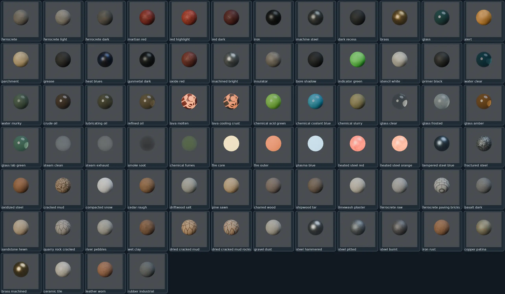

# Tech-Priests

Tech Priests is under a base-state recovery and runtime-unification milestone. Ordinary feature expansion is paused until physical-accounting safety, scheduler truth, shared runtime ownership, authority consolidation, bounded UPS cost, and objective Factorio evidence are established.

## Current Project Authority

1. **[Base-State Recovery and Unification Sequence](RECOVERY_REPAIR_SEQUENCE.md)** — temporary top-level work-order authority and required repair order.
2. **[Standards and Practices](docs/STANDARDS_AND_PRACTICES.md)** — permanent engineering, safety, validation, and release-governance authority.
3. **[Development History](docs/DEVELOPMENT_HISTORY.md)** — canonical narrative record of completed work and evidence.
4. **[State of Mod and Recovery Plan](docs/state-of-mod-master-plan.md)** — current system inventory, artifact truth, gate state, and recovery context.
5. **[Current Recovery Authority Map](docs/RECOVERY_AUTHORITY_MAP_CURRENT.md)** — Mermaid map connecting the legacy, shared-authority, late-hardener, specialized-family, movement, and recovery layers.
6. **[Current Testing Goals](tech-priests_src/docs/CURRENT_TESTING_GOALS.md)** — active Stage 5 validation target and scenario order.
7. **[Recovery Runtime Evidence](docs/RECOVERY_RUNTIME_EVIDENCE.md)** — evidence collection and validation contract.
8. **[Runtime Authority Continuity](tech-priests_src/docs/AUTHORITY_REFACTOR_CONTINUITY.md)** — canonical ownership boundaries for runtime refactoring.
9. **[Current Behavior Map](docs/BEHAVIOR_MERMAID_MAP_0660.md)** — current entry points, owners, scheduling boundaries, and the existing function drilldowns.
10. **[Generated Behavior Source Inventory](docs/BEHAVIOR_SOURCE_INVENTORY.md)** — source-derived module, function, registration, scan, and state-writer inventory with a machine-readable companion.

## Current State

- Authoritative branch: `main`
- Runtime source metadata: see [`tech-priests_src/info.json`](tech-priests_src/info.json), currently `0.1.687`; a separately published archive has its own version and source identity.
- Current incident: the owner's four-priest slowdown. Source repairs and their Lua regressions require a matched native replay before a performance improvement can be claimed.
- Current topology: the behavior maps and source inventory linked above; the old numbered filenames are retained as stable document addresses, not version claims.
- Native measurement procedure and evidence boundaries: [UPS Validation Runbook](docs/UPS_VALIDATION_RUNBOOK_0742.md).
- Earlier `0.1.672` / `0.1.674-dev` / `v0.1.674-rc.3` statements remain historical records and do not identify today's source or packaged build.

Source implementation, source validation, Factorio loading, migration, behavioral validation, profiler evidence, packaging, packaged-load testing, and publication are separate evidence states. A published experimental artifact is not automatically a verified release candidate or verified release.

### Keep the behavior maps current

After changing runtime Lua, run `python tools/audit_ups_hotspots_0743.py --write-behavior-maps`, review and update the affected existing diagrams, then run `python tools/audit_ups_hotspots_0743.py --acknowledge-behavior-map-review`. The existing hot-path regression harness checks `--check-behavior-maps` before running Lua. Source or diagram changes invalidate the review receipt; regenerating the inventory alone cannot approve an old diagram. This is source drift enforcement, not evidence of measured game performance.

## Visual and Asset Construction Doctrine

- **[Red Tech Priests of Mars — Construction and Defensive Architecture Doctrine](docs/RED_TECH_PRIESTS_CONSTRUCTION_DOCTRINE.md)** — canonical style guide for original Tech Priests fortifications, heavy-weapon emplacements, sensors, conduits, functional gothic reinforcements, ritual machine sanctification, and one-asset-at-a-time 3D modeling reviews. This art guide does not supersede the recovery work order or engineering/release standards.

## Browse FMPL visual proofs on GitHub

[**FMPL gallery — materials, models and raw-map previews**](docs/fmpl-gallery/README.md) displays 448 verified Blender previews directly in GitHub without downloading ZIPs. The searchable static page lives in `docs/fmpl-gallery/index.html` and can be served by GitHub Pages from `main:/docs`.

Review proofs are not final modeling approval or game integration.
