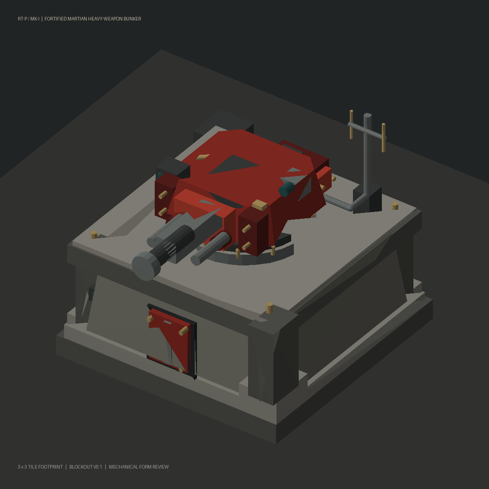
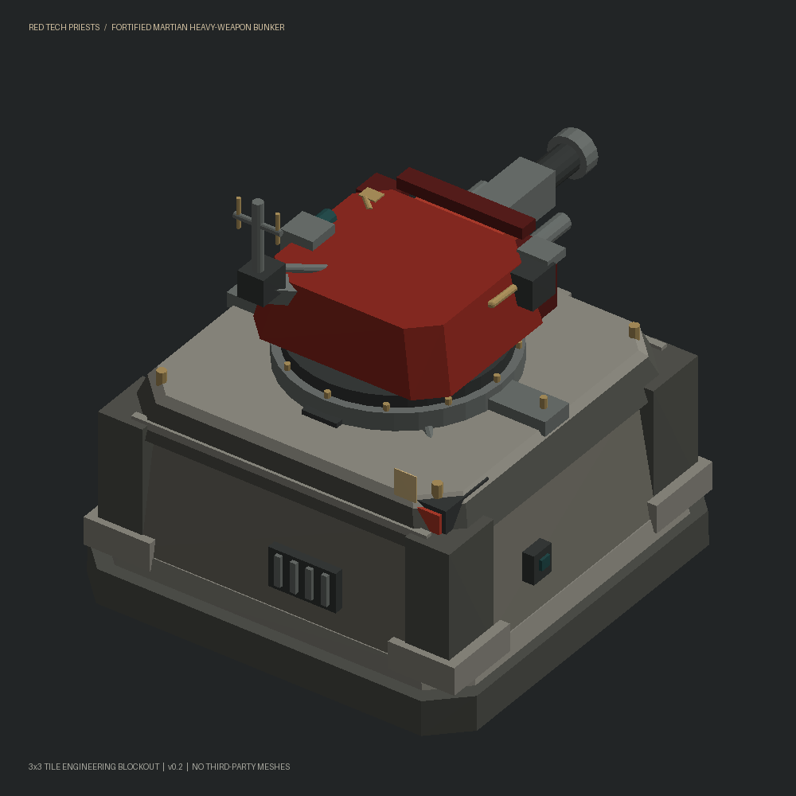
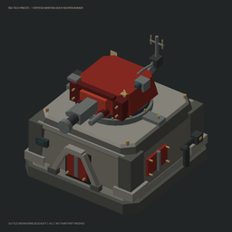

# Fortified Martian Bunker — development progress gallery

This gallery records the same original 3×3-footprint bunker at consecutive modeling checkpoints, following [construction doctrine](../../../../docs/RED_TECH_PRIESTS_CONSTRUCTION_DOCTRINE.md).

## v0.1 — initial structural blockout

## v0.2 — rear-clearance and stronger-base revision

**Design changes:** stronger true octagonal corner chamfers on the intact 3×3 base, upper roof narrowed from 2.74 to 2.35 tiles, magazine and fixed controller lowered beneath the turret rotating envelope, and an antenna standoff bolted to the **rear of the rotating armored turret**, not to the fixed roof. Moving optics, cables, and antenna are part of the turret group.

**Verification:** v0.2 local GLB contains 131 named mesh components. The moving assembly starts at Z=1.70; stationary rear equipment bodies have ≥0.10 tile-unit vertical clearance. The fixed-to-rotating data-feed coupling is intentionally closer and must be inspected as a slip-ring interface.

The [v0.2 archive](../revisions/v02/martian_bunker_v02_package.zip) includes the actual editable GLB and full source code. The separate Blender CI job regenerates the native `.blend`, checks group parenting and clearance, and publishes high-resolution Blender views here once it succeeds. Do not treat either preview as final accepted Factorio art.

## v0.2 Blender rendering, on successful CI
- [Front Blender render](v02_blender_front.png)
- [Rear Blender render](v02_blender_rear.png)
- [256 px scale check](v02_blender_256px.png)

No third-party geometry, source STL, or in-game sprites are bundled. Use official Factorio assembler models only as an independently licensed quality reference.
