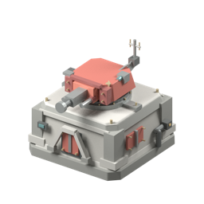

# Fortified Martian Bunker — development progress gallery

This gallery records the independent 3×3-footprint bunker under the [Red Tech Priests construction doctrine](../../../../docs/RED_TECH_PRIESTS_CONSTRUCTION_DOCTRINE.md).

## v0.3 — repaired Blender conversion (verified)

**Repaired and rendered using real headless Blender 4.0.2.** [Passing run 42153818744](https://github.com/mrcalzon02/Tech-Priests/actions/runs/42153818744) generated the editable master, exported and independently reopened the final GLB, verified the Z-up coordinate system, tested turret attachment and 15°-increment full traverse, and checked that Martian-red material pixels are genuinely visible in the rendered front and rear views.

[Native editable master](../src/v03/martian_heavy_weapon_bunker_v03.blend) · [Verified Blender-exported GLB](../src/v03/martian_heavy_weapon_bunker_v03_blender_export.glb) · [Reproducible modeling source](../revisions/v03/martian_bunker_v03_source.zip) · [Render validation evidence](../src/v03/render_validation_v03.json)

**Why v0.2 looked terrible:** the intermediate GLB's axis conventions were not established in Blender and none of the color-identity materials were constructed for shader rendering. Counting meshes and giving them a common parent did not prove they were spatially attached. The first v0.3 correction restored geometry orientation and the material system, but its colors were still washed out because Blender's linear shader inputs were fed raw sRGB hex fractions. The final v0.3 build uses the correct sRGB-to-linear conversion for deep red and industrial concrete. Both source-to-Blender and exported-GLB-to-fresh-Blender checks passed.

## v0.1 — initial structural blockout

## v0.2 — legitimate geometry refinement, failed Blender scene (retained for diagnostics)

The source design correctly retained the 3×3 base, strong octagonal corner chamfers, smaller upper roof, lowered stationary rear magazine/controller and co-rotating antenna mounted behind the turret. These changes survive unchanged in v0.3.

**Rejected Blender renders:** [v0.2 front](v02_blender_front.png) · [v0.2 rear](v02_blender_rear.png). They remain only as regression evidence; do not use them for visual acceptance.

No imported Wube 3D meshes or other third-party copyrighted geometry are bundled. v0.3 passes orientation, physical attachment and color diagnostics, **not** final Factorio-quality texture, animation or sprite-acceptance tests.
