# Fortified Martian Bunker — development progress gallery

## v0.8 — user-selected visual target rebuilt in the REAL Blender model

**Source target** (design comparison only, *never baked into geometry or a texture*):
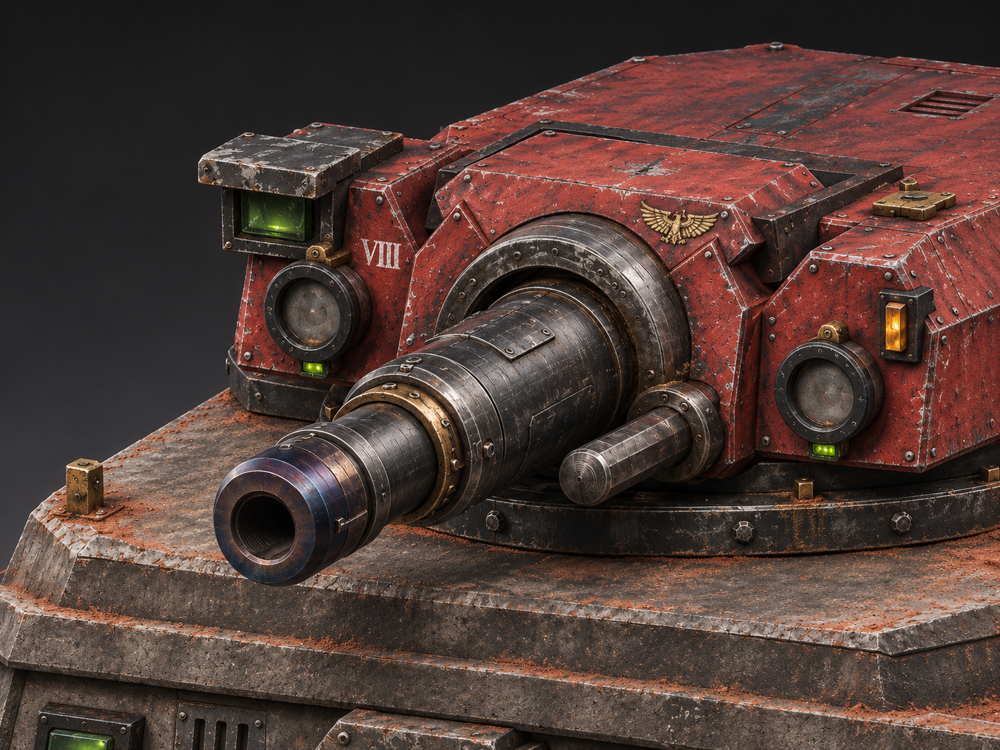

**Actual edit:** inherits the native Blender v0.7 with its circular, hollow main barrel. Adds **82 named, functional modeled components** (254 total, 165 turret-moving) to reconstruct visible features from the selected render instead of generating another unrelated picture:

- Full concentric, bolted gun mantlet, overlapping mechanical oil seal and machined wear lip (genuine 56-sided annular geometry).
- 18-arc-segment curved machined gun service hatch with four radial bolts; five round gun-service bands aligned with the barrel.
- Paired recessed circular optical heads with retaining rings, six bolts each, genuinely seated dark lenses and working green status lights.
- Forward-shielded optical hood, amber side status instrument, removable top turret service armor, attached bolt/seam details, physical hydraulic recoil seals.
- An **original** machine-purity cog medallion, simple identification marks, mechanical joins; no copied eagle/Aquila.
- 23 procedural, original 512×512 albedo/ORM/normal sets (69 image maps) using the three hard paint-weathering reference photos, never copying their pixels.

**Native Blender gallery (outputs only published after the CI passes):**

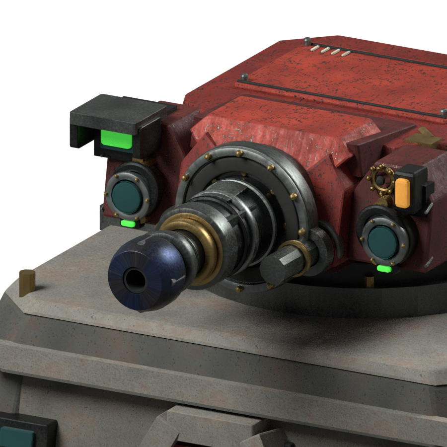

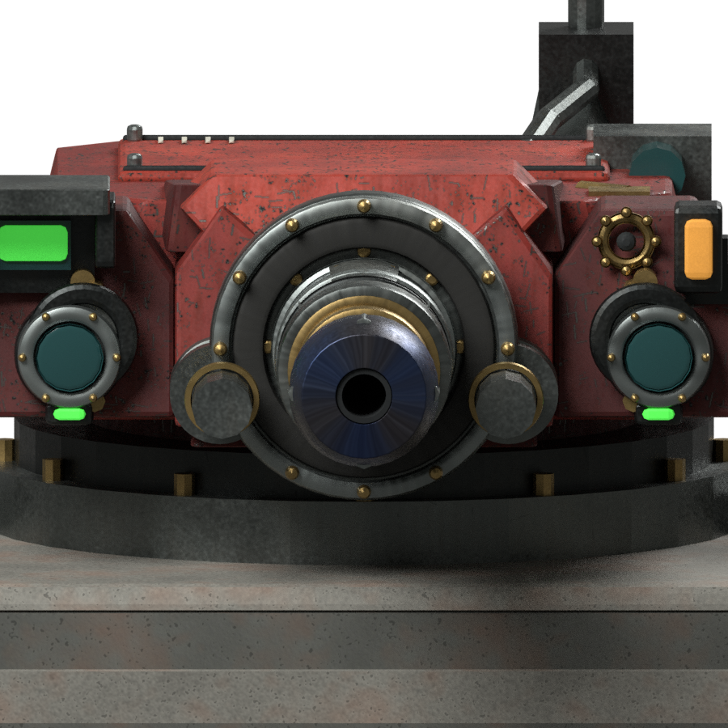

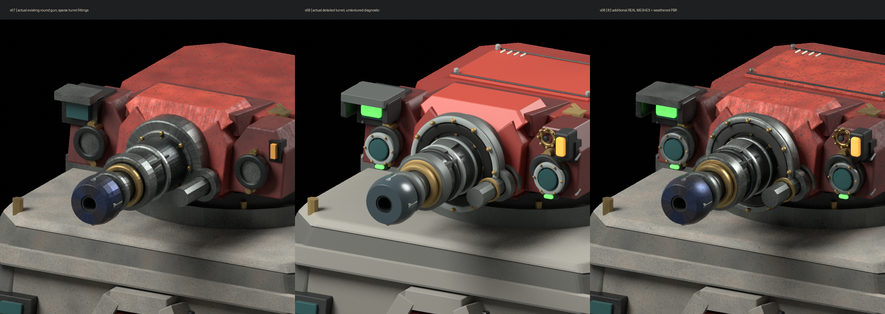

[Editable textured Blender master](../src/v08/martian_heavy_weapon_bunker_v08_textured.blend) · [Blender-exported GLB](../src/v08/martian_heavy_weapon_bunker_v08_textured_export.glb) · [Rebuildable v0.8 source ZIP](../revisions/v08/martian_bunker_v08_actual_model_source.zip) · [Validation](../src/v08/validation_report_v08.json)

**Gate:** prove non-floating mounted parts, cylindrical shroud/open muzzle, 360° traverse, glTF material/UV survival, visually different flat-versus-textured Blender renders. Approval against the target image still requires viewing actual rendered outputs; **not** claimed an exact photograph-to-3D reconstruction or a game-ready sprite.

## v0.7 — ACTUAL Blender model: round barrel jacket and applied weathering

**The v0.6 rectangular cannon shroud is deleted from the underlying geometry.** The replacement is a tapered 48-sided, truly cylindrical gun jacket, complete with fitted concentric locking flange, round service collar and eight physically seated flange bolts. The open pressure barrel and muzzle remain in place; all parts traverse with the turret.

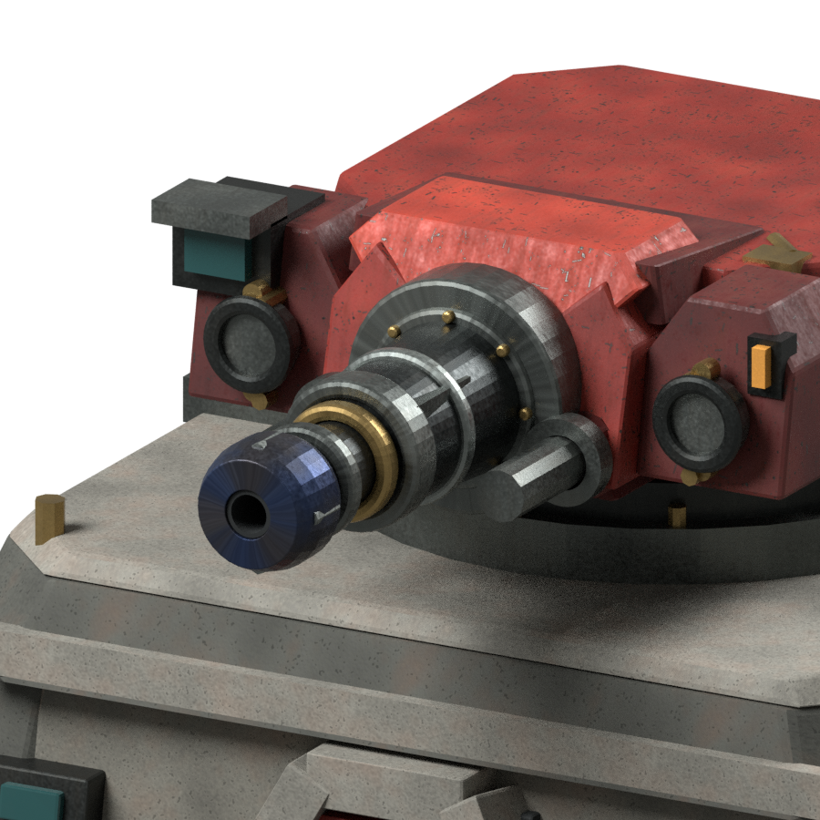

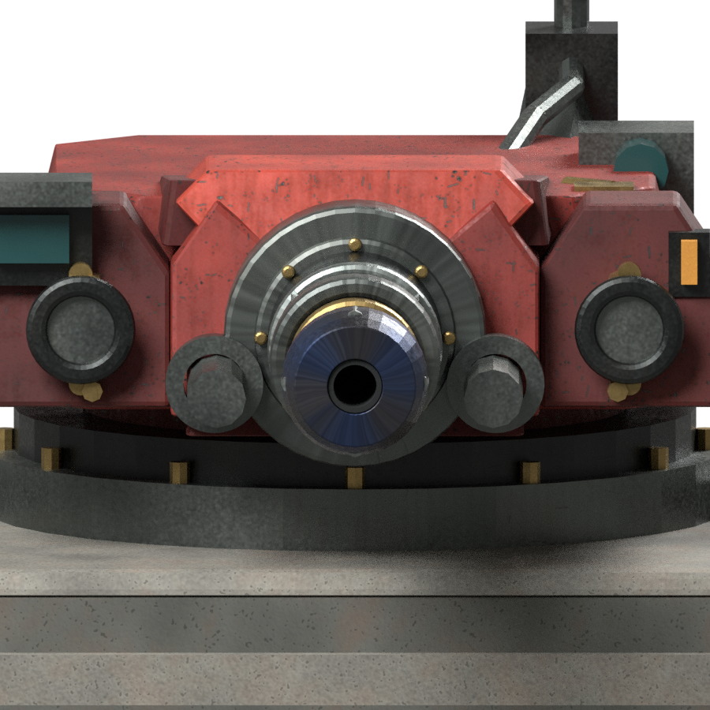

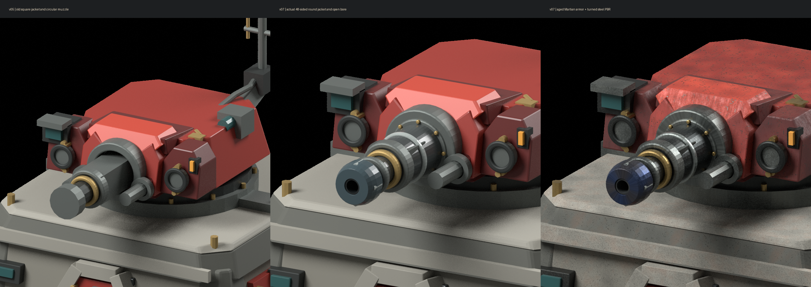

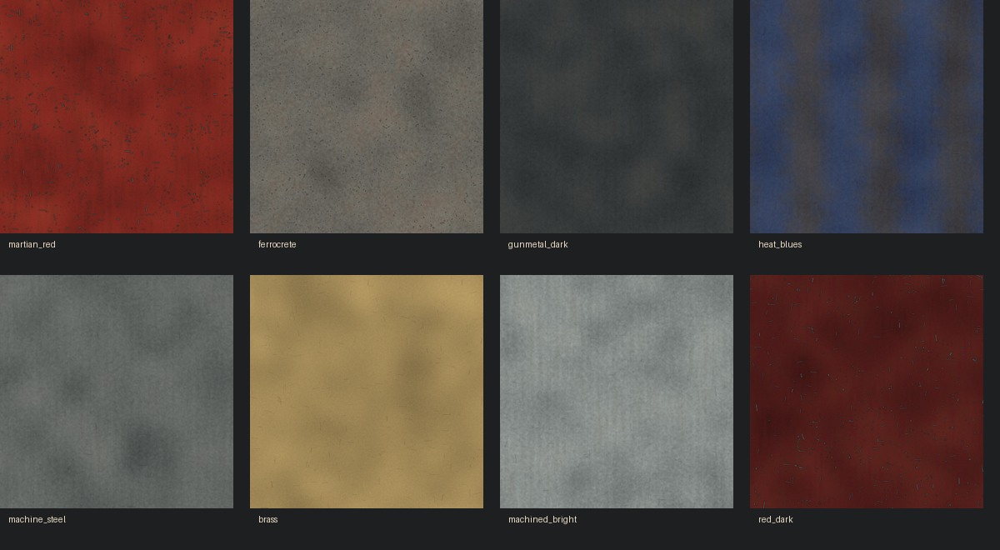

[**Final packed-texture Blender master**](../src/v07/martian_heavy_weapon_bunker_v07_textured.blend) · [Blender-exported PBR GLB](../src/v07/martian_heavy_weapon_bunker_v07_textured_export.glb) · [Reproducible source package](../revisions/v07/martian_bunker_v07_round_jacket_source.zip) · [Validation report](../src/v07/validation_report_v07.json) · [Three user-supplied visual references](../style-references/README.md)

**Hard texture style references:** three user-provided photographs of distressed red military armor at overhead, three-quarter, and side views. They inform the deliberate material-response rules—exposed dark primer under red paint, chipped raw-steel corners, oily bearings, dust and soot in seams, circular machined barrel, heat-treated muzzle, and non-glossy ferrocrete. None of their pixels is used as a texture. All 60 material images (20 sets of albedo/ORM/normal, each 512×512) are deterministic original outputs and are packed into the native Blender master.

**Acceptance:** CI must build the GLB in Blender, re-import it separately, prove the old square shroud does not exist, test cylindrical cross-section and actual muzzle opening, confirm 360° turret traverse and texture import, and render flat-versus-weathered comparisons. These are required before any claim of native Blender success; no production Factorio sprite is replaced.

## v0.6 — hollow barrel refinement and original PBR texture system

This revision uses an **owner-provided image as stylistic direction only**. The reference image is **not stored, reproduced, used as texture pixels, or imported as geometry**.

**Barrel:** The previous solid disk muzzle becomes a genuinely hollow, lathed pressure tube, with a stepped replaceable blue-tempered crown, open inner liner, three machined service collars, supported shroud heat rails and four seated crown ribs. Every new barrel part moves with the turret. The v0.5 bunker hull, 22 hull attachments, 8 sloped corner foot/buttress parts and antenna remain unchanged.

**Textures:** 20 original material classes, each with deterministic 384×384 tileable albedo, occlusion/roughness/metalness and tangent-space normal maps (60 image files total). Painted red, granular ferrocrete, heat-darkened metal, machined gray steel, brass, glass and other service surfaces have physically distinct finish. The finished Blender scene **packs image assets**, and the exported GLB must pass a clean Blender import with UVs and textures intact.

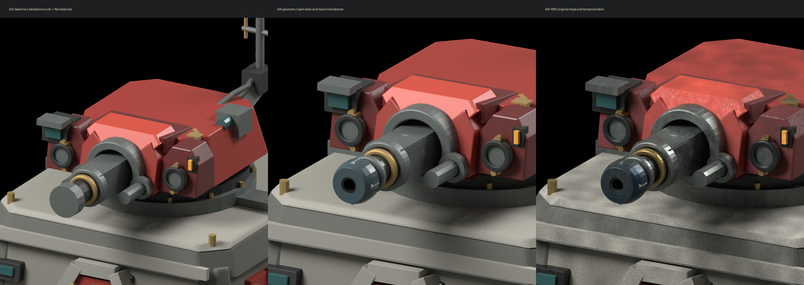

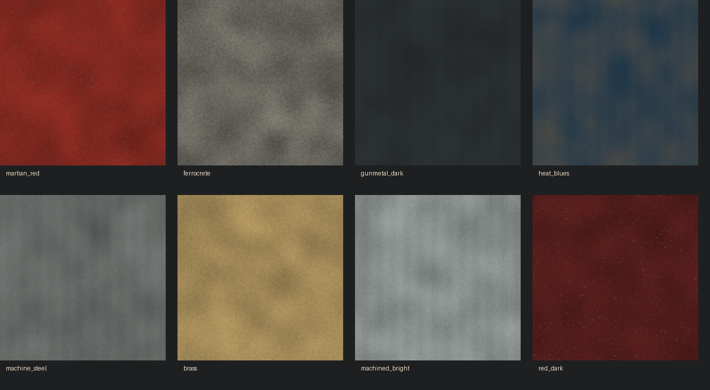

[Barrel three-quarter closeup](v06_barrel_three_quarter.png) · [Muzzle head-on](v06_barrel_head_on.png) · [Barrel side](v06_barrel_side.png) · [Full front](v06_textured_front.png) · [Full rear](v06_textured_rear.png) · [Factorio-scale 256px](v06_factorio_256px.png)

[**Native textured Blender master**](../src/v06/martian_heavy_weapon_bunker_v06_textured.blend) · [**Final PBR GLB**](../src/v06/martian_heavy_weapon_bunker_v06_textured_export.glb) · [Full source and map generator](../revisions/v06/martian_bunker_barrel_texture_v06_source.zip) · [Validation report](../src/v06/validation_report_v06.json)

**Status:** CI must pass and final renders need visual inspection. Not yet approved as production Factorio sprites. Neither sprites nor gameplay data are modified.

## v0.5 — two progressive refinements of the *front of the rotating turret*

These are **real Blender-rendered, editable two-stage geometry builds**, not concept illustrations.

**First pass:** The flat front cheek blocks become genuinely sloped faceted armor with positive thickness and an anchored rear edge. A four-piece mantlet surrounds a hollow steel gun socket and dust seal; the visor and optic were re-seated to the new front geometry.

**Second pass:** Two cheek trunnion covers and guards, removable fasteners, supported recoil-cylinder collars and brackets, the heat-shroud connection, and the elevation-limit index. No decorative boxes were added without a defined mechanical purpose. Both passes preserve the 3×3 foundation, hull-mounted equipment, aft magazine, turret bearing and antenna.

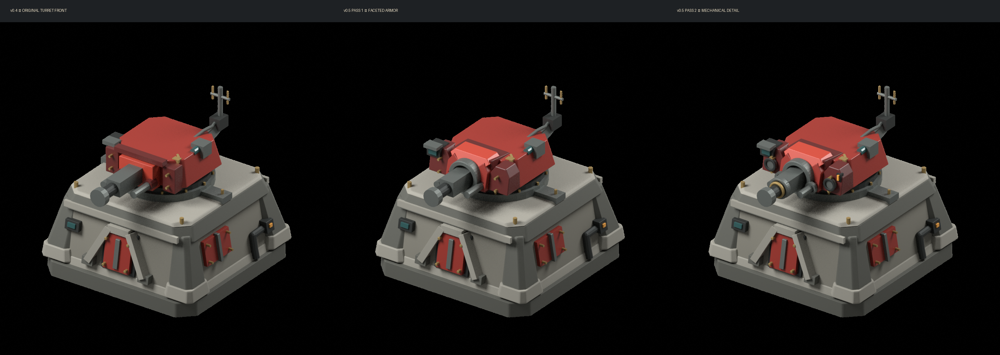

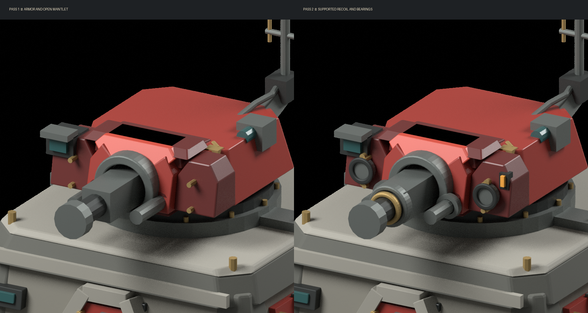

[First pass: front armor](v05_pass1_turret_close.png) · [Second pass: final turret closeup](v05_pass2_turret_close_front.png) · [Final head-on view](v05_pass2_turret_head_on.png) · [Full front](v05_pass2_full_front.png) · [Full rear](v05_pass2_full_rear.png) · [256px](v05_final_256px.png)

[**Editable pass-one Blender model**](../src/v05/martian_heavy_weapon_bunker_pass1_v05.blend) · [**Editable pass-two Blender model**](../src/v05/martian_heavy_weapon_bunker_v05.blend) · [final Blender-exported GLB](../src/v05/martian_heavy_weapon_bunker_v05_blender_export.glb) · [rebuildable source ZIP](../revisions/v05/martian_bunker_turret_front_v05_source.zip) · [test report](../src/v05/validation_report_v05.json)

Automatic Blender testing includes an independent clean-scene GLB reimport, turret parenting and 15-degree traverse checks, mesh watertightness for new facial armor, open barrel socket, mounting contact, and an actual rendered pixel difference between stages. **Provisional art only:** full recoil animation, detailed PBR wear and game sprite approval remain pending.

Follow the [canonical construction doctrine](../../../../docs/RED_TECH_PRIESTS_CONSTRUCTION_DOCTRINE.md). **Source geometry is original.** No Wube production models or third-party 40K meshes are redistributed.

## v0.4 — corner buttress slope and all outer hull attachments

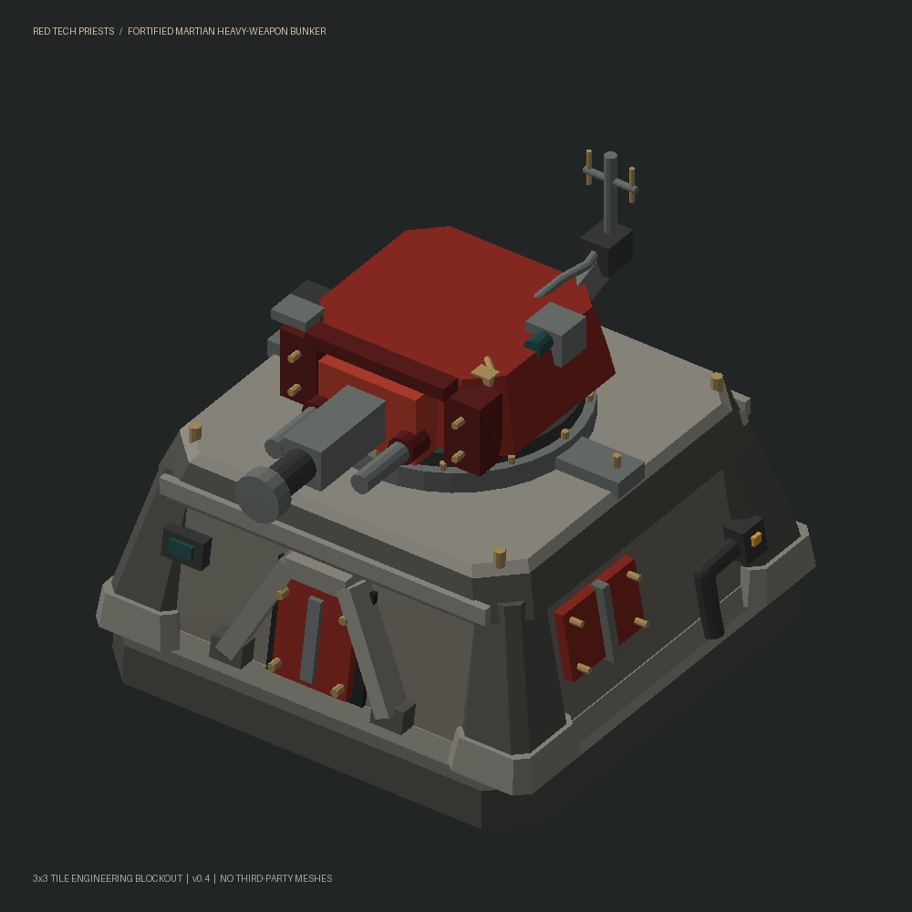
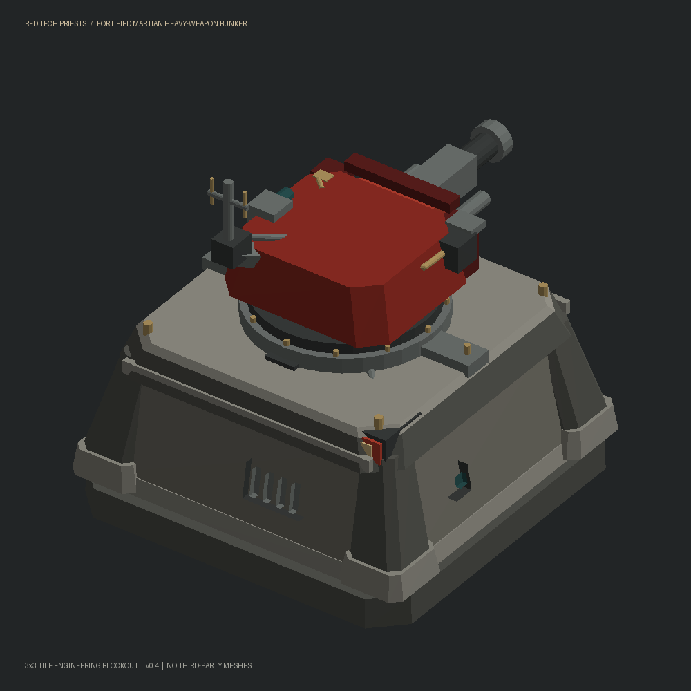

These three images are direct mesh geometry diagnostics. The source passes **22 sloped face attachment assembly** checks and **8 beveled corner/foot part** checks, and keeps the original **3×3 foundation** plus 42 rotating turret meshes. Reference: [complete rebuildable v0.4 source package](../revisions/v04/martian_bunker_v04_source.zip).

### Native Blender views, published by the dedicated verification workflow

- [Front view](v04_blender_front.png)
- [Rear view](v04_blender_rear.png)
- [Opposite front corner](v04_blender_front_west.png)
- [Opposite rear corner](v04_blender_rear_east.png)
- [256 px native Blender preview](v04_blender_256px.png)
- [v0.3 versus v0.4 front comparison](v04_before_after_front.png)

**Acceptance:** CI must prove actual mesh vertex contact along the top and bottom of tilted mounting plates, inward-leaning buttress geometry, turret parenting and fixed rear clearance. It then opens the Blender-exported GLB in an independent scene and checks visible Martian-red materials. Source geometry diagnostic success is not final game-art approval.

## v0.3 — corrected Z-up, colors and turret attachment

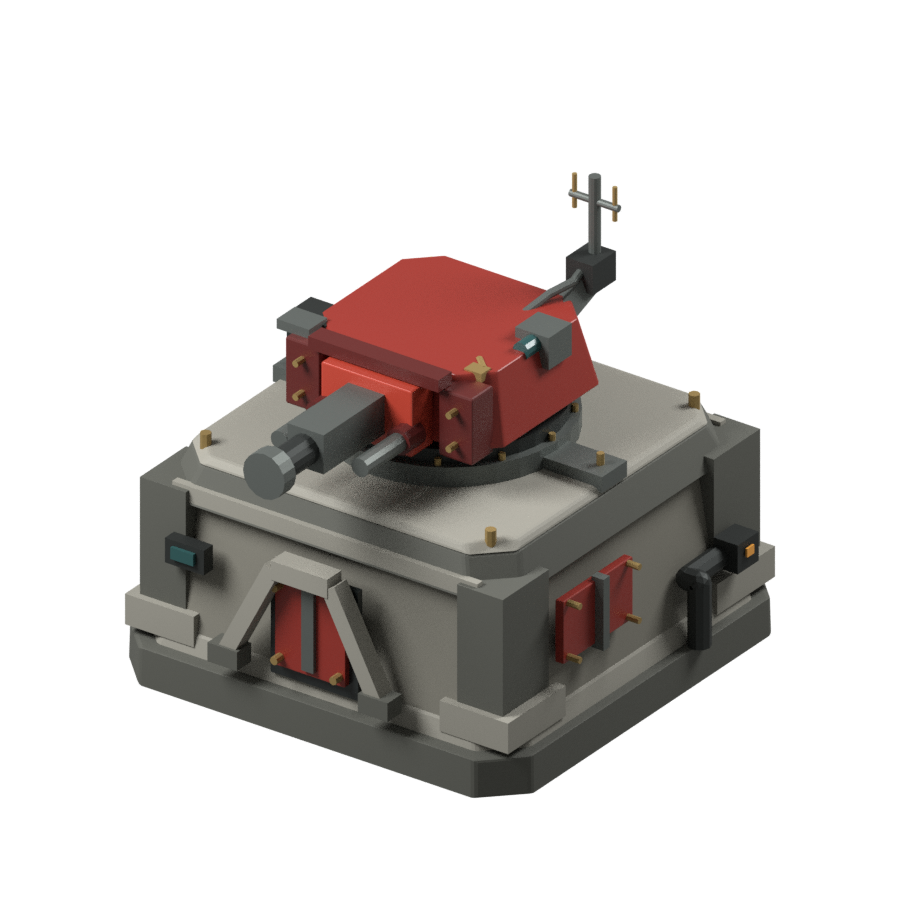
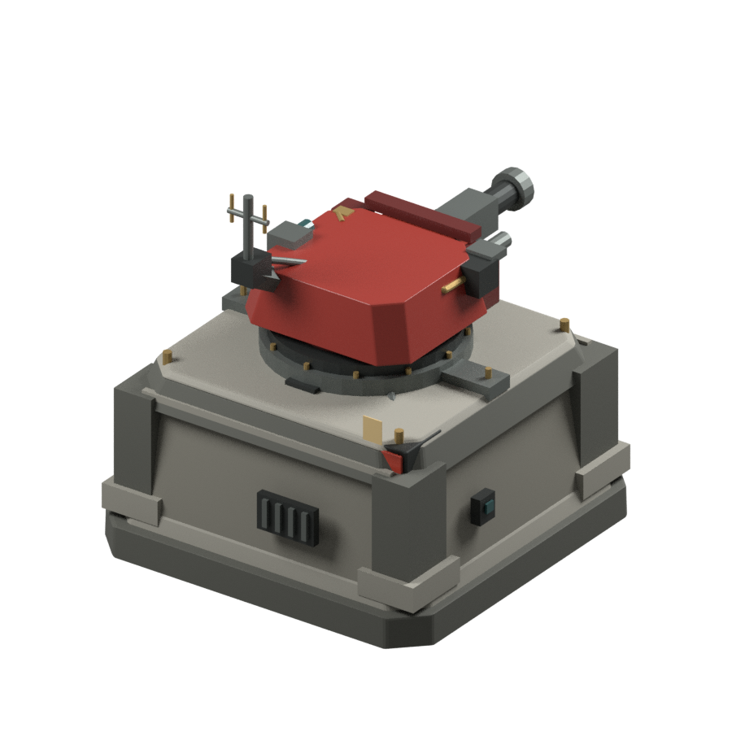

[v0.3 native model](../src/v03/martian_heavy_weapon_bunker_v03.blend) fixed the catastrophic sideways/monochrome Blender import, but **still had hull fixtures floating relative to the subsequently beveled shell**.

## v0.2 — valid intermediate mechanical shape, broken Blender handoff

[Rejected Blender front](v02_blender_front.png) and [rejected Blender rear](v02_blender_rear.png) are retained for regression analysis only.

## v0.1 — initial blockout

**Art status:** open. Finish proper surface wear and material details, 360° collision/sweep inspection, and in-game Factorio-scale validation before any sprite replacement.
