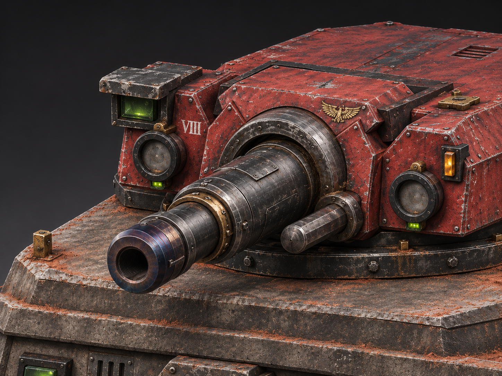

# v0.8 user-selected visual reference — reconstruction target

This reference image was supplied by the project owner as the target for **ACTUAL Blender geometry and texture work**, not to generate or display further concept images. It supplements the previous three **hard texture-style references** and is NOT itself a 3D source or accepted game sprite.

## Match priorities

1. Gun is continuous and cylindrical with a real hollow bore; steel mantlet ring and bolts are substantial and correctly attached.
2. Flanking circular optics and green status lights sit in physical sockets, not floating in front of the red cheek armor. Hooded left sight and right amber panel.
3. Low faceted Martian-red turret silhouette with thick armored corners, fitted bolts and seams; no unnecessary invented mechanisms.
4. Degraded red painted enamel with dark undercoat, exposed-metal chips, oil/dirt in actual joints, brass service points; separate gunmetal and heat-treated crown finishes.
5. Roof access hatches and machine-purity insignia have actual mechanical utility. Avoid copied third-party insignia/art/texture pixels.
6. Real bunker remains 3×3 and retains v0.7 artillery mounting, rear mast and functional exposed cabling. Verify independent glTF re-import and in-render visibility.
7. Before acceptance, render equivalent camera angle plus side, head-on, rear and 256-pixel scale checks; document **what differs from reference**. Final acceptance is a human art review, not a numerical mesh-count check.

[Model source](../revisions/v08/martian_bunker_v08_actual_model_source.zip) · [Gallery](../gallery/README.md) · [Doctrine](../../../../docs/RED_TECH_PRIESTS_CONSTRUCTION_DOCTRINE.md)
