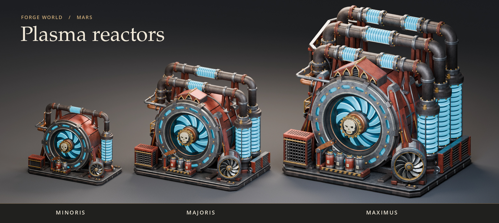

# Mars plasma reactor family

Three static, editable reactor studies for the Tech Priests of Mars. The Blender scene shows the machines at a common scale. Each GLB contains one reactor with a ground-level origin, named subassemblies, UVs, embedded surface textures, and emissive plasma materials.

| Reactor | Overall dimensions (W × D × H) | Main transfer circuits | Special construction |
| --- | --- | --- | --- |
| Minoris | 5.19 × 3.09 × 4.03 m | 1 | Single transfer arch, one caged thermic column, compact charging cassette |
| Majoris | 7.24 × 5.02 × 6.17 m | 2 | Stepped twin galleries, a three-bay vaulted exhaust, and a maintenance walk |
| Maximus | 10.08 × 7.80 × 9.07 m | 3 | Triple gallery and regulator bank, five-bay exhaust, and a full-height rear riser cage |

All three have an upright containment drum, a cut-through annular flange, a helical plasma impeller, a centered cog-and-skull seal, and a separate extraction turbine. The dimensions are measured from re-imported export geometry. The model dimensions use meters in Blender.



## Open or edit

Open `Blender/Mars_Reactor_Family.blend` to see the three reactors together. Each reactor has its own collection. Select a named assembly to edit it. Vertex groups identify components within the assembly, including individual types of fittings, plates, and bolts. Each reactor's ground pivot controls the whole model.

The download bundle contains all three independent exports in `GLB/`. Running the generator also writes these files to the output directory. Their origins share the containment shaft's lateral centerline at ground level.

## Rebuild

Run the generator with Blender 4.3.2 or a compatible later version. In the download bundle, open the `Source/` folder first. The repository stores the same scripts together in this directory.

```sh
blender -b --python-exit-code 1 -P build_family.py -- ./output
blender -b ./output/Blender/Mars_Reactor_Family.blend --python-exit-code 1 -P render_views.py -- ./output/Previews family
blender -b ./output/Blender/Mars_Reactor_Family.blend --python-exit-code 1 -P render_views.py -- ./output/Previews all
```

The generator packs the surface maps into the native scene and GLBs. Parts are defined in `core.py`, `structure.py`, `plumbing.py`, and `services.py`. `forge.py` supplies the common construction tools and materials. The studio uses Blender's bundled CC0 studio environment when available.
