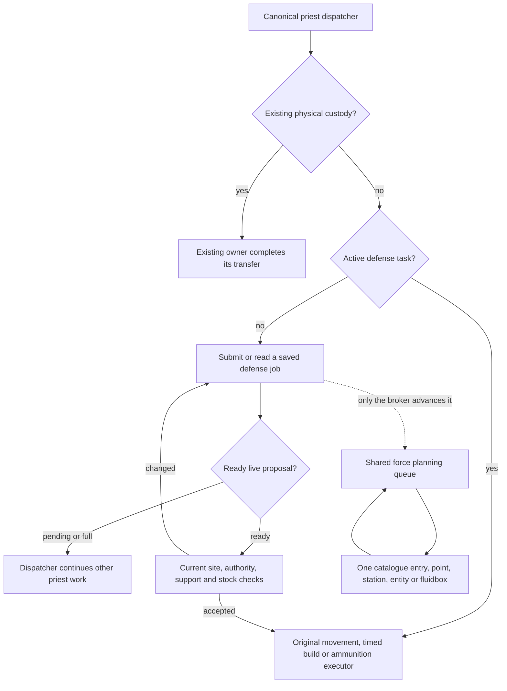
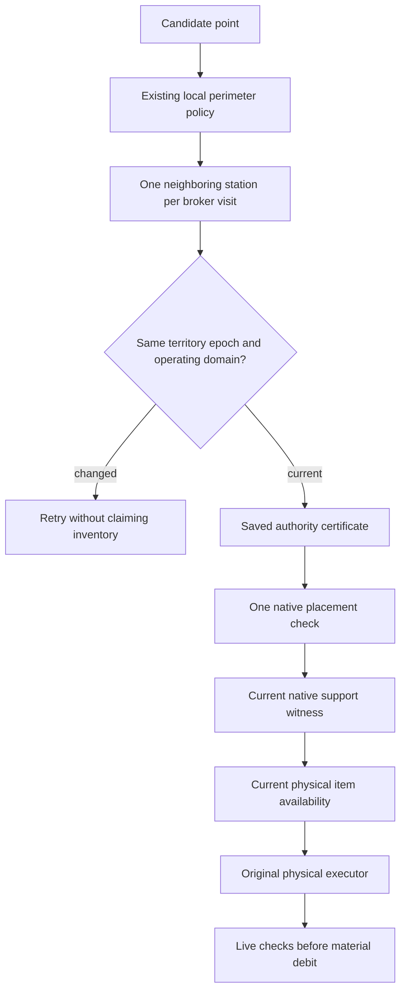

# Bounded perimeter defense planning (1507)

Reviewed against the candidate based on `025a7a5d613f1df6e3b131aad0b1cc5006760160`, 2026-11-26.

## Ownership and caller behavior

`scripts/defense_perimeter.lua` remains the physical executor. Its canonical
`TechPriestsDefensePerimeter0259.service_pair` bridge and its legacy `tick_pair`
wrapper now submit/read `core/defense_planning_1507.lua` jobs. They do not advance
the search. `core/force_planning_queue.lua` owns all continuation advancement
through the existing runtime broker, sharing its 16-work-unit pulse among forces
and jobs. The coordinator charges an empty or waiting visit as well as a visit
that produces a candidate.

The original priest entity, movement issuer, construction delay, station
inventory, item debit/refund, real `create_entity`, and physical ammunition
delivery remain authoritative. A proposal contains no material reservation and
takes no custody. Existing machine, direct-acquisition and emergency-feed custody
still precedes defense in the bridge.

An active routine wall continues moving/building while an urgent turret job
runs. Its exact task table is suspended only after a ready, currently stocked
turret or support proposal is accepted. If an unladen build site becomes blocked,
the exact task moves to `site_waiting_task_1507`; the original dispatcher can do
other work while its replacement site is searched. This is distinct from a
physical custody handoff. Old saved tasks without the new authority certificate
receive the same bounded admission before another placement.

## Work charged inside a job

| Phase | Maximum work in one coordinator visit | Retained continuation |
| --- | --- | --- |
| Cold policy metadata | Request/read shared item and recipe metadata; wait until complete | The shared metadata jobs and epoch |
| Defense catalogue | One preferred weapon or one immutable entity-to-item index entry | Shared catalogue cursor, seen set and unpublished rows |
| Incident assessment | One incident, one capped native turret query, or one returned turret | Incident index, bounded result page and entity index |
| Ammunition selection | One native inventory slot | Inventory reference and numeric slot cursor |
| Desired wall ring | One desired position or one neighboring station admission check | Angle index, desired positions and admission cursor |
| Tracked walls | One tracked record, one capped replacement query, or one replacement entity | Wall key, record and bounded replacement page |
| Wall/gate site search | One search position or one neighboring station | Ring, `dx`/`dy`, candidate and territory cursor |
| Routine turret layering | One weapon family, one slot, one adoption query, or one existing turret | Existing paid-family cursor, slot index and matching entity |
| Electric/fluid support discovery | One bounded spatial query or one returned support entity | Shared bounded-area cursor and support references |
| Supported site selection | One point or one candidate/support comparison | Ring cursor and support index |
| Connected pole planning | One available pole item, one point, or one upstream wire witness | Item cursor, native wire/supply ranges and anchor index |
| Pipe contamination safety | One returned pipe or one native fluidbox | Spatial cursor, planned fluid and live-content proof |
| Final publication | One final point check or one final support witness | Complete proposal only |

The historical `dx`-major/`dy`-minor search order around a point is retained.
The cursor jumps over a square ring's interior rather than visiting those
irrelevant coordinates for free inside one step. Rejected positions and rejected
support witnesses still consume their visits.

Support scans use `bounded_planning_area_1507`: native pages are limited to 16
entities, saturated cells subdivide, and each returned entity is visited
separately. A large result is never processed in one broker unit. Saturation at
the scanner's depth limit fails closed. Incident/slot turret lookups and exact
wall replacement lookups have an eight-entity cap, with a subsequent visit for
each returned entity. The read-only `connected_laser_supply_at` and
`connected_laser_pole_site` diagnostic exports retain their existing native
probe contracts; the live planner uses individual witnesses instead of invoking
their old multi-entity loops at every point.

## Authority and freshness

The actual 0646 metadata is explicitly primed before its execution-time policy
helpers are used. A cold item/recipe index therefore remains pending instead of
falling back to the historical synchronous catalogue walks or becoming a false
technology failure.

Production defense territory checks retain the 0646 perimeter tolerance and the
0259 placement band. They visit one neighboring station per broker step instead
of calling 0646's whole station-map overlap loop for every point. The certificate
uses the shared 0359 territory epoch and native station/force/surface identity,
the station position and the current operating radius. It is rechecked before
dispatch and throughout the active physical task. Station build/remove/clone,
force, research, configuration and runtime-setting invalidation use that shared
authority. The owner station's radius is also read directly when using the
certificate. Unreported third-party authority changes are outside those event
contracts; no new independent territory owner is introduced here.

Positive sites are checked again with current `can_place_entity`. An electric
turret requires a currently connected same-force pole and its quality-aware
native square supply range. A new pole also requires current native wire reach
to an already connected upstream pole. A failed pole witness does not become an
ordinary, unsupported site during relocation. Fluid-turret support proves only
pipe adjacency; it does not claim that oil is supplied or that a flamethrower is
combat ready.

Pipe-support proposals carry the checked neighboring pipe membership and native
fluidbox contents. The caller checks those contents again even if no terrain
event occurred. Relocating a pipe runs the contamination scan again. The global
24-unit live-check allowance includes rejected final positions, individual
support/fluidbox checks and the physical caller's current item-availability
check. A depleted allowance retains pending work and does not authorize a
partial safety result.

Geometry changes invalidate a negative world's snapshot so an old “no work” or
logistics request is not published after the terrain changes. The selected
positive point and witnesses are independently live checked; unrelated factory
construction does not force an otherwise valid positive site to be rescanned.
A new or changed hostile queue head invalidates a proposal for an older
incident. The current incident is removed only after its own real turret or
support task starts; routine walls and routine turret layers do not consume it.

## Save and queue state

The saved state consists of ordinary tables, numbers, strings, booleans and
Factorio-supported object references. Catalogue/search cursors, area pages,
authority certificates, actual support entities and optional pipe-content
proofs survive reload. Job handlers and the executor adapter are rebuilt when
the modules are parsed; no function or coroutine is saved. The shared metadata
epoch retires jobs after a configuration change.

| Result | Caller action |
| --- | --- |
| Pending | Retain incident/task continuation; no search advancement or failure cooldown |
| Queue full | Retain demand and allow other work; retry admission later |
| Ready, obstruction/support/authority changed | Discard the stale proposal and resubmit; take no materials |
| Ready, stock missing | Keep the incident and make the existing exact logistics request |
| Ready and live | Start the existing physical task; debit only at actual construction/refill |
| Fully assessed no action | Apply the existing scan cadence after the completed assessment |

The bounded existing hostile-memory reconciliation remains owned by 0816/0817.
It is not replaced with the planning worker or delayed until a whole factory plan
finishes.

## Verification and limits of the evidence

`tests/unit/defense_planning_1507.lua` exercises the actual perimeter bridge,
legacy caller and shared coordinator. It checks cold metadata, caller-only
polling, full queues, no-action force fairness, original paid construction and
ammunition delivery, serialized continuation reload, changed terrain/stock/
electricity/fluid contents, connected pole and pipe-safe relocation, and 120
neighboring stations charged individually. It also runs the actual canonical
0510 dispatcher with the real pending defense bridge and confirms another repair
owner receives service while the defense queue is full.

The existing mixed turret test now advances the actual broker between physical
calls. It retains its gun/laser/flamethrower conservation checks, independent
family slots, completed-wall-ring stock depletion, and paid-family round robin.
The existing prestock test retains its locked-recipe owned-item exception,
custody yield, rearm, wall preemption/resume and partial-state assertions with
broker advancement. The native electrical-grid fixture was corrected to call
mock prototype methods with Factorio's bound-method signature; its old
Legendary-range failure was reproduced on unchanged baseline source first.

These tests are source-level Lua contracts with engine mocks. They do not prove
native Factorio save/load acceptance, displayed FPS/UPS, physical path quality or
combat effectiveness. The headed four-priest smoke test and the subsequent
matched, active 100-priest timing windows remain separate acceptance gates.

## Source/API references

- [0259 physical executor](../tech-priests_src/scripts/defense_perimeter.lua)
- [1507 defense continuation](../tech-priests_src/scripts/core/defense_planning_1507.lua)
- [1507 shared force coordinator](../tech-priests_src/scripts/core/force_planning_queue.lua)
- [1507 bounded spatial membership](../tech-priests_src/scripts/core/bounded_planning_area_1507.lua)
- [0359 shared placement and territory authority](../tech-priests_src/scripts/core/construction_site_planner.lua)
- [Factorio storage](https://lua-api.factorio.com/latest/auxiliary/storage.html)
- [LuaSurface.find_entities_filtered](https://lua-api.factorio.com/latest/classes/LuaSurface.html#find_entities_filtered)
- [LuaInventory](https://lua-api.factorio.com/latest/classes/LuaInventory.html)
- [LuaEntityPrototype.get_supply_area_distance](https://lua-api.factorio.com/latest/classes/LuaEntityPrototype.html#get_supply_area_distance)
- [LuaEntityPrototype.get_max_wire_distance](https://lua-api.factorio.com/latest/classes/LuaEntityPrototype.html#get_max_wire_distance)
