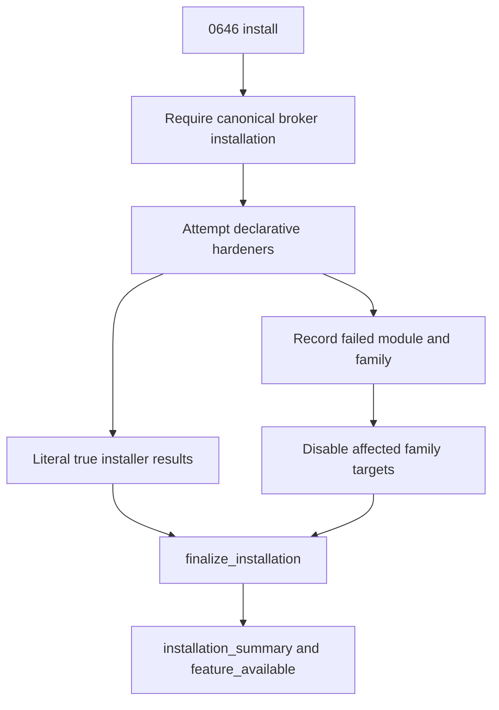
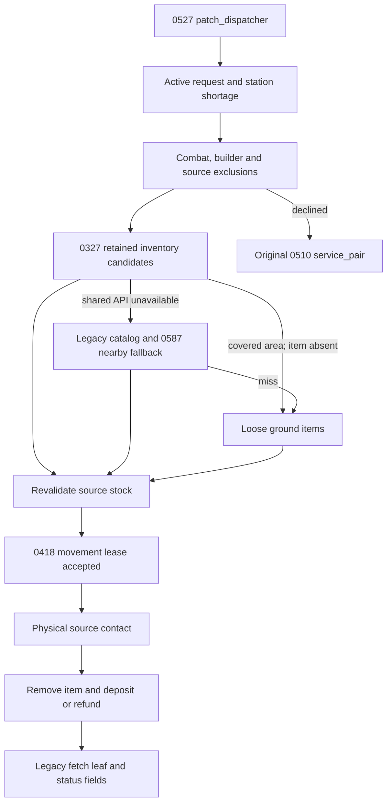
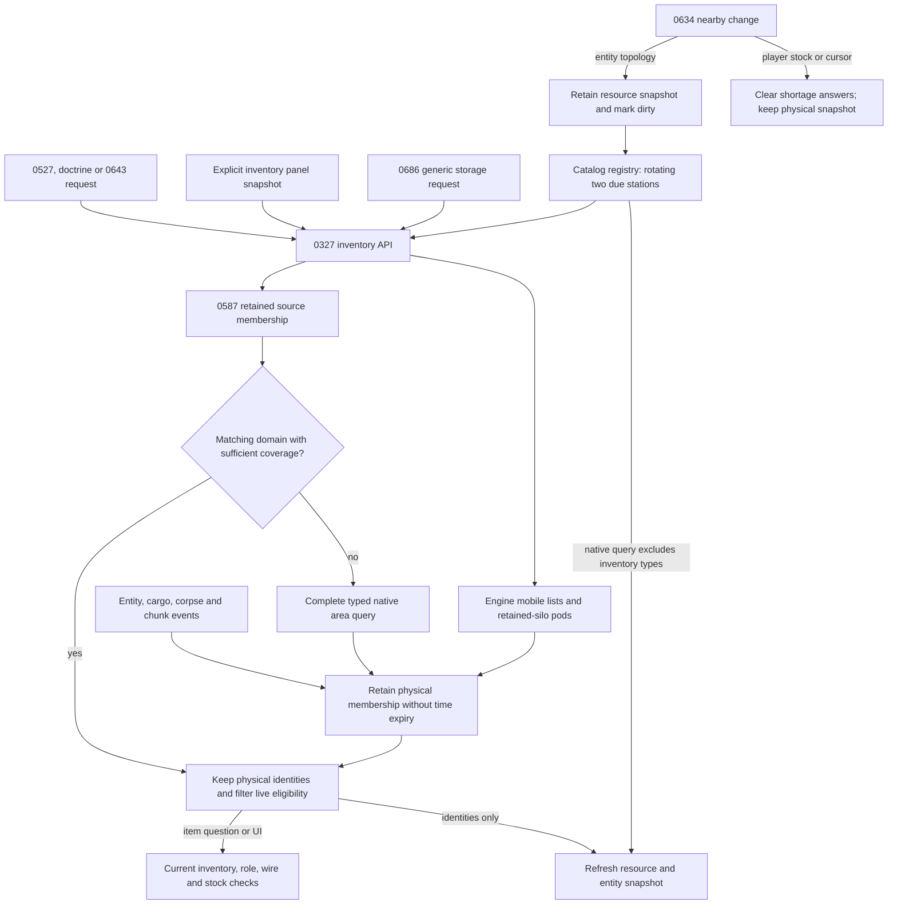

# Shared Policy, Discovery and Known-Source Fetch

**Reviewed:** 2026-11-25. This is a source map, not native behavior or performance acceptance.
The number in this filename is retained for existing links; it is not a claim that the old implementation is still active.

Use the [complete source inventory](BEHAVIOR_SOURCE_INVENTORY.md) and its
[content hashes and source sites](BEHAVIOR_SOURCE_INVENTORY.json) for the full module/function/registration index.
Potential reachability, conditional wrappers, and retired source are distinguished there.
Source presence does not prove that a callback installed or ran in Factorio.

## Current scope

The old drilldown's 0655 leaf, 0656 construction and 0651 vector services are retired. Their replacement owners are in the [family index](BEHAVIOR_FUNCTION_MAP_0659.md). This file now maps the retained planning policy, fetch wrapper and their connections.

## Policy installation

`item_for_entity`, `item_unlocked`, `entity_unlocked`, `interior_position_allowed` and `defense_position_allowed` are policy helpers. They do not provide an independent executor or timer. The hardener table is only part of the loader graph.

## Known-source fetch is still a pre-dispatch wrapper

The installed path asks the shared catalog inventory API, then loose ground. A complete shared view with no requested stock does not start a second inventory-discovery path. Legacy catalog/typed nearby access remains a compatibility fallback when that API is unavailable. The wrapper can return before ordinary 0510 selection. `request_move` requires literal accepted movement and checks that the resulting owner and destination are still its own before publishing a fetch task.

### State and boundaries

| Item | Current behavior |
| --- | --- |
| Request state | Reads queue/item intent and the real station count. |
| Writes | `logistics_fetch_0527`, compatibility `logistics_fetch_0526`, `active_leaf_task_0655`, `actual_task_status_0655`, target/mode. The 0655 **module** is retired, but these fields still have an active writer. |
| Movement | Calls `tech_priests_request_movement_0418`; it does not prewrite movement request storage or issue fallback commands. |
| Transfer | Immediate contact transfer with deposit/refund helpers. Do not call it an accepted persistent-custody transaction without separate verification. |
| Timing | No independent fetch timer; work happens through its dispatcher wrapper and direct calls. |
| Discovery | `0327.inventory_candidates` uses the existing 0587 `catalog-inventory-0327` domain. 0527 requests its six general-source types, then checks same-or-neutral force, current circular reach, wires and its permitted inventory slot. It does not acquire machine buffers. The compatibility nearby path retains domain `inventory-fetch-0527`; neither domain expires on a timer. |
| Loose items | The separate routed pickup query still has a 240-tick cache request and native result limit 128. It does not use the retained inventory-source domain. |
| Catalog access | 0527 reads retained identities through the shared API, ranks current station distances and rechecks stock. A missing item does not invoke `get_for_pair`, force a resource survey or repeat nearby inventory discovery after a covered result. The old snapshot path remains a fallback. The source-preserved 0526 helper still reads retained catalog state; this does not establish a new installation path for 0526. |

## Retained discovery, live stock and catalog refresh

`efficiency_economy_0587.source_candidates` and `.container_candidates` reuse the existing source-cache owner. Keys include source domain, force policy, surface, force and home station. Validity also checks station identity/position and type list. An existing larger coverage radius serves narrower live views; alternating catalog, doctrine and facility radii does not replace the record repeatedly. Expansion beyond known coverage can seed once. Physical membership is independent of item quantity and current force eligibility. Reads keep valid typed known identities when temporarily ineligible and filter the returned view against live force, surface and range. Consumers recheck inventory, roles, wire permissions and available count before transfer. 0686's initial typed query includes other forces so an already known source can become eligible after a force change.

0327 derives inventory-bearing entity types once from immutable native prototype inventory support, including zero-size support, with explicit runtime-dependent corpse, cargo-pod and proxy-container types. Its shared domain retains empty sources and all forces; each consumer applies its own live eligibility. `find_inventory_source` answers an item question from current counts. `resource_doctrine.find_inventory_source` uses that API with its existing inventory-ID set and current canonical wire policy. `snapshot_inventory` obtains full current contents for an explicitly rendered ledger. These operations do not require a resource survey first.

Build/removal events, including space-platform variants, clones, script teleports and surface changes update or discard membership. Vehicle/player/train/spider and corpse events remain connected. Cargo ascent/descent/delivery events add pods and delivered containers; rocket launch captures the attached pod. Generated chunks receive a typed query restricted to the new chunk when it overlaps an existing retained domain. Programmatic stash creation in 0686 calls the same invalidator. Force eligibility stays live without requiring an entity-force-change event.

For ordinary autonomous arrivals, 0327 reads the engine's vehicle list and deployed robots in current logistic networks, including personal networks, and observes awaiting-launch pods through already retained silos. A requested type view avoids unrelated mobile-list work. Newly observed identities are batch-merged through `0587.observe_source_candidates`, not stored in a second world index. Before the last logistic cell is removed, its roboport or equipment-grid owner can preserve deployed robot identities, including those outside the current view, in one batch per affected retained record. These engine lists still have a traversal cost; retaining membership does not make an inventory question constant-time.

Retained membership has no timer expiry, including an initially empty result, and survives module reload in the existing persisted `source_cache`. Short-lived legacy answer cleanup is separate. Station/domain changes, coverage expansion or explicit cache clearing can repopulate membership. Unraised scripted creation/movement, a never-observed orphan robot outside the initial area, or equipment removal after an unseen robot's old network has vanished may remain unknown until explicit refresh. Elapsed time does not silently replace the area list. Without successful event registration, enabled caching or the required metadata API, compatibility paths fall back to discovery. Failed/non-table results are not installed as complete negative records.

The 0686 generic-storage view prefers the shared 0327 API with exactly container, logistic-container, car and spider-vehicle types. Its live same-force, surface, circular-range and valid-inventory checks admit at most 256 physical candidates; role, quality and quantity policy remains with its consumers. The shared 0587 record retains complete overflow, so removing a visible entry can promote a known entity without another spatial query. Only when the shared API is unavailable does 0686 use its prior generic-storage cache domain. Inventory slots are selected by entity type: chest for the two container types, car trunk for cars and spider trunk for spiders. Native inventory-ID aliases must not expose vehicle fuel as generic storage. Initial population, coverage expansion or an explicit/domain-change native query is complete and has no entity limit; its cost still grows with local density. 0527's retained typed view is not capped at 256. Cached membership also does not eliminate repeated live inventory probes.

`station_area_change_invalidator_0634.clear_pair_state` marks topology changes dirty and due while retaining the last snapshot. Player stock/cursor events clear shortage answers without scheduling physical rediscovery. No nearby entity event forces a synchronous full scan. `station_catalog.scan_due(2)` has a separate 60-tick registry route, sorts due station units and resumes after saved `scan_cursor_0634`; collecting/sorting still visits the roster. Cold `get_for_pair` and explicit refresh can still invoke a survey. Known-resource GUI rendering reuses the resource snapshot when present, then explicitly reads inventory contents through `snapshot_inventory`; a redraw does not expire membership. These paths remain outside the broker's internal callback cap.

Station rotation does not provide fairness within the remaining non-inventory dense survey. `catalog_dense_scan_1478.scan` starts its fixed subdivision order again on each invocation, with at most 13 native queries and 3,072 unique returned entities. It does not retain a subtree/entity cursor. An incomplete scan replaces the resource/catalog snapshot with an explicit completeness flag while preserving old ownership keys; retained ownership is not complete candidate knowledge. A stable area above those bounds may repeatedly omit its non-inventory tail. The separate retained inventory seed has no such result cap.

Within each scan, `station_catalog` reuses the identity key passed into a resource/mineable claim and the existing read-only prototype-product arrays. Mineable eligibility returns the same product list for catalog insertion. These remove repeated identity construction and per-entity product copies without changing selection, scan limits or cadence. A successful numeric connector count answers both connected and empty cases without materializing `connections`; fully successful modern connector queries avoid obsolete field probes, while uncertain or failed queries retain compatibility fallbacks. Static prototype inventory-ID results use the existing cache; runtime-dependent inventory types remain live. These are source reductions, not measured native acceptance.

0327's scheduled native world query excludes inventory-bearing types and merges their retained identities for entity tallies and existing resource classification. It does not call `get_contents`; stored-item presentation is updated by explicit UI snapshots. The filtered survey must not certify complete 0579 world cells. Compatibility engines that reject the type filter retain a counted broad fallback, while missing metadata/ownership may require fresh discovery. Separate physical infrastructure/resource surveys still exist outside this inventory owner. Loose-ground pickup retains its separate 240-tick routed cache request.

## Broker admission and related read reductions

`efficiency_economy_0598.broker_plan` now runs inside `runtime_tick_broker.pulse`. It phases eligible background services, persists deadlines and admits at most four due background callbacks per pulse using a saved rotating cursor. Deferred services retain their due deadline. Admitted callbacks still run in the broker's canonical priority order. `broker_ran` records their next deadline. This applies independently of the outer registry route budget.

Movement, dispatcher, combat and other categories outside the background allowlist remain unaffected by this background cap. The broad-category services `order_queue_0469`, `station-starvation-first-junior-0922` and `inventory_steward_0357` are explicitly excluded to preserve queue, original-priest and custody progression. Four is a background callback count, not a total callback cap, pair limit or millisecond ceiling.

The separate `proxy_ammo_hardener_0649` combat service collects station inventory sources once per `station_ammo` call, derives fallback ammo names once from immutable prototypes per runtime, and short-circuits a valid empty proxy inventory. Stock remains live. Its 41-tick broker route retains category `combat` and offered budget 6; it is not governed by the background allowlist.

The complete registration, scan and wrapper-site index is in the generated inventory. These source changes do not establish native timing or workload acceptance.

## Audited exported entry points

These names are taken from the current source; local helpers and call sites are in the full inventory. A callable helper is not an independently scheduled service.

| Module | Exported functions |
| --- | --- |
| [planning_constraints_0646](../tech-priests_src/scripts/core/planning_constraints_0646.lua) | `M.recipe_names_for_item`, `M.item_for_entity`, `M.item_unlocked`, `M.entity_unlocked`, `M.interior_position_allowed`, `M.defense_position_allowed`, `M.finalize_installation`, `M.installation_summary`, `M.feature_available`, `M.install` |
| [logistics_fetch_executor_0527](../tech-priests_src/scripts/core/logistics_fetch_executor_0527.lua) | `M.spendable_source_count`, `M.root`, `M.service_pair`, `M.describe_pair`, `M.install` |
| [scan_routing_0610](../tech-priests_src/scripts/core/scan_routing_0610.lua) | `M.root`, `M.should_skip_negative`, `M.record_negative`, `M.clear_negative`, `M.find_entities`, `M.report_lines`, `M.install` |
| [efficiency_economy_0587](../tech-priests_src/scripts/core/efficiency_economy_0587.lua) | `M.source_candidates`, `M.container_candidates`, `M.observe_source_candidates`, `M.invalidate_entity_sources`, `M.cleanup`, `M.install` |
| [efficiency_economy_0598](../tech-priests_src/scripts/core/efficiency_economy_0598.lua) | `M.broker_plan`, `M.broker_ran`, `M.install` |
| [runtime_tick_broker](../tech-priests_src/scripts/core/runtime_tick_broker.lua) | `M.register_service`, `M.pulse`, `M.normalize_result`, `M.installation_summary`, `M.install` |
| [station_catalog](../tech-priests_src/scripts/core/station_catalog.lua) | `Catalog.inventory_types`, `Catalog.inventory_candidates`, `Catalog.find_inventory_source`, `Catalog.snapshot_inventory`, `Catalog.scan_pair`, `Catalog.scan_due`, `Catalog.get_for_pair`, `Catalog.find_known_source` |
| [proxy_ammo_hardener_0649](../tech-priests_src/scripts/core/proxy_ammo_hardener_0649.lua) | `M.station_ammo`, `M.proxy_has_ammo`, `M.load_proxy_from_station`, `M.service_all`, `M.install` |

## Update and evidence rule

Change the relevant diagram and ownership/exit description with the source change. Regenerate the source inventory with `python tools/audit_ups_hotspots_0743.py --write-behavior-maps`, explicitly acknowledge the reviewed curated maps with `--acknowledge-behavior-map-review`, then run `--check-behavior-maps` through the same tool. Generation alone does not bless a changed manual diagram. Follow the [performance validation protocol](UPS_VALIDATION_RUNBOOK_0742.md) for exact source, save, engine version, population, profiling settings, sample window and artifacts. A clean map check proves freshness only.
