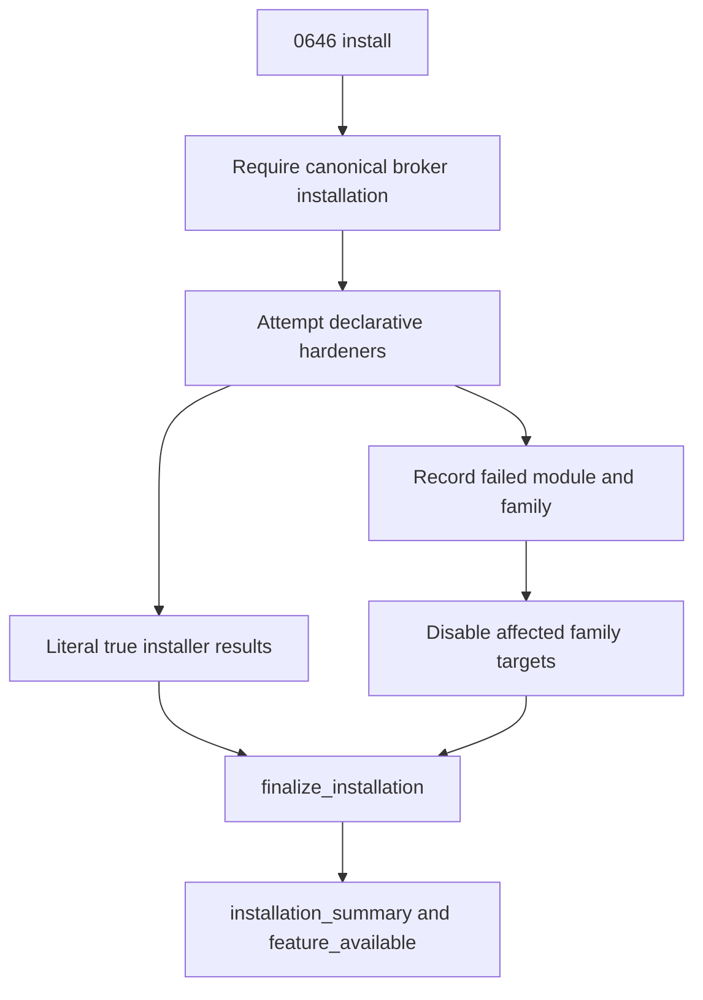
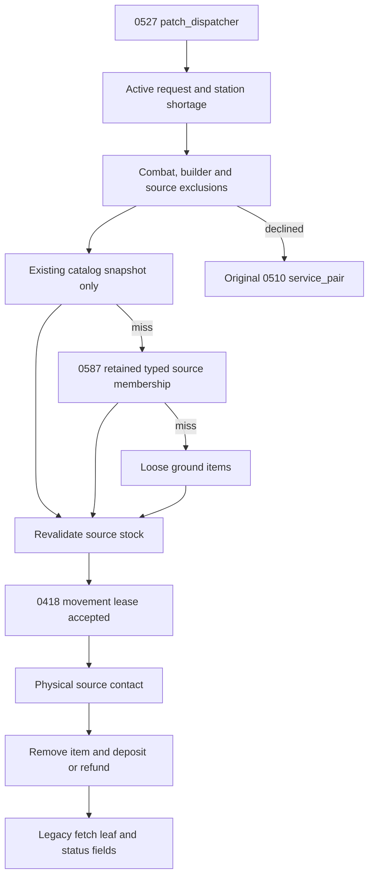
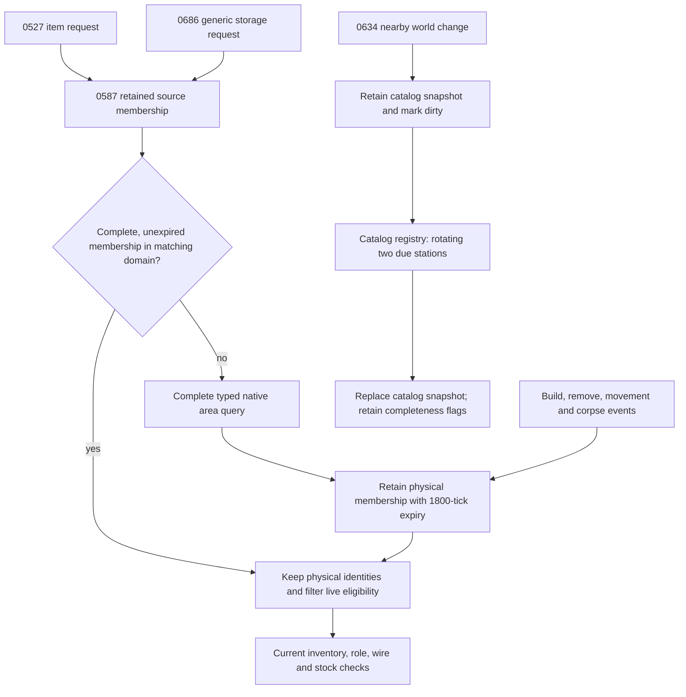

# Shared Policy, Discovery and Known-Source Fetch

**Reviewed:** 2026-11-25. This is a source map, not native behavior or performance acceptance.
The number in this filename is retained for existing links; it is not a claim that the old implementation is still active.

Use the [complete source inventory](BEHAVIOR_SOURCE_INVENTORY.md) and its
[content hashes and source sites](BEHAVIOR_SOURCE_INVENTORY.json) for the full module/function/registration index.
Potential reachability, conditional wrappers, and retired source are distinguished there.
Source presence does not prove that a callback installed or ran in Factorio.

## Current scope

The old drilldown's 0655 leaf, 0656 construction and 0651 vector services are retired. Their replacement owners are in the [family index](BEHAVIOR_FUNCTION_MAP_0659.md). This file now maps the retained planning policy, fetch wrapper and their connections.

## Policy installation

`item_for_entity`, `item_unlocked`, `entity_unlocked`, `interior_position_allowed` and `defense_position_allowed` are policy helpers. They do not provide an independent executor or timer. The hardener table is only part of the loader graph.

## Known-source fetch is still a pre-dispatch wrapper

Source order is catalog, typed nearby storage, loose ground. The wrapper can return before ordinary 0510 selection. `request_move` requires literal accepted movement and checks that the resulting owner and destination are still its own before publishing a fetch task.

### State and boundaries

| Item | Current behavior |
| --- | --- |
| Request state | Reads queue/item intent and the real station count. |
| Writes | `logistics_fetch_0527`, compatibility `logistics_fetch_0526`, `active_leaf_task_0655`, `actual_task_status_0655`, target/mode. The 0655 **module** is retired, but these fields still have an active writer. |
| Movement | Calls `tech_priests_request_movement_0418`; it does not prewrite movement request storage or issue fallback commands. |
| Transfer | Immediate contact transfer with deposit/refund helpers. Do not call it an accepted persistent-custody transaction without separate verification. |
| Timing | No independent fetch timer; work happens through its dispatcher wrapper and direct calls. |
| Discovery | Nearby storage uses `0587.source_candidates` with domain `inventory-fetch-0527` and same-or-neutral force policy. Membership is independent of requested item/order. Event updates are immediate; a 1,800-tick demand expiry also discovers unobserved arrivals, including after an empty result. Initial, expired, changed-domain and explicit-refresh typed native queries have no result limit. |
| Loose items | The separate routed pickup query still has a 240-tick cache request and native result limit 128. It does not use the retained inventory-source domain. |
| Catalog access | 0527 reads existing `station_catalog_0327.stations` directly, checks the source's live position against the current station radius, ranks live distances and rechecks current stock. A missing item no longer invokes `find_known_source`, `get_for_pair` or a forced catalog scan. The source-preserved 0526 compatibility helper uses the retained-only catalog approach; this does not establish a new installation path for 0526. |

## Retained discovery, live stock and catalog refresh

`efficiency_economy_0587.source_candidates` and `.container_candidates` reuse the existing source-cache owner. Their keys include source domain, force policy, surface, force and home station. Validity also checks station identity/position, radius and type list. Physical membership is retained independently of current item quantity and force eligibility. Reads keep valid typed known identities when temporarily ineligible and filter the returned view against live force, surface and range; membership events can add or remove identities as they move. Consumers also recheck inventory, roles, wire permissions and available count before transfer. 0686's initial typed query includes other forces so a known source can become eligible after a force change without needing rediscovery.

Build/removal events, including space-platform variants, clones, script teleports and surface changes update or discard membership. Player driving/position/surface changes update moving vehicles; spider-command completion and train changes update their affected inventory sources. Corpse creation and expiry are also observed. Programmatic stash creation in 0686 calls the same invalidator. Force eligibility is evaluated on every read and does not depend on an entity-force-change notification.

`candidate_ttl = 60 * 30` bounds reuse of retained inventory membership to 1,800 ticks, including an initially empty result. The first demand after expiry performs complete typed discovery, so a previously unseen vehicle entering without a supported event cannot remain unknown indefinitely. Expiry alone does not run a scan. Records stay in the existing persisted `source_cache` through module reload; old retained records without an expiry refresh on their next demand. Event updates, station/domain changes and explicit refresh can change membership sooner. Short-lived legacy answer cleanup remains separate. Without successful event registration or enabled caching, the owner falls back to discovery. Failed/non-table query results are not installed as complete negative records.

The 0686 generic-storage view returns at most 256 candidates while retaining overflow membership. Removal of a visible entry can promote a known overflow entity without another spatial query. Initial population, expired membership or an explicit/domain-change native query is complete and has no entity limit; its cost still grows with local density. 0527's retained typed view is not capped at 256. Cached membership also does not eliminate repeated live inventory probes.

`station_area_change_invalidator_0634.clear_pair_state` marks the catalog dirty and due while retaining the last snapshot. It no longer forces a scan for every nearby entity event. `station_catalog.scan_due(2)` runs through a separate registry route every 60 ticks, sorts due station units, and resumes after saved `scan_cursor_0634`. Collecting/sorting due stations still visits the roster. `get_for_pair` can synchronously scan a station with no existing snapshot; explicit refresh can also force a scan. Ordinary known-resource GUI rendering now calls `catalog_for_pair(pair, false)`, so it reuses an existing snapshot but can still initialize a missing one. These paths remain outside the broker's internal callback cap.

Station rotation does not provide fairness within a dense station area. `catalog_dense_scan_1478.scan` starts its fixed subdivision order again on each invocation, with at most 13 native queries and 3,072 unique returned entities. It does not retain a subtree/entity cursor. An incomplete scan replaces the catalog snapshot with an explicit completeness flag while preserving old ownership keys; retained ownership is not complete candidate knowledge. A stable area above those bounds may repeatedly omit its tail.

Within each scan, `station_catalog` reuses the identity key passed into a resource/mineable claim and the existing read-only prototype-product arrays. Mineable eligibility returns the same product list for catalog insertion. These remove repeated identity construction and per-entity product copies without changing selection, scan limits or cadence. A successful numeric connector count answers both connected and empty cases without materializing `connections`; fully successful modern connector queries avoid obsolete field probes, while uncertain or failed queries retain compatibility fallbacks. Positive and empty inventory-ID results already use the existing prototype cache. These are source reductions, not measured native acceptance.

0327's broad world survey still includes inventory-bearing entities and reads their current contents. It is distinct from the retained 0527/0686 source-selection paths; the dedicated inventory repair does not establish that every surrounding-world query is event-only. Loose-ground-item pickup retains its separate 240-tick routed cache request.

## Broker admission and related read reductions

`efficiency_economy_0598.broker_plan` now runs inside `runtime_tick_broker.pulse`. It phases eligible background services, persists deadlines and admits at most four due background callbacks per pulse using a saved rotating cursor. Deferred services retain their due deadline. Admitted callbacks still run in the broker's canonical priority order. `broker_ran` records their next deadline. This applies independently of the outer registry route budget.

Movement, dispatcher, combat and other categories outside the background allowlist remain unaffected by this background cap. The broad-category services `order_queue_0469`, `station-starvation-first-junior-0922` and `inventory_steward_0357` are explicitly excluded to preserve queue, original-priest and custody progression. Four is a background callback count, not a total callback cap, pair limit or millisecond ceiling.

The separate `proxy_ammo_hardener_0649` combat service collects station inventory sources once per `station_ammo` call, derives fallback ammo names once from immutable prototypes per runtime, and short-circuits a valid empty proxy inventory. Stock remains live. Its 41-tick broker route retains category `combat` and offered budget 6; it is not governed by the background allowlist.

The complete registration, scan and wrapper-site index is in the generated inventory. These source changes do not establish native timing or workload acceptance.

## Audited exported entry points

These names are taken from the current source; local helpers and call sites are in the full inventory. A callable helper is not an independently scheduled service.

| Module | Exported functions |
| --- | --- |
| [planning_constraints_0646](../tech-priests_src/scripts/core/planning_constraints_0646.lua) | `M.recipe_names_for_item`, `M.item_for_entity`, `M.item_unlocked`, `M.entity_unlocked`, `M.interior_position_allowed`, `M.defense_position_allowed`, `M.finalize_installation`, `M.installation_summary`, `M.feature_available`, `M.install` |
| [logistics_fetch_executor_0527](../tech-priests_src/scripts/core/logistics_fetch_executor_0527.lua) | `M.spendable_source_count`, `M.root`, `M.service_pair`, `M.describe_pair`, `M.install` |
| [scan_routing_0610](../tech-priests_src/scripts/core/scan_routing_0610.lua) | `M.root`, `M.should_skip_negative`, `M.record_negative`, `M.clear_negative`, `M.find_entities`, `M.report_lines`, `M.install` |
| [efficiency_economy_0587](../tech-priests_src/scripts/core/efficiency_economy_0587.lua) | `M.source_candidates`, `M.container_candidates`, `M.invalidate_entity_sources`, `M.cleanup`, `M.install` |
| [efficiency_economy_0598](../tech-priests_src/scripts/core/efficiency_economy_0598.lua) | `M.broker_plan`, `M.broker_ran`, `M.install` |
| [runtime_tick_broker](../tech-priests_src/scripts/core/runtime_tick_broker.lua) | `M.register_service`, `M.pulse`, `M.normalize_result`, `M.installation_summary`, `M.install` |
| [station_catalog](../tech-priests_src/scripts/core/station_catalog.lua) | `Catalog.scan_pair`, `Catalog.scan_due`, `Catalog.get_for_pair`, `Catalog.find_known_source` |
| [proxy_ammo_hardener_0649](../tech-priests_src/scripts/core/proxy_ammo_hardener_0649.lua) | `M.station_ammo`, `M.proxy_has_ammo`, `M.load_proxy_from_station`, `M.service_all`, `M.install` |

## Update and evidence rule

Change the relevant diagram and ownership/exit description with the source change. Regenerate the source inventory with `python tools/audit_ups_hotspots_0743.py --write-behavior-maps`, explicitly acknowledge the reviewed curated maps with `--acknowledge-behavior-map-review`, then run `--check-behavior-maps` through the same tool. Generation alone does not bless a changed manual diagram. Follow the [performance validation protocol](UPS_VALIDATION_RUNBOOK_0742.md) for exact source, save, engine version, population, profiling settings, sample window and artifacts. A clean map check proves freshness only.
