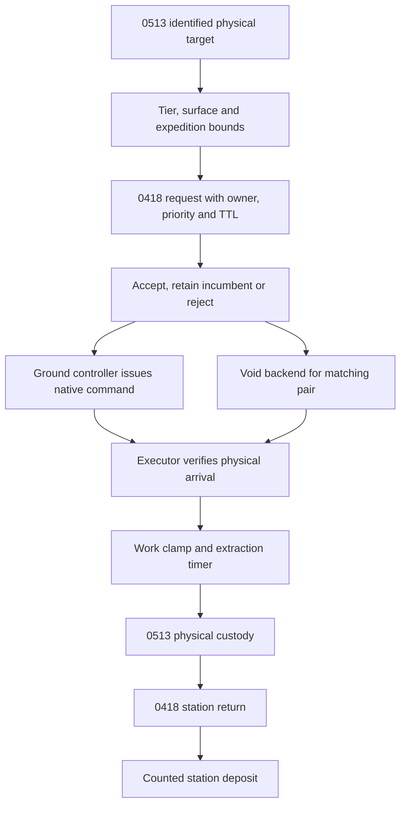

# Direct Acquisition Movement and Retired Wrapper Replacements

**Reviewed:** 2026-11-25. This is a source map, not native behavior or performance acceptance.
The number in this filename is retained for existing links; it is not a claim that the old implementation is still active.

Use the [complete source inventory](BEHAVIOR_SOURCE_INVENTORY.md) and its
[content hashes and source sites](BEHAVIOR_SOURCE_INVENTORY.json) for the full module/function/registration index.
Potential reachability, conditional wrappers, and retired source are distinguished there.
Source presence does not prove that a callback installed or ran in Factorio.

## Current replacement for the historical stack

The former graph showed 0649 → 0650 → 0652 → 0654 as a layered movement stack. **0650, 0652 and 0654 are retired** in the current planning declaration. Their old diagrams are removed rather than presented as an active alternative.

`direct_acquisition_physical_guard_0649` remains in the declarative active list and guards physical target adoption. It is not permission to reinstall retired movement-lock or reconciliation authorities. The direct executor rejects protected/mismatched targets itself.

## Replacement and exit table

| Old responsibility | Current owner | Terminal condition |
| --- | --- | --- |
| Bind a physical direct target | 0513 task selection plus 0649 guard | Literal target/item invalidation fails or replans through executor. |
| Prevent unrelated retargets | 0418 owner/priority/lease rules | Explicit stop, accepted replacement, TTL or terminal cleanup. |
| Publish execution state | 0510 canonical action and 0513 dispatcher phase | Executor/dispatcher publishes current result; compatibility fields remain separately inventoried. |
| Maintain commands and displacement samples | 0418 broker services | Active requests only, with controller validity/recovery rules. |
| Return held ore | 0513 custody path | Physical station contact and exact accepted deposit; refused remainder remains held. |
| Off-surface/space travel | Explicit Void/platform backends | Backend-specific surface and destination checks. |

## Scheduling and performance

The 0513 executor is dispatcher-owned and has no separately installed periodic executor service. Its callable `service_all` is not evidence of an independent registration. 0418 owns service at 10 ticks, sampling at 5 ticks and enforcement at 89 ticks. Discovery deferral must not reduce those movement cadences.

Trace repeated path requests at the controller boundary: request owner, target identity, last issued command, TTL and retarget hold. Repeated source search belongs to discovery analysis; repeated native commands belong to movement analysis. These are separate costs.

## Audited exported entry points

These names are taken from the current source; local helpers and call sites are in the full inventory. A callable helper is not an independently scheduled service.

| Module | Exported functions |
| --- | --- |
| [direct_acquisition_physical_guard_0649](../tech-priests_src/scripts/core/direct_acquisition_physical_guard_0649.lua) | `M.guard_pair`, `M.service_pair`, `M.service_all`, `M.install` |
| [direct_acquisition_executor_0513](../tech-priests_src/scripts/core/direct_acquisition_executor_0513.lua) | `M.direct_radius`, `M.hard_leash`, `M.target_within_bounds`, `M.authorize_expedition`, `M.revoke_expedition`, `M.target_is_safe`, `M.physical_item`, `M.root`, `M.player_mining_ticks`, `M.laser_work_ticks`, `M.machine_route_has_movement`, `M.service_pair`, `M.service_all`, `M.report_lines`, `M.install` |
| [movement_controller](../tech-priests_src/scripts/core/movement_controller.lua) | `M.work_radius`, `M.hard_leash`, `M.position_allowed`, `M.request`, `M.request_status`, `M.combat_intent`, `M.stop`, `M.enforce_pair`, `M.enforcement_service`, `M.service`, `M.sample`, `M.route_command`, `M.patch_globals`, `M.commands`, `M.report_lines`, `M.cleanup_retired_pair_state`, `M.install` |
| [void_movement_authority_0630](../tech-priests_src/scripts/core/void_movement_authority_0630.lua) | `M.is_void_pair`, `M.request`, `M.stop`, `M.status`, `M.service`, `M.report_lines`, `M.install` |

## Update and evidence rule

Change the relevant diagram and ownership/exit description with the source change. Regenerate the source inventory with `python tools/audit_ups_hotspots_0743.py --write-behavior-maps`, explicitly acknowledge the reviewed curated maps with `--acknowledge-behavior-map-review`, then run `--check-behavior-maps` through the same tool. Generation alone does not bless a changed manual diagram. Follow the [performance validation protocol](UPS_VALIDATION_RUNBOOK_0742.md) for exact source, save, engine version, population, profiling settings, sample window and artifacts. A clean map check proves freshness only.
