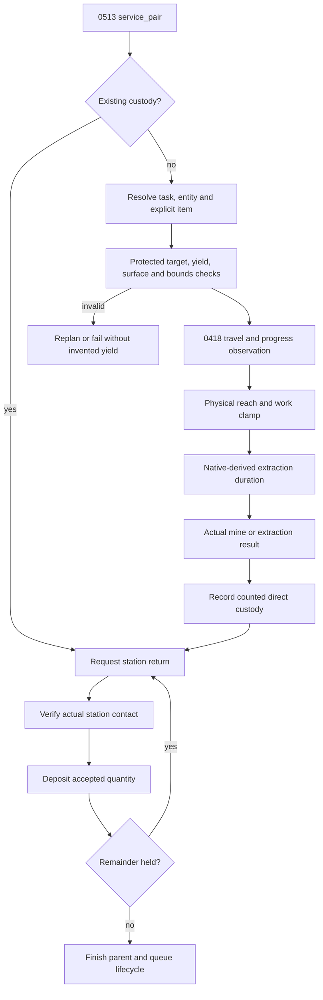

# Direct Acquisition Executor 0513

**Reviewed:** 2026-11-25. This is a source map, not native behavior or performance acceptance.
The number in this filename is retained for existing links; it is not a claim that the old implementation is still active.

Use the [complete source inventory](BEHAVIOR_SOURCE_INVENTORY.md) and its
[content hashes and source sites](BEHAVIOR_SOURCE_INVENTORY.json) for the full module/function/registration index.
Potential reachability, conditional wrappers, and retired source are distinguished there.
Source presence does not prove that a callback installed or ran in Factorio.

## Owner and entry

`single_dispatcher_0510` invokes `service_pair` for identified direct acquisition and prioritizes an incumbent ore-return custody path before assigning new work. Legacy acquisition entry points are wrapped to reach or yield to 0513. The executor does not create an independent timer.

## State and function ownership

| Concern | Functions / fields |
| --- | --- |
| Target interpretation | `current_task`, `entity`, `explicit_item`, `M.physical_item`, `M.target_is_safe`. Child-first sparse item declarations must still match physical output. |
| Bounds | `M.direct_radius`, `M.hard_leash`, `M.target_within_bounds`, `M.authorize_expedition`, `M.revoke_expedition`. |
| Work timing | `M.player_mining_ticks`, `M.laser_work_ticks`; saved remaining work when leaving reach. |
| Execution progress | `pair.dispatcher_direct_0513`; task due/remaining fields. |
| Cargo | `pair.direct_acquisition_custody_0513`; counted physical extraction, parent identity and station-return processing. |
| Completion | `finish_deposit`, `queue_terminal`, parent/task cleanup, work-clamp release. |
| Blocked return | Retains custody and movement failure state; cannot report a completed acquisition just because extraction occurred. |

## Performance boundary

Travel observations may recur on dispatcher pulses, but native movement requests have their own refresh/stall conditions. Work visuals are separately throttled. `service_all` has a rotating cursor; normal ownership is still dispatcher scheduling. No claim of faster UPS follows from those controls without native evidence.

The retired 0650/0652/0654 movement wrappers must not be reintroduced to repair a target mismatch. Correct literal target ownership in 0513 or request admission in 0418.

## Audited exported entry points

These names are taken from the current source; local helpers and call sites are in the full inventory. A callable helper is not an independently scheduled service.

| Module | Exported functions |
| --- | --- |
| [direct_acquisition_executor_0513](../tech-priests_src/scripts/core/direct_acquisition_executor_0513.lua) | `M.direct_radius`, `M.hard_leash`, `M.target_within_bounds`, `M.authorize_expedition`, `M.revoke_expedition`, `M.target_is_safe`, `M.physical_item`, `M.root`, `M.player_mining_ticks`, `M.laser_work_ticks`, `M.machine_route_has_movement`, `M.service_pair`, `M.service_all`, `M.report_lines`, `M.install` |

## Update and evidence rule

Change the relevant diagram and ownership/exit description with the source change. Regenerate the source inventory with `python tools/audit_ups_hotspots_0743.py --write-behavior-maps`, explicitly acknowledge the reviewed curated maps with `--acknowledge-behavior-map-review`, then run `--check-behavior-maps` through the same tool. Generation alone does not bless a changed manual diagram. Follow the [performance validation protocol](UPS_VALIDATION_RUNBOOK_0742.md) for exact source, save, engine version, population, profiling settings, sample window and artifacts. A clean map check proves freshness only.
