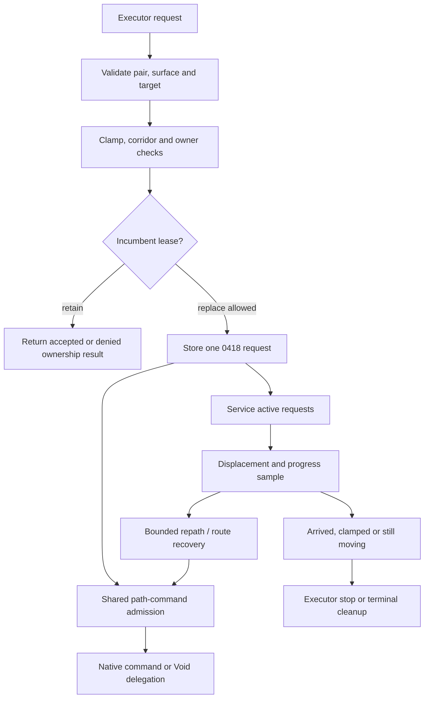

# Ground Movement Controller 0418 / 0419

**Reviewed:** 2026-11-25. This is a source map, not native behavior or performance acceptance.
The number in this filename is retained for existing links; it is not a claim that the old implementation is still active.

Use the [complete source inventory](BEHAVIOR_SOURCE_INVENTORY.md) and its
[content hashes and source sites](BEHAVIOR_SOURCE_INVENTORY.json) for the full module/function/registration index.
Potential reachability, conditional wrappers, and retired source are distinguished there.
Source presence does not prove that a callback installed or ran in Factorio.

## Authority

`movement_controller.lua` owns ground-priest movement intent, leases, native command submission, active-request servicing, samples and recovery enforcement. Other owners request movement; source-preserved 0518, 0566, 0632/0633 and 0650–0654 wrappers are not alternate controllers. Void requests delegate through the explicit backend.

## Concrete cadence and request contract

| Setting or service | Current source value | Meaning |
| --- | --- | --- |
| `movement_controller_service_0611` | 10 ticks, priority 42, budget 24 | Services active movement requests. |
| `movement_controller_sample_0611` | 5 ticks, priority 80, budget 32 | Samples active requests. |
| `movement_controller_enforcement_0566` | 89 ticks, priority 70, budget 24 | Integrated stale-request / envelope / overleash enforcement. |
| `command_refresh_ticks` | 45, retained constant | Does not impose periodic repathing on an advancing unit; active submission uses initial-command or stalled-progress checks. |
| `retarget_hold_ticks` | 90 | Retarget suppression boundary. |
| `default_request_ttl` | 600 | Default request lifetime. |
| `long_action_lease_ticks` | 480 | Lease for qualifying long physical tasks. |
| `stall_repath_ticks` | 240 | Stalled progress repath threshold. |

These are nominal ticks and offered work counts, not measured execution durations. Service budgets do not reduce the simulation tick rate. An accepted request may retain an existing owner for the same destination; callers that require their own lease must verify the returned live owner.

## Native ground speed and appearance

The ground priest constructor now uses the native Engineer's `running_speed`
as its unit `movement_speed`, with the existing 20% belt-immune tier bonus.
With the default Engineer this is 0.15 and 0.18 tiles per tick, replacing the
old deliberate 0.080/0.095 crawl. The original rail-capable Magos uses the same
baseline. Native unit commands still execute every engine tick; this repair
does not change movement leases, service cadence or arrival accounting. Void
attendants retain their separate movement backend and prototype override.

The presentation exporter preserves each priest's native running and attack
animation clocks while hiding only pixels. `character_visuals` applies the
custom animation's speed once, including correction of old saved render
objects. Appearance changes do not write entity movement speed. The
[player appearance route](BEHAVIOR_MERMAID_MAP_0660.md#character-appearance-and-native-player-ownership)
is separate from these explicitly requested ground-unit speed changes.

## State and exit

- Pair intent is `movement_request_0418`; controller state uses `storage.tech_priests.movement_controller_0419` and active request IDs.
- Clamps prevent movement during physical work, conversation and stabilization where applicable.
- Ground corridor planning proposes legal routes; the controller owns command submission and request mutation.
- Cargo, relocation, rail and station-resupply exclusions protect original physical owners during recovery.
- Arrival is a movement observation. The physical executor independently verifies reach, target validity and inventory/accounting before work or completion.

## Debugging route

Inspect the current executor, expected destination, current movement owner, clamp, lease, last command and progress samples before changing cadence. A stale target is an ownership defect; a frequent native command is a submission-cost defect. Correct the specific boundary.

## Audited exported entry points

These names are taken from the current source; local helpers and call sites are in the full inventory. A callable helper is not an independently scheduled service.

| Module | Exported functions |
| --- | --- |
| [movement_controller](../tech-priests_src/scripts/core/movement_controller.lua) | `M.work_radius`, `M.hard_leash`, `M.position_allowed`, `M.request`, `M.request_status`, `M.combat_intent`, `M.stop`, `M.enforce_pair`, `M.enforcement_service`, `M.service`, `M.sample`, `M.route_command`, `M.patch_globals`, `M.commands`, `M.report_lines`, `M.cleanup_retired_pair_state`, `M.install` |
| [authority_corridor_pathing_0574](../tech-priests_src/scripts/core/authority_corridor_pathing_0574.lua) | `M.root`, `M.authorization_for_destination`, `M.position_allowed`, `M.maybe_corridor_waypoint`, `M.plan_request`, `M.install` |
| [void_movement_authority_0630](../tech-priests_src/scripts/core/void_movement_authority_0630.lua) | `M.is_void_pair`, `M.request`, `M.stop`, `M.status`, `M.service`, `M.report_lines`, `M.install` |

## Update and evidence rule

Change the relevant diagram and ownership/exit description with the source change. Regenerate the source inventory with `python tools/audit_ups_hotspots_0743.py --write-behavior-maps`, explicitly acknowledge the reviewed curated maps with `--acknowledge-behavior-map-review`, then run `--check-behavior-maps` through the same tool. Generation alone does not bless a changed manual diagram. Follow the [performance validation protocol](UPS_VALIDATION_RUNBOOK_0742.md) for exact source, save, engine version, population, profiling settings, sample window and artifacts. A clean map check proves freshness only.
