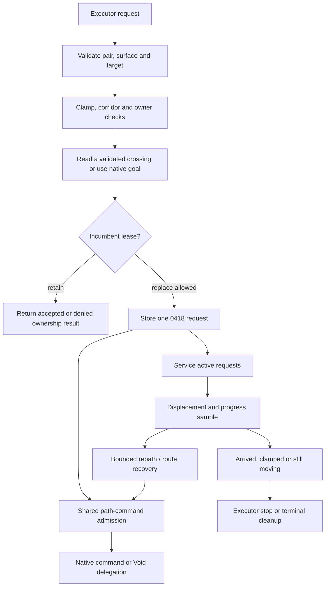
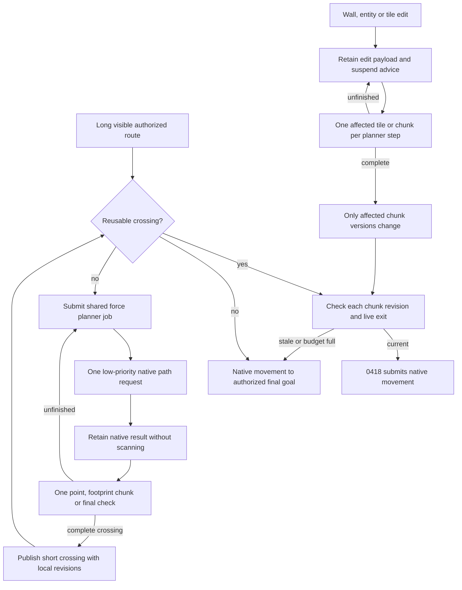
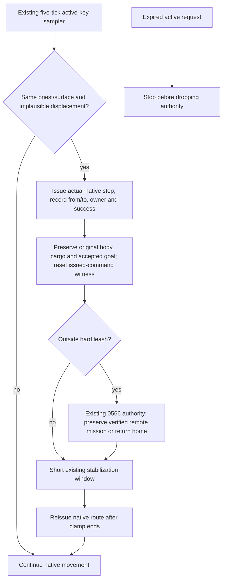

# Ground Movement Controller 0418 / 0419

**Reviewed:** 2026-11-26. This is a source map, not native behavior or performance acceptance.
The number in this filename is retained for existing links; it is not a claim that the old implementation is still active.

Use the [complete source inventory](BEHAVIOR_SOURCE_INVENTORY.md) and its
[content hashes and source sites](BEHAVIOR_SOURCE_INVENTORY.json) for the full module/function/registration index.
Potential reachability, conditional wrappers, and retired source are distinguished there.
Source presence does not prove that a callback installed or ran in Factorio.

## Authority

`movement_controller.lua` owns ground-priest movement intent, leases, native command submission, active-request servicing, samples and recovery enforcement. Other owners request movement; source-preserved 0518, 0566, 0632/0633 and 0650–0654 wrappers are not alternate controllers. Void requests delegate through the explicit backend.

## Gradual traversable crossing learning (1507)

`traversable_crossings_1507.lua` supplies optional advice to the existing
controller. It does not issue movement, enlarge a station's authority, move a
priest's coordinates, take custody, or report arrival. A route still has to pass
0574/0418 authority and native physics. The same owner, reason, priority and final
goal retain the existing waypoint and lease when the priest crosses a start cell.

The shared `force_planning_queue_1507` is the only Lua learning/invalidation
executor. It offers one deterministic operation per visit, within its global
16-operation broker pulse. Native `request_path` results return asynchronously;
the event callback keeps the result and handle without copying or walking the
waypoint list. Processing splits long edges into at most one tile per point and
charges footprint-chunk checks and publication validation separately. Rejected
points and no-action waits consume their visit. No elapsed-time value controls
gameplay.

The cache stores crossings of approximately 12 tiles, with at most nine chunk
dependencies. Keys include surface, force, collision prototype, two-tile start
cell and quarter-tile final goal. Reuse requires a nearby start, a waypoint within
the existing 18-tile segment limit, matching chunk generations, current authority,
and a live native placement check. All reuse checks share limits of 64 individual
chunk checks and eight live exit checks per tick. Exhaustion falls back to native
movement immediately. At most eight native learning requests are outstanding;
at most one starts per tick. A 2,048-entry ring bounds persistent cache growth.

Each entity edit stores its affected bounding box; large tile payloads are
retained and consumed one tile at a time. During that unresolved payload, cached
advice on the affected surface is temporarily suspended without deleting its
records. Once edit locations are known, unrelated crossings remain reusable.
Collision footprints that overlap a neighboring chunk depend on that chunk too.
The path request's edit serial rejects native answers which became stale while
pending. A cleared/deleted surface changes only its surface generation. A mod
configuration change retires cached prototype profiles because their collision
geometry may have changed.

Normal player/robot build, mine, death, clone, rotation, script-raised entity/tile,
chunk-delete and surface-reset events enter the canonical runtime event registry.
Other mods may deliberately edit geometry without raising events; moving entities
also change occupancy without a construction event. Native movement remains the
final safety check in those cases: crossing-managed commands disable native path
cache reuse and disallow destructive/own-entity paths. Crossing-managed recovery
can only reissue the authorized native goal. 1510 retires coordinate-teleport
recovery for all ordinary ground priests, not just learned routes or physical
couriers. Native results marked `needs_destroy_to_reach` are rejected.

Continuation state consists of saved tables, primitive cursors, native request
IDs and serializable engine entity references. Handler functions and event
bindings are reinstalled from module code. There are no saved coroutines, closures,
profilers, or background Lua threads.

## Concrete cadence and request contract

| Setting or service | Current source value | Meaning |
| --- | --- | --- |
| `movement_controller_service_0611` | 10 ticks, priority 42, budget 24 | Resumes saved active-key cursor; charged valid, invalid and expired visits. Expiry issues an actual native stop. |
| `movement_controller_sample_0611` | 5 ticks, priority 80, budget 32 | Independent saved active-key cursor; large discontinuities physically stop, retain the work lease and invoke existing overleash authority when needed. |
| `movement_controller_enforcement_0566` | 89 ticks, priority 70, budget 24 | Integrated stale-request / envelope / overleash enforcement. |
| `command_refresh_ticks` | 45, retained constant | Does not impose periodic repathing on an advancing unit; active submission uses initial-command or stalled-progress checks. |
| `retarget_hold_ticks` | 90 | Retarget suppression boundary. |
| `default_request_ttl` | 600 | Default request lifetime. |
| `long_action_lease_ticks` | 480 | Lease for qualifying long physical tasks. |
| `stall_repath_ticks` | 240 | Stalled progress repath threshold. |

These are nominal ticks and offered work counts, not measured execution durations. Service budgets do not reduce the simulation tick rate. An accepted request may retain an existing owner for the same destination; callers that require their own lease must verify the returned live owner.

## 1510 sandbox displacement recovery

Owner sandbox 1.0.4 reported 14,736 large displacement detections across ten
original priests, including 133.70 tiles within five ticks. These are position
samples, not a verified continuous velocity. The prior sampler deleted the
active lease without issuing the stop it logged. Ground recovery also projected
a displaced worker onto an old route and teleported it there, resetting the
sample to hide that discontinuity. Both paths are retired. Native train travel
of the original Magos is not treated as a walking-speed violation. Every
violation is counted; per-priest detail logs are limited to one per 600 ticks.
The fix leaves prototype speed and native physics, force planning and the
existing broker cadence intact. External/native displacement causality must
still be reproduced; do not infer it from a successful synthetic jump test.

## Native ground speed and appearance

The ground priest constructor now uses the native Engineer's `running_speed`
as its unit `movement_speed`, with the existing 20% belt-immune tier bonus.
With the default Engineer this is 0.15 and 0.18 tiles per tick, replacing the
old deliberate 0.080/0.095 crawl. The original rail-capable Magos uses the same
baseline. Native unit commands still execute every engine tick; this repair
does not change movement leases, service cadence or arrival accounting. Void
attendants retain their separate movement backend and prototype override.

The presentation exporter preserves each priest's native running and attack
animation clocks while hiding only pixels. `character_visuals` applies the
custom animation's speed once, including correction of old saved render
objects. Appearance changes do not write entity movement speed. The
[player appearance route](BEHAVIOR_MERMAID_MAP_0660.md#character-appearance-and-native-player-ownership)
is separate from these explicitly requested ground-unit speed changes.

## State and exit

- Pair intent is `movement_request_0418`; controller state uses `storage.tech_priests.movement_controller_0419` and active request IDs.
- Clamps prevent movement during physical work, conversation and stabilization where applicable.
- Ground corridor planning proposes legal routes; the controller owns command submission and request mutation.
- Cargo, relocation, rail and station-resupply exclusions protect original physical owners during recovery.
- Crossing-managed routes use native repathing only, including while learning is pending, the queue is full, or geometry changes. Learning installation failure leaves the normal movement services installed.
- Arrival is a movement observation. The physical executor independently verifies reach, target validity and inventory/accounting before work or completion.

## Debugging route

Inspect the current executor, expected destination, current movement owner, clamp, lease, last command and progress samples before changing cadence. A stale target is an ownership defect; a frequent native command is a submission-cost defect. Correct the specific boundary.

## Audited exported entry points

These names are taken from the current source; local helpers and call sites are in the full inventory. A callable helper is not an independently scheduled service.

| Module | Exported functions |
| --- | --- |
| [movement_controller](../tech-priests_src/scripts/core/movement_controller.lua) | `M.work_radius`, `M.hard_leash`, `M.position_allowed`, `M.request`, `M.request_status`, `M.combat_intent`, `M.stop`, `M.enforce_pair`, `M.enforcement_service`, `M.service`, `M.sample`, `M.route_command`, `M.patch_globals`, `M.commands`, `M.report_lines`, `M.cleanup_retired_pair_state`, `M.install` |
| [authority_corridor_pathing_0574](../tech-priests_src/scripts/core/authority_corridor_pathing_0574.lua) | `M.root`, `M.authorization_for_destination`, `M.position_allowed`, `M.maybe_corridor_waypoint`, `M.plan_request`, `M.install` |
| [traversable_crossings_1507](../tech-priests_src/scripts/core/traversable_crossings_1507.lua) | `M.root`, `M.on_entity_changed`, `M.on_tiles_changed`, `M.on_chunks_deleted`, `M.on_surface_reset`, `M.on_configuration_changed`, `M.on_path_finished`, `M.validate`, `M.select`, `M.install` |
| [void_movement_authority_0630](../tech-priests_src/scripts/core/void_movement_authority_0630.lua) | `M.is_void_pair`, `M.request`, `M.stop`, `M.status`, `M.service`, `M.report_lines`, `M.install` |

## Update and evidence rule

`tests/unit/traversable_crossings_1507.lua` exercises the real 0418 callers and
shared planner with native API doubles: pending/full queues; unchanged original
priest/owner; same-goal continuity; save-like serialization and complete module
reload during both the async wait and point processing; another force's no-action
fairness; unrelated same-surface route reuse; live/profile/terrain changes;
pending native result invalidation; destructive path rejection; chunk-boundary
footprints; and a 1,024-tile edit resumed after reload. The existing movement
waypoint recovery fixture also passes. These are executable Lua contracts;
native Factorio save/reload, displayed FPS, UPS and headed active-population
acceptance remain separate integration evidence.

API contracts checked against the official Factorio 2.1.25 documentation:
[native asynchronous paths](https://lua-api.factorio.com/latest/classes/LuaSurface.html#request_path),
[native path completion](https://lua-api.factorio.com/latest/events.html#on_script_path_request_finished),
[waypoint destruction flags](https://lua-api.factorio.com/latest/concepts/PathfinderWaypoint.html),
[path flags](https://lua-api.factorio.com/latest/concepts/PathfinderFlags.html), and
[saved data](https://lua-api.factorio.com/latest/auxiliary/storage.html).

Change the relevant diagram and ownership/exit description with the source change. Regenerate the source inventory with `python tools/audit_ups_hotspots_0743.py --write-behavior-maps`, explicitly acknowledge the reviewed curated maps with `--acknowledge-behavior-map-review`, then run `--check-behavior-maps` through the same tool. Generation alone does not bless a changed manual diagram. Follow the [performance validation protocol](UPS_VALIDATION_RUNBOOK_0742.md) for exact source, save, engine version, population, profiling settings, sample window and artifacts. A clean map check proves freshness only.
