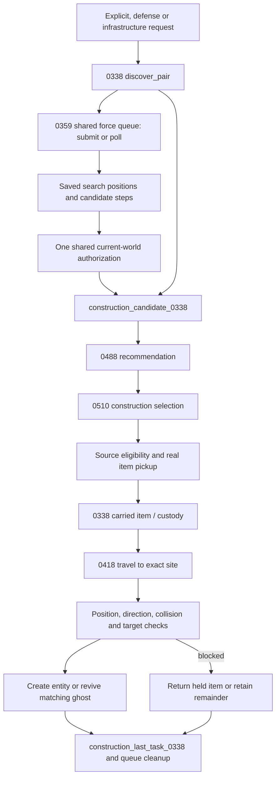

# Construction Discovery, Physical Builder and Native Robot Handoff

**Reviewed:** 2026-11-26. This is a source map, not native behavior or performance acceptance.
The number in this filename is retained for existing links; it is not a claim that the old implementation is still active.

Use the [complete source inventory](BEHAVIOR_SOURCE_INVENTORY.md) and its
[content hashes and source sites](BEHAVIOR_SOURCE_INVENTORY.json) for the full module/function/registration index.
Potential reachability, conditional wrappers, and retired source are distinguished there.
Source presence does not prove that a callback installed or ran in Factorio.

## Current ownership

`construction_site_planner` scores/proposes sites. `construction_planner` owns physical priest construction through 0510. The retired 0656 placement wrapper is not a live executor. The native robot path is an explicit separate engine handoff whose real build event is observed.

## Discovery is not construction

| Route | Current contract |
| --- | --- |
| `construction_discovery_0338` | Broker category `construction`, interval 233, priority 58, nominal budget 6; discovery-only. |
| `discover_pair` | Submits/polls the shared placement job; pending/full does not fail, cool down, reserve or claim items. A completed ticket requires shared live authorization before custody. |
| `plan_fixed_admission` | Fixed positions and the exact owned 0645 ghost receive a saved admission ticket. The physical caller spends the same `placement-live` token before reservation or material custody. |
| `recommend_action` | Exposes candidate or already active custody to classifier. |
| `service_pair` | Selected physical builder; movement, source removal, carried item, exact placement and result. |
| `abort_pair` | Returns or retains physical custody and releases owned claims/routes. |
| `service_robot_network_pair_0338` | Existing native robot prerequisites and original ranked-station build handoff. |
| `observe_native_robot_build_0338` | Reads actual native build receipt; does not substitute a synthetic event. |

## Native robot branch

```mermaid
flowchart TD
    Request["Original eligible robot build request"] --> Preflight["Native network, coverage and real materials"]
    Preflight --> Ghost["Accepted physical ghost"]
    Ghost --> Engine["Factorio construction robot job"]
    Engine --> Built["Real on_robot_built_entity"]
    Built --> Registry["Canonical event registry"]
    Registry --> Receipt["0338 receipt reconciles original request"]
    Preflight -->|"unavailable"| Wait["Retain request / report blocker"]
```

## Defense and frustration are separate

Urgent defensive construction is reached through the defense/perimeter owner and canonical dispatcher. Independent emergency factory expansion is admitted by `self_construction_frustration_gate` in its existing planner/entry routes. Do not attach that timer to every construction candidate: a wall or defensive turret must not wait for factory logistics frustration.

## Custody and failure conditions

Revalidate the original item, source and exact site after travel. Site obstruction, foreign custody, train/rail ownership, wide collision boxes and original ghost identity are explicit execution concerns. Successful placement is recorded before terminal handoff; a failed return must not discard carried stock. Command acceptance alone is not placement.

Ordinary search preserves its original spiral order while inspecting at most
15 shared search positions per tick. Both 0338 and 0645 consume the same single
live recheck allowance; neither caller advances scanning. Failed checks consume
the allowance. Mining and defense retain cell, entity, anchor, neighboring
station and scoring cursors; native queries use capped cells no larger than
8×8 tiles with dense subdivision. Changed ore, station authority, request
contents, recipe enablement or physical obstruction invalidates admission.
Existing carried construction retains its physical executor and does not
repeat the full planning search. See [the placement continuation map](PLACEMENT_CONTINUATION_1507.md)
for the detailed work accounting and actual-caller tests.

An owned planning ghost is only a proposal for physical construction. Its
identity, position, direction, force and station record must still match at
admission. Native `ghost_revive` collision/terrain validation exempts only that
exact ghost; a second ghost still blocks the footprint. Ticketless, unstarted
candidates restored from older saves acquire fresh admission before becoming
tasks. Already admitted tasks and carried material retain their executor.

The separate 0259 perimeter planner also submits saved discovery, stock,
territory and support work to the force queue. Its incumbent wall, turret,
ammunition and support execution continues through the existing dispatcher.
See [the defense continuation map](BEHAVIOR_MERMAID_DEFENSE_PLANNING_1507.md).

The work cap is deterministic and does not guarantee a millisecond ceiling.
Physical source eligibility and inventory/custody helpers retain their separate
costs; native whole-frame measurement is required.

## Audited exported entry points

These names are taken from the current source; local helpers and call sites are in the full inventory. A callable helper is not an independently scheduled service.

| Module | Exported functions |
| --- | --- |
| [construction_planner](../tech-priests_src/scripts/core/construction_planner.lua) | `M.root`, `M.yield_unfunded_frontier_candidate_0338`, `M.discover_pair`, `M.observe_native_robot_build_0338`, `M.service_robot_network_pair_0338`, `M.recommend_action`, `M.configure_built_factory_recipe_1150`, `M.abort_pair`, `M.service_pair`, `M.service_all`, `M.describe_pair`, `M.install` |
| [construction_site_planner](../tech-priests_src/scripts/core/construction_site_planner.lua) | `Planner.is_pending`, `Planner.authorize`, `Planner.plan_fixed_output`, `Planner.plan_fixed_admission`, `Planner.territory_epoch`, `Planner.territory_radius`, `Planner.live_admitted_defense_site`, `Planner.install`, `Planner.evaluate_defense_candidate`, `Planner.plan_defense_site`, `Planner.plan_spiral`, `Planner.plan_site`, `Planner.placement_effectiveness_report`, `Planner.debug_sequence` |
| [construction_bootstrap_ghost_planner_0645](../tech-priests_src/scripts/core/construction_bootstrap_ghost_planner_0645.lua) | `M.physical_site_obstruction`, `M.service_pair`, `M.service_all`, `M.install` |

## Update and evidence rule

Change the relevant diagram and ownership/exit description with the source change. Regenerate the source inventory with `python tools/audit_ups_hotspots_0743.py --write-behavior-maps`, explicitly acknowledge the reviewed curated maps with `--acknowledge-behavior-map-review`, then run `--check-behavior-maps` through the same tool. Generation alone does not bless a changed manual diagram. Follow the [performance validation protocol](UPS_VALIDATION_RUNBOOK_0742.md) for exact source, save, engine version, population, profiling settings, sample window and artifacts. A clean map check proves freshness only.
