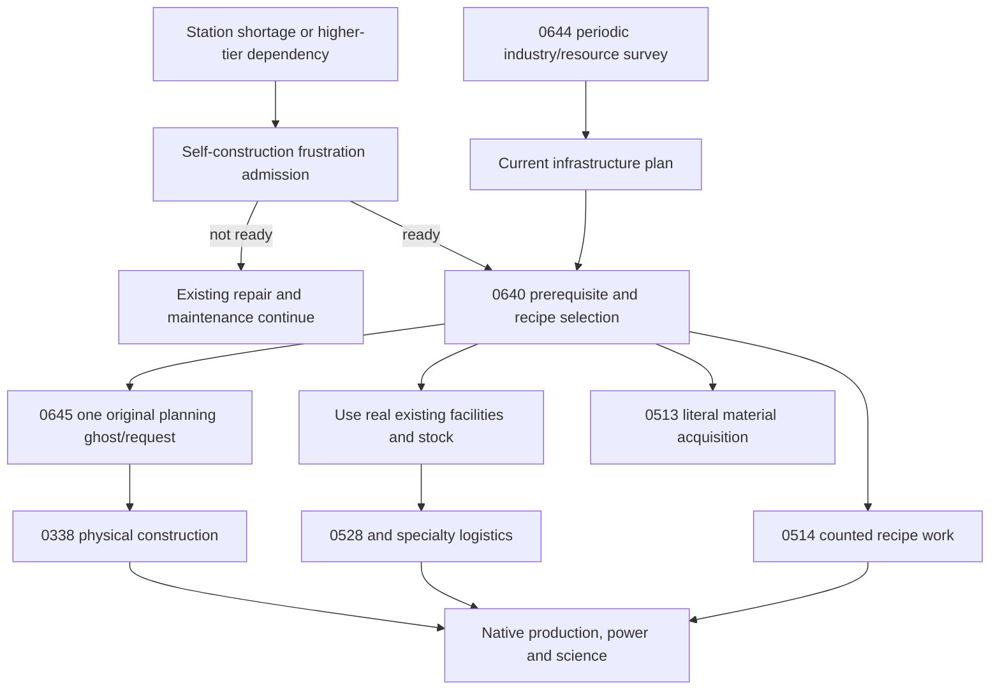

# Infrastructure, Frustration Admission and Physical Handoffs

**Reviewed:** 2026-11-25. This is a source map, not native behavior or performance acceptance.
The number in this filename is retained for existing links; it is not a claim that the old implementation is still active.

Use the [complete source inventory](BEHAVIOR_SOURCE_INVENTORY.md) and its
[content hashes and source sites](BEHAVIOR_SOURCE_INVENTORY.json) for the full module/function/registration index.
Potential reachability, conditional wrappers, and retired source are distinguished there.
Source presence does not prove that a callback installed or ran in Factorio.

## Current planners

The actual source names are `infrastructure_first_governor_0640`, `master_infrastructure_plan_0644` and `construction_bootstrap_ghost_planner_0645`. They feed existing recipe, construction, resource and machine owners; they are not separate physical factories.

This is the dependency relationship, not an assertion that each selected factory/science scenario succeeds. Survey, request admission, physical construction, resource feed, machine output and consumed science need distinct observations.

## Scheduling and current work bounds

| Owner | Registered cadence / offered budget | Boundary |
| --- | --- | --- |
| `infrastructure_first_governor_0640` | 23 ticks / 10 | Callback passes the offered budget. `service_all` counts every inspected slot and resumes saved `service_cursor`; fallback defaults to the existing cap of 32. |
| `master_infrastructure_plan_0644` | 97 ticks / 8, category `diagnostics` | Despite the category, source includes research/science servicing. Do not infer presentation-only behavior from the label. |
| `construction_bootstrap_ghost_planner_0645` | 83 ticks / 6 | Existing rotating discovery work; planning-ghost/request generation is distinct from paid construction. |

Each installer prefers the broker and retains a registry fallback when broker registration fails. An inventory entry for both paths does not mean both were installed. The 0644 survey itself is not behind the frustration gate. 0640 gates new autonomous industry; 0645 reconciles already owned sites first and applies the gate before creating a new autonomous ghost.

## Expanded infrastructure families

| Family | Existing decision / handoff |
| --- | --- |
| Primitive mining and smelting | Prefer available normal mining drill items where appropriate; emergency variants remain fallbacks under source policy. |
| Electrical setup | `power_setup_1252` and native electric inspection prepare actual pole/generator requirements; 0338 handles placement. |
| Water, steam and fuel | 0689/0691 inspect and request pipes; 0705/0707 inspect/service fuel; explicit 1259 control installation prevents unloaded owners. |
| Belt/inserter automation | Master plan proposes transfers between verified source and consumer; native entities perform their actual production. |
| Science | Plan/report plus real laboratory feed/research pathways; producing a candidate is not sustained science acceptance. |
| Ranked station / roboport expansion | 0256, starvation continuations and 1076 frontier requests keep original builders and real stock. |
| Remote resource shortage | 0820 chain, 0835 railway observation and 0836 frontier requests; incumbent physical work keeps ownership. |
| Physical return | 0837 counted courier custody and native rail return; reserve future work without cancelling incumbent cargo. |

## Performance findings and evidence

The previous 0640 callback advertised budget 10 but discarded it, stopped after 32 **acted** pairs, and restarted `pairs(pair_map())` at the beginning. That allowed full-population visits when work returned false and risked prefix starvation. The repaired existing owner now accepts `offered_budget`, counts every inspected slot including invalid/no-op pairs, and resumes a scalar saved `service_cursor` with `next`. A removed cursor safely restarts traversal. It preserves the historical acted-count first return and adds a structured result for the broker. The 23-tick cadence is unchanged. This is a work-count correction; native timing and workload-progress acceptance remain separate.

The current 0644 source also avoids repeating a full `force.recipes` search after a fresh 0646 scan has already selected a usable recipe. `planning_constraints_0646.item_unlocked` returns that recipe as an optional third result only when this call performs the scan; its existing one-tick Boolean cache remains unchanged and returns no recipe. 0644 rechecks live enabled/product state and performs the live fallback search when no usable recipe result is supplied. That preserves same-tick recipe-choice changes on cached Boolean paths. Each synchronous `build_plan` shares a call-local item-count snapshot across feasibility and science checks. The snapshot is discarded after that call, so another plan in the same tick reads current stock again. These are source cost reductions, not a measured UPS result.

Separate remaining risks include station catalog synchronous queries and the 0689/0716 prefix-only discovery loops. A callback limit does not bound its nested native scans or guarantee fairness. Keep those open until their own source and native evidence are recorded.

## Audited exported entry points

These names are taken from the current source; local helpers and call sites are in the full inventory. A callable helper is not an independently scheduled service.

| Module | Exported functions |
| --- | --- |
| [infrastructure_first_governor_0640](../tech-priests_src/scripts/core/infrastructure_first_governor_0640.lua) | `M.cooperative_labor_for_pair`, `M.cooperative_workshop_for_pair`, `M.yield_uncommitted_recipe_to_reversal_0938`, `M.request_installed_lab_power_pole_1251`, `M.service_pair`, `M.service_all`, `M.report_lines`, `M.status_for_pair`, `M.install` |
| [master_infrastructure_plan_0644](../tech-priests_src/scripts/core/master_infrastructure_plan_0644.lua) | `M.build_plan`, `M.service_pair`, `M.service_all`, `M.install` |
| [construction_bootstrap_ghost_planner_0645](../tech-priests_src/scripts/core/construction_bootstrap_ghost_planner_0645.lua) | `M.physical_site_obstruction`, `M.service_pair`, `M.service_all`, `M.install` |
| [power_setup_1252](../tech-priests_src/scripts/core/power_setup_1252.lua) | `M.service_pair` |
| [self_construction_frustration_gate](../tech-priests_src/scripts/core/self_construction_frustration_gate.lua) | `M.ready` |

## Update and evidence rule

Change the relevant diagram and ownership/exit description with the source change. Regenerate the source inventory with `python tools/audit_ups_hotspots_0743.py --write-behavior-maps`, explicitly acknowledge the reviewed curated maps with `--acknowledge-behavior-map-review`, then run `--check-behavior-maps` through the same tool. Generation alone does not bless a changed manual diagram. Follow the [performance validation protocol](UPS_VALIDATION_RUNBOOK_0742.md) for exact source, save, engine version, population, profiling settings, sample window and artifacts. A clean map check proves freshness only.
