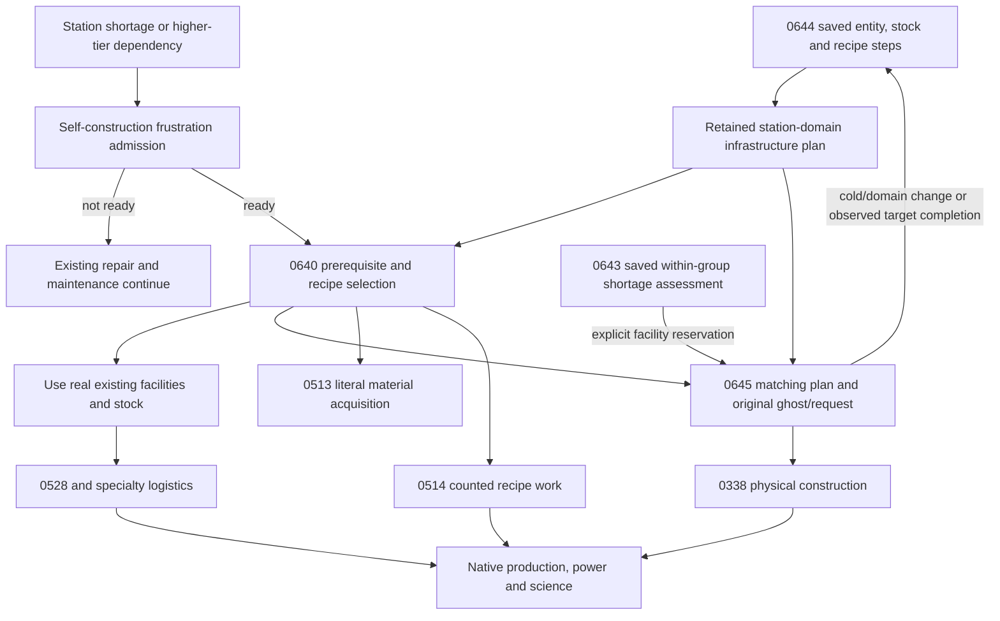
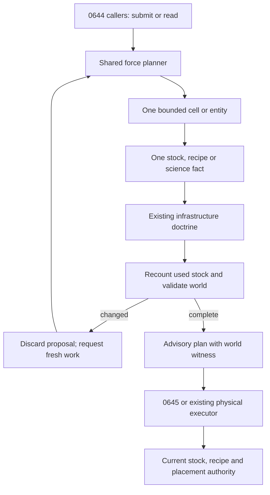
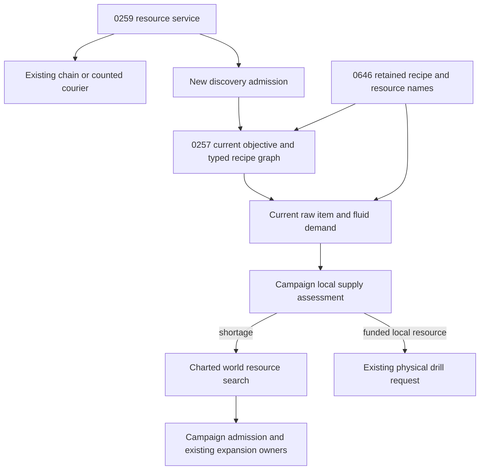

# Infrastructure, Frustration Admission and Physical Handoffs

**Reviewed:** 2026-11-26. This is a source map, not native behavior or performance acceptance.
The number in this filename is retained for existing links; it is not a claim that the old implementation is still active.

Use the [complete source inventory](BEHAVIOR_SOURCE_INVENTORY.md) and its
[content hashes and source sites](BEHAVIOR_SOURCE_INVENTORY.json) for the full module/function/registration index.
Potential reachability, conditional wrappers, and retired source are distinguished there.
Source presence does not prove that a callback installed or ran in Factorio.

## Current planners

The actual source names are `infrastructure_first_governor_0640`, `emergency_facility_placement_bridge_0643`, `master_infrastructure_plan_0644` and `construction_bootstrap_ghost_planner_0645`. They feed existing recipe, construction, resource and machine owners; they are not separate physical factories.

This is the dependency relationship, not an assertion that each selected factory/science scenario succeeds. Survey, request admission, physical construction, resource feed, machine output and consumed science need distinct observations.

## Scheduling and current work bounds

| Owner | Admission / execution | Actual work boundary |
| --- | --- | --- |
| `force_planning_queue_1507` | One broker service; nominal five-tick cadence, priority 58 | At most 16 charged handler visits per admitted pulse. Forces and jobs rotate, including no-action work. Repeated same-tick calls do not advance again. |
| `infrastructure_first_governor_0640` | Existing 23 ticks / 10 | Every inspected pair consumes budget; active executors retain their original authority. Its remaining recipe/dependency helpers are separately audited. |
| `emergency_facility_placement_bridge_0643` | 113-tick admission callback | Admission does no group survey. Saved roster, station, entity, provider, recipe and material cursors execute through the shared queue. Healthy completed groups defer deep reconsideration for 1,800 ticks; relevant events wake them. |
| `master_infrastructure_plan_0644` | 97-tick admission callback | Admission does no station survey. `build_plan`, `service_pair` and `service_all` enqueue/poll; one saved roster entry, world candidate, inventory, ingredient, technology or validation cell is charged per visit. No synchronous registry fallback remains. |
| `construction_bootstrap_ghost_planner_0645` | Existing 83-tick caller cadence | Ordinary, mining, defense and fixed-output searches submit to 0359's shared jobs. A pending/full queue is not a no-site failure. |

The queue holds at most 64 ordinary jobs per force and 256 globally. Shared
item/recipe builders alone have bounded reserved dependency capacity, so a full
queue cannot deadlock after a configuration reset. They consume the same
16-work budget and release their slots when complete. Results expire through
charged incremental cleanup. No time measurement affects simulation choices.
Movement, repairs, active construction and custody remain with their current
executors and are not paused behind a pending plan.

### 0644 cycle continuation

The roster uses a saved table key instead of gathering or sorting the whole
station population. Deleted keys, invalid pairs, failures and no-action visits
consume work and allow other stations to progress. A failed station admission
does not terminate the roster. The public APIs never run the worker directly.
Jobs retain ordinary saved tables, entity identities and scalar cursors; module
handlers are re-registered after load. No coroutine or profiler is serialized.

`bounded_planning_area_1507` walks existing indexed cell identities one at a
time. Cold areas use capped 16-result queries and deterministic subdivision;
returned and rejected candidates are charged separately. Final cell validation
is also sliced. Fixed region counters detect later entity edits in constant
bounded work, including an edit after scanning but before publication or
consumption. Station/domain and metadata-epoch changes reject the proposal.

0644 preserves its infrastructure doctrine, first enabled matching recipe,
stocked standard-miner priority, emergency workshop/lab progression and cheapest
physically supported science selection. Quantities are rolling observations;
used stock is recounted before final selection and the chosen science packs and
prerequisites are checked again. These observations grant no material custody
or reservation. Native research and physical construction retain final action
authority. Inventories can change after any observation, so this is not an
atomic factory snapshot.

0645 reuses a retained plan only while its domain and new world/metadata witness
remain valid. Cold, changed or completed domains request the canonical owner.
Explicit requested-entity work keeps its own authority. A pending refresh does
not authorize the old proposal or prevent incumbent physical work.

### 0644 drill-output receiver lookup

Every drill and receiver bucket candidate is a separate saved step. Native
`drop_target` is checked first, then the drop cell and its eight neighbors using
the original strict distance below one. Selection retains the closest legal
output and a deferred blocked output. Current interior and engine placement
checks precede proposal. Fixed-output ghost placement uses the same shared live
admission token as other 0359 work; the later physical builder rechecks its
actual site and item.

Both legal and deferred output proposals retain the selected native drill,
its position and its exact drop coordinate. Resumed work, final publication
and retained-plan consumption revalidate that witness. A rotated/moved drill
or a newly connected native `drop_target` invalidates the old receiver proposal;
player rotation also invalidates the relevant area epoch. The actual
0644-to-0645 regression covers rotation while scanning, immediately before
publication and after fixed placement is ready, including saved-state reload.

The earlier private [receiver-helper run 45699182910](https://github.com/mrcalzon02/Dens-Mortis/actions/runs/45699182910)
compared a synchronous helper at an older revision on 4,320 entities. Its
three-call sample means were 1,783.738 ms and 71.742 ms. That historical result
is neither a measurement of this continuation nor game FPS/UPS evidence.

## Expanded infrastructure families

| Family | Existing decision / handoff |
| --- | --- |
| Primitive mining and smelting | Prefer available normal mining drill items where appropriate; emergency variants remain fallbacks under source policy. |
| Electrical setup | `power_setup_1252` and native electric inspection prepare actual pole/generator requirements; 0338 handles placement. |
| Water, steam and fuel | 0689/0691 inspect and request pipes; 0705/0707 inspect/service fuel; explicit 1259 control installation prevents unloaded owners. |
| Belt/inserter automation | Master plan proposes transfers between verified source and consumer; native entities perform their actual production. |
| Science | Plan/report plus real laboratory feed/research pathways; producing a candidate is not sustained science acceptance. |
| Ranked station / roboport expansion | 0256, starvation continuations and 1076 frontier requests keep original builders and real stock. |
| Remote resource shortage | 0820 chain, 0835 railway observation and 0836 frontier requests; incumbent physical work keeps ownership. |
| Physical return | 0837 counted courier custody and native rail return; reserve future work without cancelling incumbent cargo. |

## Performance findings and evidence

### Magos ratio and resource planning

`resource_expansion.tech_priests_0259_resource_expansion_service` first services
an incumbent 0820 chain, the 1011 drill builder and the 0837 counted courier.
Only new discovery passes through the existing 1200-tick gate (300 ticks once
a strategic campaign exists). An explicit 1076 robot frontier also keeps its
existing admission priority. The change does not move these duties behind a
new discovery delay.

| Caller | Retained membership | Values still read when deciding |
| --- | --- | --- |
| `0257_pick_recipe_for_item` | Existing `0646.recipe_names_for_item(..., true)`; includes disabled recipes and coproducts. Native force queries no longer enumerate every recipe for each graph node. | Force recipe enablement, typed positive yield, hidden status, ingredients, category score and deterministic name tie. Compatibility providers without a valid native force retain their prototype-only fallback. |
| `0257_is_raw_item` and `1191_is_raw_fluid` | `0646.resource_names_for_product`; one immutable resource-product index shared with 0259. The prior untyped raw-item and typed-fluid policies are preserved. | Current requested name and kind; water retains its offshore-pump requirement. |
| `0259.resource_prototypes_for_product` | The same read-only resource names in native prototype order. The crude-oil compatibility alias uses its own result instead of mutating the shared empty array. | World resource existence, amount, chart coverage, local supply and mission admission remain separate. |
| `0259.nearest_known_resource` | No retained world-search answer is introduced. | Operating radius is read once per call; its square is reused for each candidate. Existing expanding areas, result limits, chart checks and selection order remain. |

The indexes contain definition membership, not stock or a cached production
answer. A failed resource metadata read does not certify a permanent negative
entry. Reload rebuilds local metadata without writing cache-warmth counters to
simulation storage. No inventory discovery, TTL or additional scheduler is
introduced here.

`magos_retained_planning_membership.lua` exercises the actual ratio graph and
resource-expansion service with 1,000 unrelated recipes and entity definitions.
One hundred repeated graph requests and twenty discovery passes retain one
force recipe walk and one resource definition walk, with live disable/enable,
ingredient, typed yield, hidden/locked selection, active-chain and courier
checks. The previous ratio implementation fails the repeated-walk assertion.
`tests/scenarios/magos-retained-planning/control.lua` also passes on native
Factorio 2.1.25 at create and save reload, checking the actual science material
graph, 100 repeated requests and same-tick recipe changes. Those fixtures verify
behavior and metadata reuse; the owner-save timing gate remains separate.

The previous 0640 callback advertised budget 10 but discarded it, stopped after 32 **acted** pairs, and restarted `pairs(pair_map())` at the beginning. That allowed full-population visits when work returned false and risked prefix starvation. The repaired existing owner now accepts `offered_budget`, counts every inspected slot including invalid/no-op pairs, and resumes a scalar saved `service_cursor` with `next`. A removed cursor safely restarts traversal. It preserves the historical acted-count first return and adds a structured result for the broker. The 23-tick cadence is unchanged. This is a work-count correction; native timing and workload-progress acceptance remain separate.

The current 0646 owner retains product-to-recipe-name membership in original force recipe traversal order, including disabled recipes. `recipe_names_for_item(force,item,true)` provides products-only candidates for 0644; the default lookup preserves the older main-product fallback where the provider supports it. Enabled flags and ingredient quantities remain live, and `item_unlocked` returns its freshly selected recipe as an optional third result. The previous one-tick Boolean unlock-answer cache is removed. 0644 checks these ordered candidates and preserves the first enabled matching recipe's feasibility result rather than selecting a later alternate merely because its ingredients are available. The initial metadata traversal remains real work and must be included in native measurements.

The shared `planning_metadata_1507` owner builds item and ordered recipe
memberships one prototype/product row at a time. Completed indices are reused;
enablement and ingredient requirements remain live. Configuration changes
invalidate the saved index epoch, and reserved dependency capacity permits
rebuilding while ordinary queues are full.

0643 uses the same force planner and the bounded area helper. Its group report
is private until complete. Providers retain current reach, force, surface,
network and typed-inventory policy, with one inventory-slot read per work step.
A final per-need stock pass notices supplies arriving during assessment. Current
local shortage, material and recipe witnesses precede canonical 0645 admission;
partial totals never publish reservations. See the detailed
[shortage continuation map](SHORTAGE_PLANNING_CONTINUATION_1507.md).

Separate remaining risks include complete cold inventory-membership seeds, live mobile-list traversal, explicit synchronous catalog scans, physical infrastructure surveys and the 0689/0716 prefix-only discovery loops. The [scheduled catalog continuation](BEHAVIOR_MERMAID_FUNCTION_DRILLDOWN_0661.md#scheduled-resource-continuation) has its own shared work allowance and delivery-latency evidence; it does not bound those separate paths. A callback limit does not bound nested native work or guarantee fairness. Keep native cost acceptance open until source and workload-progress evidence are recorded.

## Audited exported entry points

These names are taken from the current source; local helpers and call sites are in the full inventory. A callable helper is not an independently scheduled service.

| Module | Exported functions |
| --- | --- |
| [infrastructure_first_governor_0640](../tech-priests_src/scripts/core/infrastructure_first_governor_0640.lua) | `M.cooperative_labor_for_pair`, `M.cooperative_workshop_for_pair`, `M.yield_uncommitted_recipe_to_reversal_0938`, `M.request_installed_lab_power_pole_1251`, `M.service_pair`, `M.service_all`, `M.report_lines`, `M.status_for_pair`, `M.install` |
| [emergency_facility_placement_bridge_0643](../tech-priests_src/scripts/core/emergency_facility_placement_bridge_0643.lua) | `M.assess`, `M.install` |
| [master_infrastructure_plan_0644](../tech-priests_src/scripts/core/master_infrastructure_plan_0644.lua) | `M.build_plan`, `M.plan_current`, `M.service_pair`, `M.service_all`, `M.install` |
| [construction_bootstrap_ghost_planner_0645](../tech-priests_src/scripts/core/construction_bootstrap_ghost_planner_0645.lua) | `M.physical_site_obstruction`, `M.service_pair`, `M.service_all`, `M.install` |
| [power_setup_1252](../tech-priests_src/scripts/core/power_setup_1252.lua) | `M.service_pair` |
| [self_construction_frustration_gate](../tech-priests_src/scripts/core/self_construction_frustration_gate.lua) | `M.ready` |

## Update and evidence rule

Change the relevant diagram and ownership/exit description with the source change. Regenerate the source inventory with `python tools/audit_ups_hotspots_0743.py --write-behavior-maps`, explicitly acknowledge the reviewed curated maps with `--acknowledge-behavior-map-review`, then run `--check-behavior-maps` through the same tool. Generation alone does not bless a changed manual diagram. Follow the [performance validation protocol](UPS_VALIDATION_RUNBOOK_0742.md) for exact source, save, engine version, population, profiling settings, sample window and artifacts. A clean map check proves freshness only.
