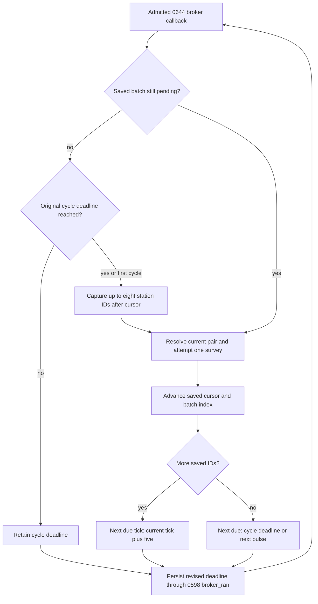

# Infrastructure, Frustration Admission and Physical Handoffs

**Reviewed:** 2026-11-25. This is a source map, not native behavior or performance acceptance.
The number in this filename is retained for existing links; it is not a claim that the old implementation is still active.

Use the [complete source inventory](BEHAVIOR_SOURCE_INVENTORY.md) and its
[content hashes and source sites](BEHAVIOR_SOURCE_INVENTORY.json) for the full module/function/registration index.
Potential reachability, conditional wrappers, and retired source are distinguished there.
Source presence does not prove that a callback installed or ran in Factorio.

## Current planners

The actual source names are `infrastructure_first_governor_0640`, `emergency_facility_placement_bridge_0643`, `master_infrastructure_plan_0644` and `construction_bootstrap_ghost_planner_0645`. They feed existing recipe, construction, resource and machine owners; they are not separate physical factories.

This is the dependency relationship, not an assertion that each selected factory/science scenario succeeds. Survey, request admission, physical construction, resource feed, machine output and consumed science need distinct observations.

## Scheduling and current work bounds

| Owner | Registered cadence / offered budget | Boundary |
| --- | --- | --- |
| `infrastructure_first_governor_0640` | 23 ticks / 10 | Callback passes the offered budget. `service_all` counts every inspected slot and resumes saved `service_cursor`; fallback defaults to the existing cap of 32. |
| `emergency_facility_placement_bridge_0643` | 113 ticks / 4, category `diagnostics` | The offered budget is not a group limit: its callback calls `assess()` across all force/surface groups and their stations, then reconciles reservations and construction requests. |
| `master_infrastructure_plan_0644` | 97-tick cycle / 8; continuations on admitted 5-tick broker pulses; category `diagnostics` | One station attempt per callback, preserving up to eight visits per cycle through a saved batch and cursor. 0598 admission can delay continuations. Despite the category, source includes research/science servicing. |
| `construction_bootstrap_ghost_planner_0645` | 83 ticks / 6 | Existing rotating discovery work; planning-ghost/request generation is distinct from paid construction. |

The 0640/0644/0645 installers prefer the broker and retain a registry fallback when broker registration fails. The 0643 installer requires successful broker registration. An inventory entry for both possible paths does not mean both were installed. The 0644 survey itself is not behind the frustration gate. 0640 gates new autonomous industry; 0645 reconciles already owned sites first and applies the gate before creating a new autonomous ghost.

### 0644 cycle continuation

The existing owner stores `broker_cycle.station_ids`, `next_index`, `deadline`, `population` and `next_due_tick`, plus `last_serviced_station_1070`. It sorts the current valid station roster once when capturing a cycle and saves at most the offered eight IDs. Each continuation resolves its ID against the current pair map; removed, invalid or failed pairs still consume one attempt and advance the cursor. The original deadline is set on the cycle's first attempt rather than after its final continuation. With admission available, this preserves up to eight visits per roughly 100 ticks on the five-tick broker grid. The installer restores the saved next deadline, and each continuation updates it through the existing 0598 persistence owner. This is not eight visits every five ticks or one visit every 97 ticks.

Public `service_all(reason, budget)` remains synchronous and keeps its acted/processed/remaining/failed return contract. The conditional registry fallback still calls it every 97 ticks with the existing default cap of 24. The one-attempt continuation applies to the broker route. One station's survey can still be expensive, roster collection/sorting still visits the population, and background admission can delay work; the cycle is not an elapsed-time ceiling.

0645 reads the existing `pair.master_infrastructure_plan_0644` when station identity, surface, force, position, canonical clamped radius, stage and target match. It does not introduce an age-based survey timer. Cold stations, old snapshot schemas and changed domains can initialize through 0644 once. Observing physical completion of the retained proposal's target permits one owner refresh to prevent recreating the completed ghost; an already advanced plan remains reusable. Live storage and custody checks still govern replacement of an active ghost. Explicit requested-entity reservations do not invoke the autonomous master survey. A failed domain/completion refresh cannot authorize the obsolete proposal.

## Expanded infrastructure families

| Family | Existing decision / handoff |
| --- | --- |
| Primitive mining and smelting | Prefer available normal mining drill items where appropriate; emergency variants remain fallbacks under source policy. |
| Electrical setup | `power_setup_1252` and native electric inspection prepare actual pole/generator requirements; 0338 handles placement. |
| Water, steam and fuel | 0689/0691 inspect and request pipes; 0705/0707 inspect/service fuel; explicit 1259 control installation prevents unloaded owners. |
| Belt/inserter automation | Master plan proposes transfers between verified source and consumer; native entities perform their actual production. |
| Science | Plan/report plus real laboratory feed/research pathways; producing a candidate is not sustained science acceptance. |
| Ranked station / roboport expansion | 0256, starvation continuations and 1076 frontier requests keep original builders and real stock. |
| Remote resource shortage | 0820 chain, 0835 railway observation and 0836 frontier requests; incumbent physical work keeps ownership. |
| Physical return | 0837 counted courier custody and native rail return; reserve future work without cancelling incumbent cargo. |

## Performance findings and evidence

The previous 0640 callback advertised budget 10 but discarded it, stopped after 32 **acted** pairs, and restarted `pairs(pair_map())` at the beginning. That allowed full-population visits when work returned false and risked prefix starvation. The repaired existing owner now accepts `offered_budget`, counts every inspected slot including invalid/no-op pairs, and resumes a scalar saved `service_cursor` with `next`. A removed cursor safely restarts traversal. It preserves the historical acted-count first return and adds a structured result for the broker. The 23-tick cadence is unchanged. This is a work-count correction; native timing and workload-progress acceptance remain separate.

The current 0646 owner retains product-to-recipe-name membership in original force recipe traversal order, including disabled recipes. `recipe_names_for_item(force,item,true)` provides products-only candidates for 0644; the default lookup preserves the older main-product fallback where the provider supports it. Enabled flags and ingredient quantities remain live, and `item_unlocked` returns its freshly selected recipe as an optional third result. The previous one-tick Boolean unlock-answer cache is removed. 0644 checks these ordered candidates and preserves the first enabled matching recipe's feasibility result rather than selecting a later alternate merely because its ingredients are available. The initial metadata traversal remains real work and must be included in native measurements.

Each synchronous 0644 `build_plan` shares a call-local item-count snapshot across feasibility and science checks, and science uses laboratories already returned by the role survey. The snapshot is discarded after that call, so another plan in the same tick reads current stock again. 0645 consumes the retained owner plan instead of repeating those surveys on ordinary ghost-planning passes. These are source cost reductions, not a measured UPS result.

The 0643 assessment obtains machine and logistic-provider identities through `0327.inventory_candidates`, backed by the existing 0587 retained membership. It still checks current force, surface, the 36-tile circle and each provider's actual logistic-network identity. One distinct provider list serves the three reserve-item counts in a snapshot; item quantities are read live, and build-material checks remain separate. Its inventory calls use the native bound `get_inventory(id)` form: supplying the entity again previously raised an argument error that was swallowed and reported stocked native inventories as empty. Placeable-item lookup reuses `0646.item_for_entity` with its existing first-match semantics. Missing shared discovery retains a typed compatibility query. Planned-ghost discovery and all-group assessment remain real work; the advertised budget of four does not bound them.

Separate remaining risks include complete cold inventory-membership seeds, live mobile-list traversal, explicit synchronous catalog scans, physical infrastructure surveys and the 0689/0716 prefix-only discovery loops. The [scheduled catalog continuation](BEHAVIOR_MERMAID_FUNCTION_DRILLDOWN_0661.md#scheduled-resource-continuation) has its own shared work allowance and delivery-latency evidence; it does not bound those separate paths. A callback limit does not bound nested native work or guarantee fairness. Keep native cost acceptance open until source and workload-progress evidence are recorded.

## Audited exported entry points

These names are taken from the current source; local helpers and call sites are in the full inventory. A callable helper is not an independently scheduled service.

| Module | Exported functions |
| --- | --- |
| [infrastructure_first_governor_0640](../tech-priests_src/scripts/core/infrastructure_first_governor_0640.lua) | `M.cooperative_labor_for_pair`, `M.cooperative_workshop_for_pair`, `M.yield_uncommitted_recipe_to_reversal_0938`, `M.request_installed_lab_power_pole_1251`, `M.service_pair`, `M.service_all`, `M.report_lines`, `M.status_for_pair`, `M.install` |
| [emergency_facility_placement_bridge_0643](../tech-priests_src/scripts/core/emergency_facility_placement_bridge_0643.lua) | `M.assess`, `M.install` |
| [master_infrastructure_plan_0644](../tech-priests_src/scripts/core/master_infrastructure_plan_0644.lua) | `M.build_plan`, `M.service_pair`, `M.service_all`, `M.install` |
| [construction_bootstrap_ghost_planner_0645](../tech-priests_src/scripts/core/construction_bootstrap_ghost_planner_0645.lua) | `M.physical_site_obstruction`, `M.service_pair`, `M.service_all`, `M.install` |
| [power_setup_1252](../tech-priests_src/scripts/core/power_setup_1252.lua) | `M.service_pair` |
| [self_construction_frustration_gate](../tech-priests_src/scripts/core/self_construction_frustration_gate.lua) | `M.ready` |

## Update and evidence rule

Change the relevant diagram and ownership/exit description with the source change. Regenerate the source inventory with `python tools/audit_ups_hotspots_0743.py --write-behavior-maps`, explicitly acknowledge the reviewed curated maps with `--acknowledge-behavior-map-review`, then run `--check-behavior-maps` through the same tool. Generation alone does not bless a changed manual diagram. Follow the [performance validation protocol](UPS_VALIDATION_RUNBOOK_0742.md) for exact source, save, engine version, population, profiling settings, sample window and artifacts. A clean map check proves freshness only.
