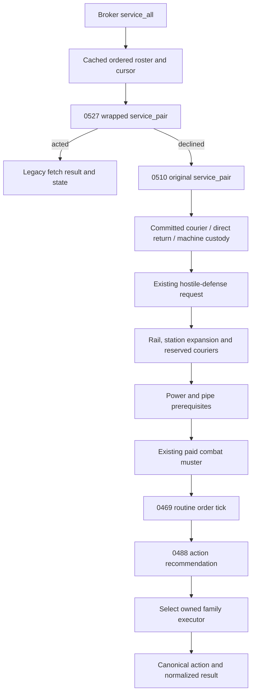

# Single Dispatcher 0510: Current Entry Paths and Execution

**Reviewed:** 2026-11-25. This is a source map, not native behavior or performance acceptance.
The number in this filename is retained for existing links; it is not a claim that the old implementation is still active.

Use the [complete source inventory](BEHAVIOR_SOURCE_INVENTORY.md) and its
[content hashes and source sites](BEHAVIOR_SOURCE_INVENTORY.json) for the full module/function/registration index.
Potential reachability, conditional wrappers, and retired source are distinguished there.
Source presence does not prove that a callback installed or ran in Factorio.

## Corrected current contract

The old document said 23-tick dispatch, 5-tick legacy gating and no construction ownership. Current source specifies **5-tick dispatch**, **24 pairs offered per ordinary pulse**, and a **30-tick legacy gate**. Construction and all six specialty logistics families are explicitly owned. `install()` removes the old `/tp-dispatcher-0510` command.

The dispatcher is an existing central routine executor, but the complete system still includes a 0527 wrapper, early incumbent/strategic paths, legacy compatibility families and independent registry callbacks. Calling it the only behavior owner would conceal real paths.

## Actual entry and branch order

The diagram groups many guarded early returns; it is not a claim that all those owners run physical work for every pair. Consult `service_pair` and the source inventory for exact guard order. Incumbent cargo and original ownership conditions must survive optimization.

## Routine executor table

| Family | Called owner |
| --- | --- |
| `direct-acquisition` | 0513 |
| `station-craft` | 0514; guarded `crafting_executor` fallback |
| `consecration` | 0515 |
| `repair` | 0516 |
| `combat-repair` | 0517, delegating physical work to 0516 |
| `construction` | `construction_planner` / 0338 |
| `machine-logistics` | 0528 |
| `item-family-logistics` | 0702 |
| `energy-family-logistics` | 0707 |
| `rocket-silo-logistics` | 0710 |
| `artillery-logistics` | 0713 |
| `roboport-repair-pack-logistics` | 0715 |

`family_for` maps classifier output to these families. `execute` normalizes execution without inventing a successful action. Families outside `OWNERSHIP`, including ordinary combat/movement/conversation compatibility paths, do not automatically acquire a new executor here.

## State publication and legacy suppression

`publish_action` writes `canonical_action_0744` with family, owner, phase, status, target identity, order key, issued/updated ticks and detail. `dispatcher_0510` retains compatibility/debug state and whether the current family gates legacy `tick_pair`.

`wrap_legacy_tick_pair` suppresses conflicting legacy work only when `should_gate_legacy` is true. `wrap_executor_pulses` suppresses duplicate acquisition/crafting pulses while preserving allowed dispatcher/manual paths. The 0527 wrapper still returns its older boolean result shape; do not assume every wrapped call matches the original table-return contract without exercising it.

## Performance accounting

The pair budget caps selected roster visits, not the total work of each visit. `ordered_pair_roster` reuses sort/allocation but still checks live pairs. Classifier recommendations, fetch discovery and early strategic branches can perform additional work. Profile actual wrapped entry and original dispatcher separately when attributing cost.

Use `processed`, `acted`, `waiting`, `blocked`, `failed` and deferred-work counters distinctly. Low acted counts can coexist with expensive discovery. Fair rotation and active custody progress must both be verified at populations above a service budget.

## Audited exported entry points

These names are taken from the current source; local helpers and call sites are in the full inventory. A callable helper is not an independently scheduled service.

| Module | Exported functions |
| --- | --- |
| [single_dispatcher_0510](../tech-priests_src/scripts/core/single_dispatcher_0510.lua) | `M.service_pair`, `M.service_all`, `M.should_gate_legacy`, `M.install` |
| [logistics_fetch_executor_0527](../tech-priests_src/scripts/core/logistics_fetch_executor_0527.lua) | `M.spendable_source_count`, `M.root`, `M.service_pair`, `M.describe_pair`, `M.install` |
| [combat_roster_orders](../tech-priests_src/scripts/core/combat_roster_orders.lua) | `M.request`, `M.on_built`, `M.replaced`, `M.service_pair`, `M.command_owned`, `M.recommend_action`, `M.install` |

## Update and evidence rule

Change the relevant diagram and ownership/exit description with the source change. Regenerate the source inventory with `python tools/audit_ups_hotspots_0743.py --write-behavior-maps`, explicitly acknowledge the reviewed curated maps with `--acknowledge-behavior-map-review`, then run `--check-behavior-maps` through the same tool. Generation alone does not bless a changed manual diagram. Follow the [performance validation protocol](UPS_VALIDATION_RUNBOOK_0742.md) for exact source, save, engine version, population, profiling settings, sample window and artifacts. A clean map check proves freshness only.
