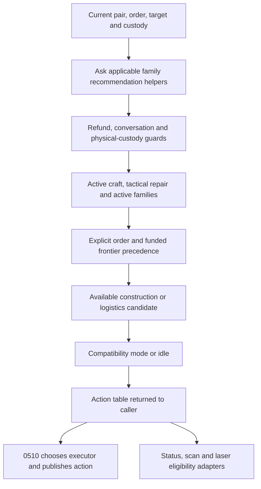

# Action Classifier 0488 and Presentation Adapters

**Reviewed:** 2026-11-25. This is a source map, not native behavior or performance acceptance.
The number in this filename is retained for existing links; it is not a claim that the old implementation is still active.

Use the [complete source inventory](BEHAVIOR_SOURCE_INVENTORY.md) and its
[content hashes and source sites](BEHAVIOR_SOURCE_INVENTORY.json) for the full module/function/registration index.
Potential reachability, conditional wrappers, and retired source are distinguished there.
Source presence does not prove that a callback installed or ran in Factorio.

## Corrected authority

`M.action` / `M.classify` selects a recommendation from current state. It is no longer the old 11-tick task-mutating arbiter. `M.service_pair` returns the classification, `M.tick_all()` returns zero, and `install()` installs visual/status adapters while removing `/tp-action-state-0488`.

The **selection function** is the decision boundary. Other functions in this module may clear rendering objects and increment diagnostic counters; describing the entire module as side-effect-free would be inaccurate.

The diagram summarizes a decision chain; earlier matching branches return the selected kind. Family recommendation helpers are requested before final selection, so a recommendation path can contribute cost even when another branch wins.

## Source precedence that must remain visible

| Condition | Selection behavior |
| --- | --- |
| Invalid pair | Returns invalid classification. |
| Due consecration refund with no higher protected condition | Selects restitution; delayed refunds have explicit retry backoff. |
| Conversation | Preserves conversation classification. |
| Physically carried construction item | Keeps active builder ownership before ordinary strict craft. |
| Exact machine output satisfying blocked strict craft | Selects the physical 0528 collection. |
| Actual timed craft | Selects craft; absence of a true craft timer/physical state is not proof of crafting. |
| Tactical repair / active specialty custody | Uses explicit active-family branches. |
| Original funded frontier request | Can precede generic noncustodial logistics. |
| Current explicit order | Uses order kind, target and family-specific conditions. |
| New candidate | Construction, machine, item, energy, silo, artillery and roboport recommendation branches. |
| No candidate | Compatibility mode or idle. |

This table does not replace exact branch order in `M.action` or the dispatcher's earlier incumbent/strategic work.

## Visual adapters and diagnostics

`allow_scan` and `allow_laser` check that visuals match the selected action, target and physical distance. They may destroy stale scan/mining render objects. `status` derives player-facing text; wrappers connect it to existing work visuals and overhead display.

`behavior_tree_monitor_0642` is a separate broad observer. Its BT labels are neither this classifier's full family vocabulary nor proof that only one owner ran. Current audit must retain its missing specialty-family coverage rather than calling the monitor a complete behavior tree.

## Performance boundary

Repeated callers of `action`, `status`, scan eligibility and laser eligibility can repeat recommendation work. Record those callers and cache semantics before claiming this classifier is cost-free because it does not execute the physical action. Diagnostic rendering and task selection must be distinguishable in timings.

## Audited exported entry points

These names are taken from the current source; local helpers and call sites are in the full inventory. A callable helper is not an independently scheduled service.

| Module | Exported functions |
| --- | --- |
| [action_state_arbiter_0488](../tech-priests_src/scripts/core/action_state_arbiter_0488.lua) | `M.action`, `M.clear_beams`, `M.allow_scan`, `M.allow_laser`, `M.status`, `M.status_for_pair`, `M.service_pair`, `M.tick_all`, `M.install` |
| [behavior_tree_monitor_0642](../tech-priests_src/scripts/core/behavior_tree_monitor_0642.lua) | `M.sample_pair`, `M.mark`, `M.service_pair`, `M.service_all`, `M.install` |

## Update and evidence rule

Change the relevant diagram and ownership/exit description with the source change. Regenerate the source inventory with `python tools/audit_ups_hotspots_0743.py --write-behavior-maps`, explicitly acknowledge the reviewed curated maps with `--acknowledge-behavior-map-review`, then run `--check-behavior-maps` through the same tool. Generation alone does not bless a changed manual diagram. Follow the [performance validation protocol](UPS_VALIDATION_RUNBOOK_0742.md) for exact source, save, engine version, population, profiling settings, sample window and artifacts. A clean map check proves freshness only.
