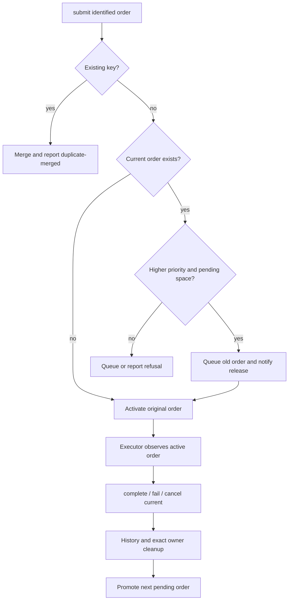
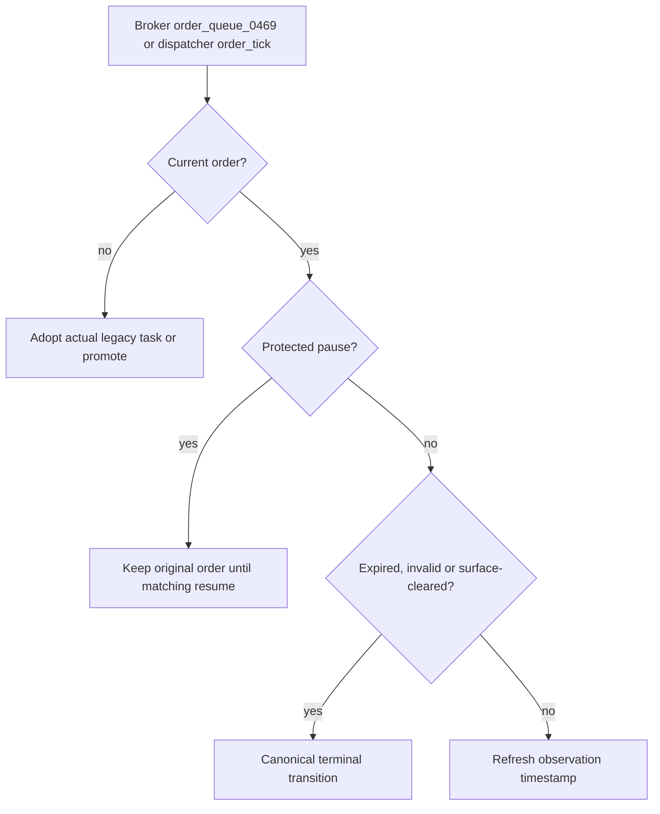

# Order Queue 0469: Admission, Pause and Terminal Handoff

**Reviewed:** 2026-11-25. This is a source map, not native behavior or performance acceptance.
The number in this filename is retained for existing links; it is not a claim that the old implementation is still active.

Use the [complete source inventory](BEHAVIOR_SOURCE_INVENTORY.md) and its
[content hashes and source sites](BEHAVIOR_SOURCE_INVENTORY.json) for the full module/function/registration index.
Potential reachability, conditional wrappers, and retired source are distinguished there.
Source presence does not prove that a callback installed or ran in Factorio.

## Authority

The queue owns canonical order acceptance, duplicate merge, pending priority, pause, transition and terminal promotion. Executors request completion/failure; they must not independently clear `q.current` and strand pending orders. Source contains explicit compatibility wrappers and special physical-return cleanup, so their conditions belong in the map.

## Tick and continuation paths

Broker registration is category `scheduler`, interval **17**, priority **30**, budget **16**. It also receives per-pair ticks from 0510. These are two entry paths into one queue authority, not two queues.

## Identity and physical-state guards

| Case | Current functions / rule |
| --- | --- |
| Missing priest | `pause_for_missing_priest`, `resume_after_priest_recovery`; protected pause does not expire as ordinary work. |
| Physical ore relay | `can_pause_uncommitted_relay_0974`, `pause_uncommitted_relay_0974`, `resume_after_resource_relay_0974`; original identity retained. |
| Rail candidate yield | `can_yield_uncommitted_rail_0836`; may yield only qualifying uncommitted work. |
| Rejected activation | `wrapper_result` reports failure and finalizes rejected activation; enqueue/duplicate can be accepted without invoking original action immediately. |
| Consecration release | `notify_consecration_released` delegates claim/refund cleanup on preemption, cancellation and transition. |
| Completed direct acquisition | `finished_physical_acquisition` clears only the exact completed task after verified direct return, absent conflicting custody. |
| Order transition | `transition_current` validates new identity and refuses pending duplicate collisions. |

`should_finish` still contains compatibility surface inference for some families. It is not equivalent to verified physical completion for every arbitrary order. Family-native completion evidence remains stronger.

## Performance accounting

`tick_all` rotates through a sorted pair roster with a work budget; sorting/allocation itself remains a cost. Deferred background policies must preserve this active queue progression and not confuse category `scheduler` with optional presentation. Track accepted, queued, merged, rejected, paused and terminal results separately.

## Audited exported entry points

These names are taken from the current source; local helpers and call sites are in the full inventory. A callable helper is not an independently scheduled service.

| Module | Exported functions |
| --- | --- |
| [order_queue_0469](../tech-priests_src/scripts/core/order_queue_0469.lua) | `M.pause_for_missing_priest`, `M.can_yield_uncommitted_rail_0836`, `M.can_pause_uncommitted_relay_0974`, `M.pause_uncommitted_relay_0974`, `M.resume_after_resource_relay_0974`, `M.resume_after_priest_recovery`, `M.submit`, `M.complete_current`, `M.fail_current`, `M.cancel_current`, `M.transition_current`, `M.tick_pair`, `M.wrap_assign_task`, `M.wrap_cancel_task`, `M.wrap_emergency_acquire`, `M.wrap_scavenge`, `M.wrap_doctrine`, `M.tick_all`, `M.install` |

## Update and evidence rule

Change the relevant diagram and ownership/exit description with the source change. Regenerate the source inventory with `python tools/audit_ups_hotspots_0743.py --write-behavior-maps`, explicitly acknowledge the reviewed curated maps with `--acknowledge-behavior-map-review`, then run `--check-behavior-maps` through the same tool. Generation alone does not bless a changed manual diagram. Follow the [performance validation protocol](UPS_VALIDATION_RUNBOOK_0742.md) for exact source, save, engine version, population, profiling settings, sample window and artifacts. A clean map check proves freshness only.
