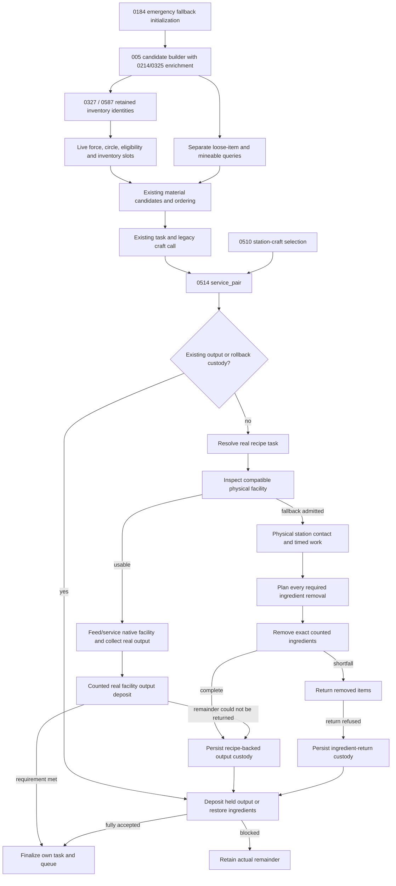

# Emergency Production Executor 0514 and Physical Recipe Accounting

**Reviewed:** 2026-11-25. This is a source map, not native behavior or performance acceptance.
The number in this filename is retained for existing links; it is not a claim that the old implementation is still active.

Use the [complete source inventory](BEHAVIOR_SOURCE_INVENTORY.md) and its
[content hashes and source sites](BEHAVIOR_SOURCE_INVENTORY.json) for the full module/function/registration index.
Potential reachability, conditional wrappers, and retired source are distinguished there.
Source presence does not prove that a callback installed or ran in Factorio.

## Current owner

The dispatcher invokes 0514 for station craft, with a guarded `crafting_executor` fallback when appropriate. Historical 0505 behavior wrappers are retired. 0514 retains compatibility entry wrappers and owns facility-first selection, physical recipe transaction, output/rollback custody and queue completion. The generated 0287 watchdog remains a separate compatibility caller; its conditional 0184 initialization reaches the original 005 candidate builder through the 0214/0325 wrappers.

## State and function boundaries

| Area | Current owner / behavior |
| --- | --- |
| Ingredient plan | `ingredients`, `plan_remove`, protected-source checks. |
| Transaction | `consume_transaction`, `rollback`; partial removal never licenses a full new output. |
| Persistent remainder | `emergency_production_custody_0514`, including `return-ingredients` and held output. |
| Facility read/write | Existing facility owner; only actual output inventories are collected as product. |
| Station fallback | `timed_fallback` requires physical station route/contact and real recipe ingredients. |
| Terminal handoff | `finalize`, `finish_order`, exact task cleanup. |
| Legacy entry | Existing wrappers direct qualifying old calls into the canonical owner and suppress duplicate facility pulses. |
| Legacy fallback discovery | Generated 005 obtains inventory identities from installed `tech_priests_0327_inventory_candidates`; 0184 and 0214/0325 continue through that same builder. |
| Legacy source permission | Existing `is_logistic_scan_candidate_entity`, current same-force/surface and circular range checks, current inventory IDs/stacks and material values. Installed 0324 still excludes player/character targets. |

The diagram is a transaction contract; a particular save/reload or partial-insert scenario still needs native evidence.

## Legacy acquisition and retained inventory membership

The generated nth-29 callback invokes the final 0287 acquisition wrapper for
active motion tasks. The 0291 loose-stockpile search and 0290 station-craft
attempt precede 0287's own cooldown. 0510's legacy gate wraps `tick_pair`, not
this watchdog. Qualifying legacy craft calls reach 0514, and the existing kick
can call that owner twice in the same tick. This inventory repair does not
change those call or retry semantics.

The conditional 0184 fallback now shares the complete 0327/0587 inventory
identity list instead of issuing an untyped surrounding-entity inventory
search. Empty inventories remain known; build/removal events, engine vehicle
lists and the existing membership owner supply arrivals. No new timer, TTL,
cache or registry is introduced. The existing complete seed/domain-change
rules apply. A compatibility runtime without the installed catalog API retains
the previous direct query.

The builder still reads real slots on each request, applies its own live target
policy and returns the same material-candidate records. It does not adopt the
catalog's item-selection, wire, quality or slot policy. Its separate loose-item,
asteroid, ore/tree and 0214/0325 mineable searches and candidate ordering remain.
Discovery does not debit stock or replace output/rollback custody; subsequent
physical withdrawal remains with the existing acquisition owner and stock guard.

## Separate facility feed

`emergency_facility_doctrine` can feed existing owned facilities through its existing cadence. It is not an alternate recipe fabricator. Station removal, partial machine insertion and unaccepted remainder/refund belong to that feed path. Native miners retained by the facility wrapper can continue their owned processing even when independent competing production pulses are suppressed.

## Performance boundary

Recipe/prototype inspection and source discovery are distinct from a timed craft advancing. `service_all` exists but is not independently registered by 0514; map actual caller edges rather than counting the function as another installed timer. A timed wait should not repeat expensive discovery unless an invalidation/retry condition requires it.

`tests/unit/emergency_craft_retained_inventory.lua` loads the actual generated
fragments, 0214/0325 wrappers, 0324 safety and catalog/0587 owners. It fails with
the original builder and passes with one inventory seed across sixty rebuilds
at 1,800-tick boundaries, live stock/permission changes, build/removal and
vehicle arrival. The reusable native scenario at
`tests/scenarios/emergency-craft-retained-inventory/control.lua` passed creation
and reload in Factorio 2.1.25: one seed, 100 warm fallback rebuilds, unchanged
rare-quality stock, live force/range checks, real single-item trunk withdrawal
and raised build/removal events. These are semantic/discovery-count results,
not acceptance of owner-save UPS or attribution of an inclusive profiler gap.

## Audited exported entry points

These names are taken from the current source; local helpers and call sites are in the full inventory. A callable helper is not an independently scheduled service.

| Module | Exported functions |
| --- | --- |
| [emergency_production_executor_0514](../tech-priests_src/scripts/core/emergency_production_executor_0514.lua) | `M.root`, `M.service_pair`, `M.service_all`, `M.install` |
| [crafting_executor](../tech-priests_src/scripts/core/crafting_executor.lua) | `Craft.before_legacy_handle`, `Craft.after_legacy_finish`, `Craft.wrap_legacy`, `Craft.pulse`, `Craft.tune_timings`, `Craft.commands`, `Craft.install` |
| [emergency_facility_doctrine](../tech-priests_src/scripts/core/emergency_facility_doctrine.lua) | `M.tag_built_entity`, `M.service_owned_miners_all`, `M.service_pair`, `M.service_all`, `M.install_commands`, `M.install` |

## Update and evidence rule

Change the relevant diagram and ownership/exit description with the source change. Regenerate the source inventory with `python tools/audit_ups_hotspots_0743.py --write-behavior-maps`, explicitly acknowledge the reviewed curated maps with `--acknowledge-behavior-map-review`, then run `--check-behavior-maps` through the same tool. Generation alone does not bless a changed manual diagram. Follow the [performance validation protocol](UPS_VALIDATION_RUNBOOK_0742.md) for exact source, save, engine version, population, profiling settings, sample window and artifacts. A clean map check proves freshness only.
