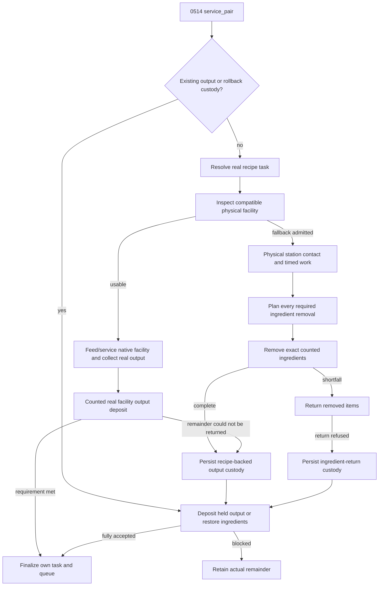

# Emergency Production Executor 0514 and Physical Recipe Accounting

**Reviewed:** 2026-11-25. This is a source map, not native behavior or performance acceptance.
The number in this filename is retained for existing links; it is not a claim that the old implementation is still active.

Use the [complete source inventory](BEHAVIOR_SOURCE_INVENTORY.md) and its
[content hashes and source sites](BEHAVIOR_SOURCE_INVENTORY.json) for the full module/function/registration index.
Potential reachability, conditional wrappers, and retired source are distinguished there.
Source presence does not prove that a callback installed or ran in Factorio.

## Current owner

The dispatcher invokes 0514 for station craft, with a guarded `crafting_executor` fallback when appropriate. Historical 0505 behavior wrappers are retired. 0514 retains compatibility entry wrappers and owns facility-first selection, physical recipe transaction, output/rollback custody and queue completion.

## State and function boundaries

| Area | Current owner / behavior |
| --- | --- |
| Ingredient plan | `ingredients`, `plan_remove`, protected-source checks. |
| Transaction | `consume_transaction`, `rollback`; partial removal never licenses a full new output. |
| Persistent remainder | `emergency_production_custody_0514`, including `return-ingredients` and held output. |
| Facility read/write | Existing facility owner; only actual output inventories are collected as product. |
| Station fallback | `timed_fallback` requires physical station route/contact and real recipe ingredients. |
| Terminal handoff | `finalize`, `finish_order`, exact task cleanup. |
| Legacy entry | Existing wrappers direct qualifying old calls into the canonical owner and suppress duplicate facility pulses. |

The diagram is a transaction contract; a particular save/reload or partial-insert scenario still needs native evidence.

## Separate facility feed

`emergency_facility_doctrine` can feed existing owned facilities through its existing cadence. It is not an alternate recipe fabricator. Station removal, partial machine insertion and unaccepted remainder/refund belong to that feed path. Native miners retained by the facility wrapper can continue their owned processing even when independent competing production pulses are suppressed.

## Performance boundary

Recipe/prototype inspection and source discovery are distinct from a timed craft advancing. `service_all` exists but is not independently registered by 0514; map actual caller edges rather than counting the function as another installed timer. A timed wait should not repeat expensive discovery unless an invalidation/retry condition requires it.

## Audited exported entry points

These names are taken from the current source; local helpers and call sites are in the full inventory. A callable helper is not an independently scheduled service.

| Module | Exported functions |
| --- | --- |
| [emergency_production_executor_0514](../tech-priests_src/scripts/core/emergency_production_executor_0514.lua) | `M.root`, `M.service_pair`, `M.service_all`, `M.install` |
| [crafting_executor](../tech-priests_src/scripts/core/crafting_executor.lua) | `Craft.before_legacy_handle`, `Craft.after_legacy_finish`, `Craft.wrap_legacy`, `Craft.pulse`, `Craft.tune_timings`, `Craft.commands`, `Craft.install` |
| [emergency_facility_doctrine](../tech-priests_src/scripts/core/emergency_facility_doctrine.lua) | `M.tag_built_entity`, `M.service_owned_miners_all`, `M.service_pair`, `M.service_all`, `M.install_commands`, `M.install` |

## Update and evidence rule

Change the relevant diagram and ownership/exit description with the source change. Regenerate the source inventory with `python tools/audit_ups_hotspots_0743.py --write-behavior-maps`, explicitly acknowledge the reviewed curated maps with `--acknowledge-behavior-map-review`, then run `--check-behavior-maps` through the same tool. Generation alone does not bless a changed manual diagram. Follow the [performance validation protocol](UPS_VALIDATION_RUNBOOK_0742.md) for exact source, save, engine version, population, profiling settings, sample window and artifacts. A clean map check proves freshness only.
