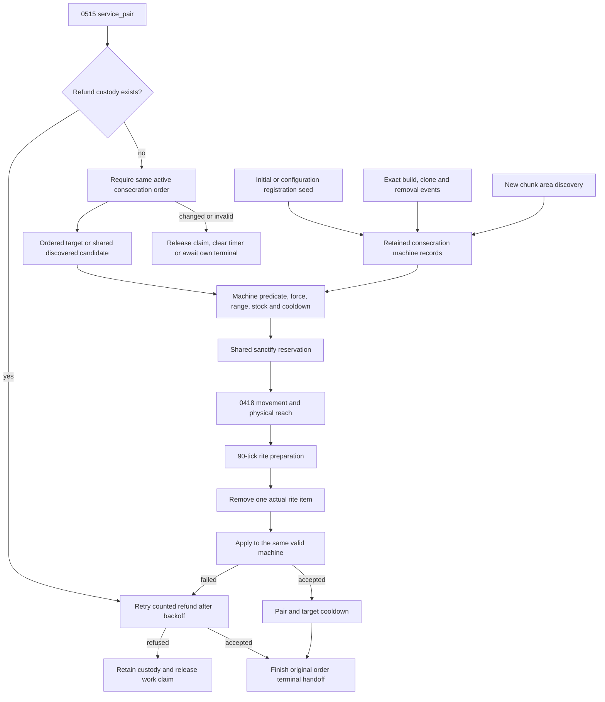

# Consecration Executor 0515, Target Eligibility and Refund Custody

**Reviewed:** 2026-11-25. This is a source map, not native behavior or performance acceptance.
The number in this filename is retained for existing links; it is not a claim that the old implementation is still active.

Use the [complete source inventory](BEHAVIOR_SOURCE_INVENTORY.md) and its
[content hashes and source sites](BEHAVIOR_SOURCE_INVENTORY.json) for the full module/function/registration index.
Potential reachability, conditional wrappers, and retired source are distinguished there.
Source presence does not prove that a callback installed or ran in Factorio.

## Eligibility and ownership

0515 executes an accepted active consecration order. Shared `work_reservations` owns the `sanctify` claim; the old private claim ledger is reconciled/retired by `M.root`. `work_queue_authority` supplies shared candidate admission. Neither a stale target field nor a diagnostic request authorizes a new rite.

The target predicate is [consecration/registry.lua](../tech-priests_src/scripts/core/consecration/registry.lua). It excludes `unit`, `character`, the complete combat roster and its AAI composite forms **before** vehicle/name allowlists. Native car bodies used for infantry do not make those actors consecratable machines. Existing invalid records are removed through the registry's reconciliation path, including owned rendering/status cleanup.

## Function and state contract

| Concern | Current behavior |
| --- | --- |
| Target identity | Order key and original ordered target are retained; invalid ordered target fails instead of silently substituting another machine. |
| Reservation | Shared `sanctify` category, exact owner and target key; private shadow claims are retired. |
| Movement | Requires literal accepted 0418 request; outside physical reach resets preparation timer. |
| Timing | 90-tick service, 45-tick pair cooldown, 480-tick target cooldown. |
| Supply/refund retry | Missing item and refund retries use 300-tick backoff. |
| Custody | `consecration_refund_custody_0515` retains a removed item when application/refund cannot finish. |
| Terminal | `on_order_released` and executor `terminal` keep matching-order cleanup; cannot complete an unrelated preempting order. |
| Submission | `submit_or_assign_consecration_task` creates/adopts an accepted order and releases provisional claims on refusal. |

## Discovery cost and limits

`find_target` prefers an explicit ordered target. Otherwise it uses scan routing or a direct native query and then examines up to `max_candidates=96`. **The direct query has no native `limit` field in this path**; the Lua loop cap does not prevent the engine from returning a larger list. Record query size and cache behavior before claiming discovery is bounded to 96 entities.

No separate periodic executor is installed by 0515. Legacy scheduler/rite adapters call the queue/executor through existing entry points. Native target exclusion, old-save cleanup and refund/terminal scenarios require their own evidence; a map change proves none of those at runtime.

### Retained world registration

The world registry is separate from that 0515 candidate search. Existing records live in `storage.tech_priests.consecration.machines`. `scan_existing_consecration_targets()` populates preexisting machines across surfaces for initial, configuration or explicit diagnostic recovery. It records whether the full seed completed in `discovery_seeded_0446`; failed queries leave it incomplete. The runtime bridge's existing 89-tick route checks that state, reuses an already seeded registry, and retries an incomplete seed with its existing 600-tick retry deadline. A successful seed does not expire with time, and module reload retains saved membership. Older saves with a previous full-scan receipt initialize the seed marker from that receipt.

Build/revive, clone, death/removal and space-platform events update exact entities through the same registration/removal authority. `on_chunk_generated` invokes the existing scan helper with only `event.surface` and `event.area`, so new terrain is discovered without rescanning existing surfaces. Configuration changes prune ineligible records and request one new seed. Existing machine IDs, wear, quality baseline and operation history are preserved when registration revisits the same machine; a clone receives its own new record. Script-created machines that emit none of the supported events require explicit/configuration recovery rather than a periodic full-world rediscovery.

The 149-tick bootstrap visibility watchdog still refreshes selected-machine presentation, but no longer invokes the full-world registration scanner. Module changes, research effects and decay retain their own routes and live state handling. This removes duplicate periodic registration sweeps; it does **not** remove 0515's target lookup, initial/configuration recovery, generated-chunk queries, or selected-machine observation.

## Audited exported entry points

These names are taken from the current source; local helpers and call sites are in the full inventory. A callable helper is not an independently scheduled service.

| Module | Exported functions |
| --- | --- |
| [consecration_executor_0515](../tech-priests_src/scripts/core/consecration_executor_0515.lua) | `M.root`, `M.on_order_released`, `M.active`, `M.service_pair`, `M.submit_or_assign_consecration_task`, `M.install` |
| [consecration/registry](../tech-priests_src/scripts/core/consecration/registry.lua) | Global API: `is_consecration_target`, `get_consecration_record`, `register_consecration_target`, `remove_consecration_target`, `prune_ineligible_consecration_targets`, `scan_existing_consecration_targets`; support globals `tech_priests_0448_is_consecration_excluded`, `tech_priests_0446_next_machine_id`, `tech_priests_0446_format_machine_id`, `clear_machine_custom_status`, `set_machine_ritual_status`, `get_nonoperating_status_diode`. The returned module table is metadata. |
| [consecration/runtime_bridge](../tech-priests_src/scripts/core/consecration/runtime_bridge.lua) | `M.install`; owns canonical seed/retry, configuration, exact-entity, generated-chunk and module-interaction routes. |
| [work_reservations](../tech-priests_src/scripts/core/work_reservations.lua) | `M.target_key`, `M.pair_id`, `M.root`, `M.get`, `M.is_claimed`, `M.is_claimed_key`, `M.claim`, `M.release_key`, `M.release`, `M.cleanup_expired`, `M.count`, `M.report_lines`, `M.install` |

## Update and evidence rule

Change the relevant diagram and ownership/exit description with the source change. Regenerate the source inventory with `python tools/audit_ups_hotspots_0743.py --write-behavior-maps`, explicitly acknowledge the reviewed curated maps with `--acknowledge-behavior-map-review`, then run `--check-behavior-maps` through the same tool. Generation alone does not bless a changed manual diagram. Follow the [performance validation protocol](UPS_VALIDATION_RUNBOOK_0742.md) for exact source, save, engine version, population, profiling settings, sample window and artifacts. A clean map check proves freshness only.
