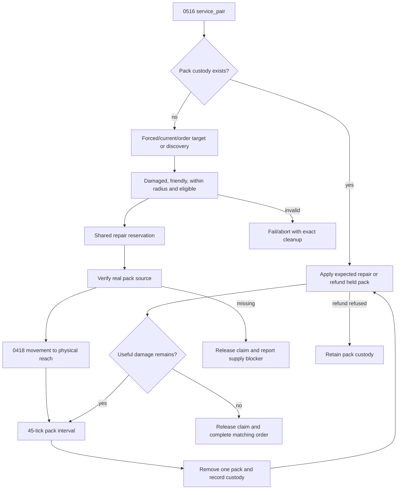

# Repair Executor 0516 and Shared Discovery

**Reviewed:** 2026-11-25. This is a source map, not native behavior or performance acceptance.
The number in this filename is retained for existing links; it is not a claim that the old implementation is still active.

Use the [complete source inventory](BEHAVIOR_SOURCE_INVENTORY.md) and its
[content hashes and source sites](BEHAVIOR_SOURCE_INVENTORY.json) for the full module/function/registration index.
Potential reachability, conditional wrappers, and retired source are distinguished there.
Source presence does not prove that a callback installed or ran in Factorio.

## Current authority

0516 owns repair movement requests, shared repair claims, actual pack removal, health application, refund custody and queue terminal handoff. Tactical 0517 delegates physical repair to this executor. The old 0673/0676/0677 repair hardeners are retired.

## Entry and discovery paths

| Entry | Actual role |
| --- | --- |
| Dispatcher family `repair` | Canonical routine execution. |
| 0517 combat repair | Supplies selected wall as a forced target; uses the same physical executor. |
| Wrapped legacy `repair_target` | Submits/adopts the order and calls 0516; not a separate health writer. |
| Wrapped `task_scheduler.try_repair` | Finds a target and submits a queue order. |
| `service_repair_bucket` | Callable rotating helper; no timer is registered by this module. |
| Event feeder / work queue | High-signal candidates and shared claims; helper source presence alone does not establish an active caller. |

`find_target` tries explicit/order target, shared nearest claim, then station-local native scan. The fallback query uses `limit=160`. That limits returned candidates but does not guarantee fair coverage of a dense area or a fixed total cost across repeated callers.

## Physical state and exits

`repair_0516` records target, phase and due tick. `repair_pack_custody_0516` records one removed pack, target identity, before/expected health and return state. A failed health write redirects to refund; a refused refund remains held. Full repair continues while useful damage remains unless explicitly configured otherwise.

`complete` retries queue terminal acknowledgement through `completion-blocked` rather than pretending promotion occurred. `abort_pair` targets the original repair and preserves a blocked pack return. Eligibility excludes priests and the hidden proxy and checks force, radius, cooldown and reservation ownership.

## Performance protocol

Count target queries, candidate inspections, stock probes and active repairs independently. A no-target response can still have paid the fallback scan. Keep active pack timing and physical return responsive; improve repeated discovery through the existing cache/queue boundaries instead of reducing movement cadence.

## Audited exported entry points

These names are taken from the current source; local helpers and call sites are in the full inventory. A callable helper is not an independently scheduled service.

| Module | Exported functions |
| --- | --- |
| [repair_executor_0516](../tech-priests_src/scripts/core/repair_executor_0516.lua) | `M.root`, `M.abort_pair`, `M.active`, `M.submit_or_assign_repair_task`, `M.service_pair`, `M.service_repair_bucket`, `M.install` |
| [event_driven_work_feeder_0608](../tech-priests_src/scripts/core/event_driven_work_feeder_0608.lua) | `M.root`, `M.handle_entity_changed`, `M.directed_wake_for_repair`, `M.directed_wake_for_category`, `M.handle_entity_built_for_work`, `M.handle_pickup_candidate`, `M.handle_entity_damaged`, `M.report_lines`, `M.install` |
| [work_queue_authority](../tech-priests_src/scripts/core/work_queue_authority.lua) | `M.root`, `M.order_key`, `M.submit`, `M.claim_nearest`, `M.discover_repair_near`, `M.cleanup`, `M.count`, `M.report_lines`, `M.install` |

## Update and evidence rule

Change the relevant diagram and ownership/exit description with the source change. Regenerate the source inventory with `python tools/audit_ups_hotspots_0743.py --write-behavior-maps`, explicitly acknowledge the reviewed curated maps with `--acknowledge-behavior-map-review`, then run `--check-behavior-maps` through the same tool. Generation alone does not bless a changed manual diagram. Follow the [performance validation protocol](UPS_VALIDATION_RUNBOOK_0742.md) for exact source, save, engine version, population, profiling settings, sample window and artifacts. A clean map check proves freshness only.
