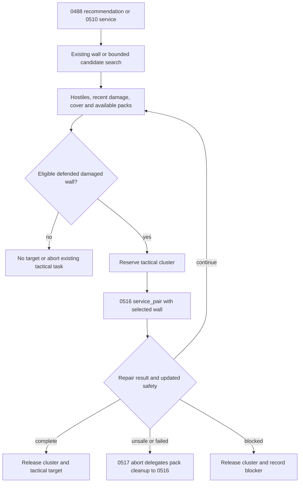

# Combat Repair 0517: Tactical Selection and 0516 Delegation

**Reviewed:** 2026-11-25. This is a source map, not native behavior or performance acceptance.
The number in this filename is retained for existing links; it is not a claim that the old implementation is still active.

Use the [complete source inventory](BEHAVIOR_SOURCE_INVENTORY.md) and its
[content hashes and source sites](BEHAVIOR_SOURCE_INVENTORY.json) for the full module/function/registration index.
Potential reachability, conditional wrappers, and retired source are distinguished there.
Source presence does not prove that a callback installed or ran in Factorio.

## Current ownership

0517 decides whether a damaged wall is safe/useful to repair under hostile pressure and reserves a local cluster. It owns tactical state and cluster bookkeeping. 0516 owns movement, packs, health application, refunds and repair order completion. No independent combat-repair timer is installed.

## Selection and state details

| Concern | Current source contract |
| --- | --- |
| Recommendation | `recommend_action` returns `combat-repair`, target, repair-pack item, tactical priority and context. It may search/evaluate candidates. |
| Search | `find_combat_repair_target`, wall eligibility, enemy/cover probes and score. |
| Nominal constants | Search radius 26, candidate limit 120, wall enemy radius 9, cover radius 8, cluster size 3, cluster TTL 150 ticks. |
| Tactical state | `combat_repair_0517`, `combat_repair_target_0517`, cluster reservation/cooldown state. |
| Physical work | `repair_executor_0516.service_pair(pair, reason, target)`. |
| Abort | Releases cluster, delegates matching target abort/refund, clears tactical state and returns to combat/idle as appropriate. |
| Completion | Checks updated missing health or repair completion result, releases cluster and publishes tactical completion. |

A loaded turret is not automatically effective cover: eligibility includes current turret/proxy state and hostile context. The diagram does not replace actual force/hostility rules.

## Performance boundary

Recommendation can run before the classifier selects another action, and wall eligibility may perform multiple enemy/cover queries. The top-level candidate count is not the full native-query count. Attribute recommendation/search cost separately from the physical pack loop. Preserve urgent combat/repair response while controlling repeated scans through existing discovery timing and caches.

Retired 0676 and 0677 wrappers must not resume independent health changes, movement or terminal cleanup. The canonical delegation above is the repair boundary.

## Audited exported entry points

These names are taken from the current source; local helpers and call sites are in the full inventory. A callable helper is not an independently scheduled service.

| Module | Exported functions |
| --- | --- |
| [combat_repair_doctrine_0517](../tech-priests_src/scripts/core/combat_repair_doctrine_0517.lua) | `M.root`, `M.inspect_wall_eligibility`, `M.find_combat_repair_target`, `M.active`, `M.recommend_action`, `M.abort_pair`, `M.service_pair`, `M.install` |
| [repair_executor_0516](../tech-priests_src/scripts/core/repair_executor_0516.lua) | `M.root`, `M.abort_pair`, `M.active`, `M.submit_or_assign_repair_task`, `M.service_pair`, `M.service_repair_bucket`, `M.install` |

## Update and evidence rule

Change the relevant diagram and ownership/exit description with the source change. Regenerate the source inventory with `python tools/audit_ups_hotspots_0743.py --write-behavior-maps`, explicitly acknowledge the reviewed curated maps with `--acknowledge-behavior-map-review`, then run `--check-behavior-maps` through the same tool. Generation alone does not bless a changed manual diagram. Follow the [performance validation protocol](UPS_VALIDATION_RUNBOOK_0742.md) for exact source, save, engine version, population, profiling settings, sample window and artifacts. A clean map check proves freshness only.
