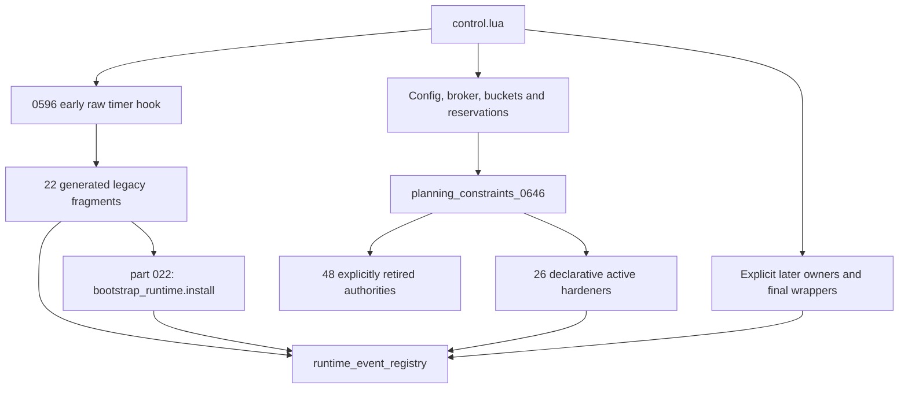
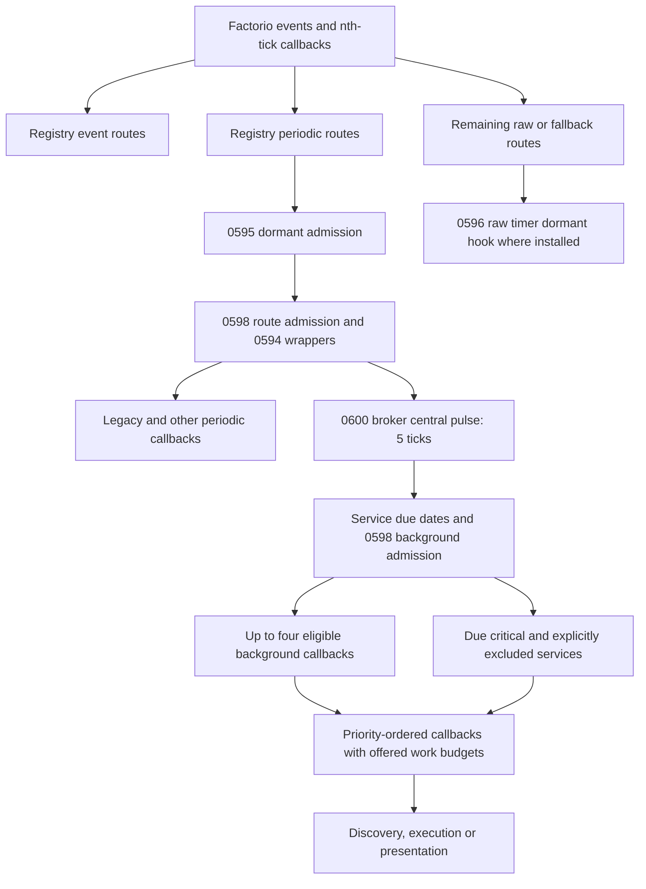
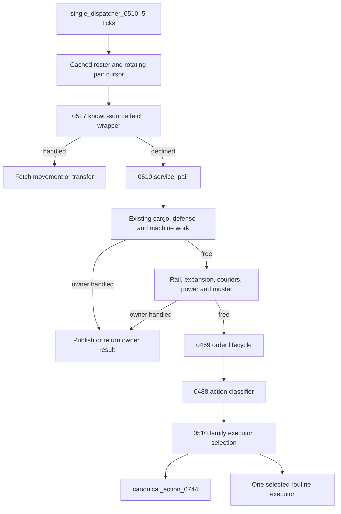
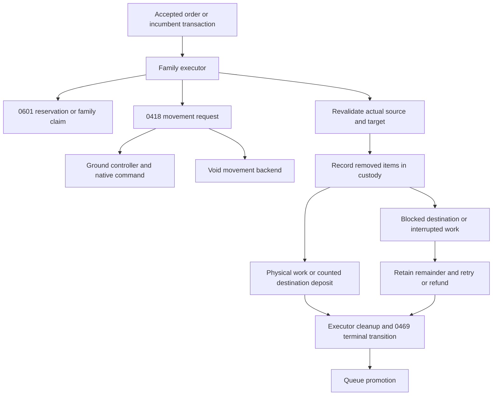
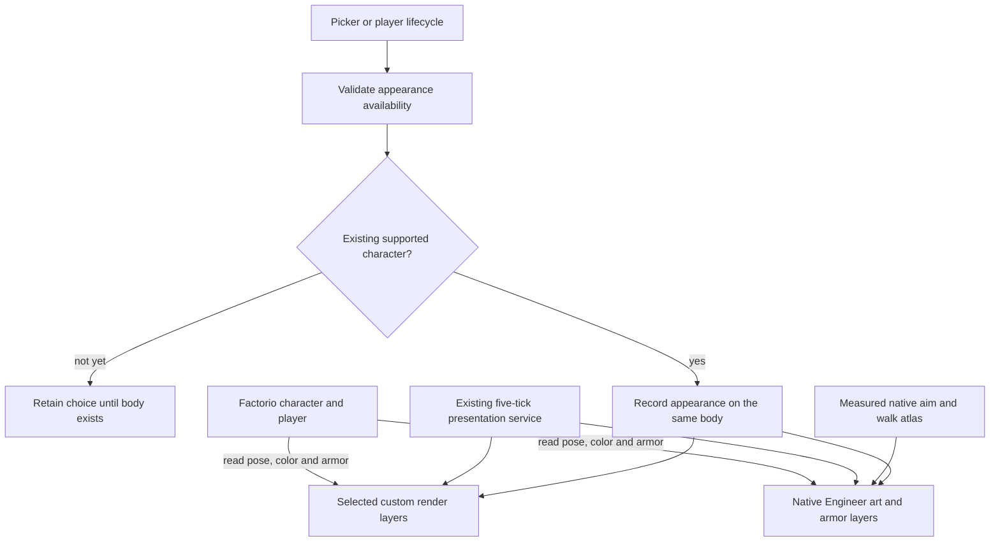

# Tech-Priests Current Behavior and Scheduling Map

**Reviewed:** 2026-11-25. This is a source map, not native behavior or performance acceptance.
The number in this filename is retained for existing links; it is not a claim that the old implementation is still active.

Use the [complete source inventory](BEHAVIOR_SOURCE_INVENTORY.md) and its
[content hashes and source sites](BEHAVIOR_SOURCE_INVENTORY.json) for the full module/function/registration index.
Potential reachability, conditional wrappers, and retired source are distinguished there.
Source presence does not prove that a callback installed or ran in Factorio.

## Scope and corrections

This map replaces the earlier 0.1.660 intended-priority sketch. That sketch incorrectly continued to show retired movement, leaf and construction wrappers as live owners. The executable system is a combination of generated legacy routes, explicit runtime installers, broker services, executor wrappers and native event owners. It is not one centrally executed behavior tree.

The [function/family index](BEHAVIOR_FUNCTION_MAP_0659.md) names the current owners. The [recovery map](RECOVERY_AUTHORITY_MAP_CURRENT.md) records custody and retired replacements. The generated inventory covers all runtime files rather than only the original thirteen drilldown subjects.

## 1. Loader and registration paths

`planning_constraints_0646.HARDENERS` is one installation list, not the complete module list. Its `RETIRED` table declares source-preserved replacements. Other owners are installed by generated fragments, bootstrap and explicit late blocks. A literal `require` dependency may only preload a module; its existence is not proof that `install()` succeeded. Final reconciliation of death, robot-build and research event delivery is in `control.lua`.

## 2. Independent scheduling lanes

The broker is a registry route. It does not replace every registry periodic route. The event registry's outer budget cannot infer how many services or native scans a broker callback invokes. The current broker explicitly calls `0598.broker_plan` to phase and fairly rotate eligible due background callbacks, at most four per pulse, and `broker_ran` to persist deadlines. Deferred callbacks keep their deadline. The cap is not population-gated and is not a limit of four total callbacks. Movement, dispatcher and combat categories are outside its background allowlist; order queue, original-priest expansion and inventory custody have named exclusions.

That internal cap does not govern `station_catalog`'s separate registry route or synchronous callers. Conditional fallback registrations and source-only candidates remain visible in the inventory. [Shared discovery](BEHAVIOR_MERMAID_FUNCTION_DRILLDOWN_0661.md) maps retained membership without timed expiry, event/engine-list updates, separate loose-item caching and remaining direct scan paths.

A service `budget` is a work-count contract passed to a callback, not a millisecond ceiling. The callback must honor it and retain a cursor if work is deferred. Native movement is not slowed to compensate for discovery costs.

## 3. Dispatcher, incumbent work and routine selection

The legacy fetch wrapper is a real pre-dispatch path and still writes legacy leaf/status fields; it must not be hidden behind a claim that every action originates in the classifier. `0510` also calls incumbent and strategic owners before routine classification. Those early paths have their own eligibility and custody guards; the diagram does not claim a single universal priority ordering for every callback.

The dispatcher offers 24 pairs per ordinary pulse before broker adaptation. Its cached roster amortizes rebuilding/sorting; checking the live pair map still visits it. The legacy `tick_pair` gate window is 30 ticks for dispatcher-owned active work. Compatibility families such as ordinary combat and movement can still resolve outside the routine executor table.

## 4. Physical work and terminal ownership

This is the canonical transaction contract. It is not an assertion that every compatibility transfer satisfies it. In particular, the older 0527 immediate fetch/deposit route warrants separate accounting review. Inventory counts, actual source removal, physical custody and final destination acceptance must be measured independently.

## 5. Full behavior-family routes

| Family | Discovery / decision | Physical or state owner | Detailed map |
| --- | --- | --- | --- |
| Pair creation, removal, pickup and recovery | Generated lifecycle, station state, 0499 policy | Generated canonical lifecycle; 0503 controlled recovery; 0823 relocation/0824 cargo | [Recovery](RECOVERY_AUTHORITY_MAP_CURRENT.md) |
| Orders, pause, cancellation and promotion | 0469 queue and legacy admission wrappers | `order_queue_0469` | [Queue](BEHAVIOR_MERMAID_FUNCTION_DRILLDOWN_0669_ORDER_QUEUE.md) |
| Ground travel and leases | Executor intent, corridor planner | `movement_controller` | [Movement](BEHAVIOR_MERMAID_FUNCTION_DRILLDOWN_0664_MOVEMENT_CONTROLLER.md) |
| Void/platform travel | Existing movement/platform request | Void and platform movement backends | [Direct movement](BEHAVIOR_MERMAID_FUNCTION_DRILLDOWN_0662_DIRECT_MOVEMENT.md) |
| Inventory fetch and loose items | 0327 retained inventory API backed by 0587; live mobile identities and separate loose-item scan | 0527 wrapper and transfer route; doctrine live item lookup | [Shared/fetch](BEHAVIOR_MERMAID_FUNCTION_DRILLDOWN_0661.md) |
| Direct resources and salvage | Identified literal physical target | `direct_acquisition_executor_0513` | [Acquisition](BEHAVIOR_MERMAID_FUNCTION_DRILLDOWN_0663_DIRECT_EXECUTOR.md) |
| Emergency production and strict recipe work | Recipe and infrastructure planners | 0514, guarded crafting fallback, facility feeder | [Production](BEHAVIOR_MERMAID_FUNCTION_DRILLDOWN_0670_EMERGENCY_PRODUCTION.md) |
| Construction, defensive buildings and robots | Site planner, 0644/0645, defense/frontier requests | `construction_planner`; native construction robots for their accepted jobs | [Construction](BEHAVIOR_MERMAID_FUNCTION_DRILLDOWN_0665_CONSTRUCTION.md) |
| Infrastructure, science and frustration | 0640/0644, 0643 group shortage assessment, power, belt, science and station planners | Existing 0338/0514/0528 executors and native machines | [Infrastructure](BEHAVIOR_MERMAID_FUNCTION_DRILLDOWN_0666_INFRASTRUCTURE_PLANNING.md) |
| Repair | Event feeder, queue, bounded local search | `repair_executor_0516` | [Repair](BEHAVIOR_MERMAID_FUNCTION_DRILLDOWN_0672_REPAIR.md) |
| Tactical repair | 0517 wall danger and cover evaluation | 0517 selection; 0516 physical repair | [Combat repair](BEHAVIOR_MERMAID_FUNCTION_DRILLDOWN_0675_COMBAT_REPAIR.md) |
| Consecration | Shared work queue and eligibility predicate | `consecration_executor_0515`; shared sanctity state | [Consecration](BEHAVIOR_MERMAID_FUNCTION_DRILLDOWN_0671_CONSECRATION.md) |
| Machine, item and energy logistics | 0528, 0702, 0705/0707 | Dispatcher invokes corresponding custody executor | [Dispatcher](BEHAVIOR_MERMAID_FUNCTION_DRILLDOWN_0667_SINGLE_DISPATCHER.md) |
| Silo, artillery and roboport logistics | 0709/0710, 0712/0713, 0714/0715 | Dispatcher invokes 0710, 0713 or 0715 | [Recovery](RECOVERY_AUTHORITY_MAP_CURRENT.md) |
| Standard fluids and fluid turrets | 0689/0691 and 0716/0717/0719 | Route planner submits construction; 0338 places physical parts | [Recovery](RECOVERY_AUTHORITY_MAP_CURRENT.md) |
| Remote resources, rails and courier chains | 0820, 0835, 0836, 0837 | Original builders, workers, physical train and counted cargo owners | [Dispatcher](BEHAVIOR_MERMAID_FUNCTION_DRILLDOWN_0667_SINGLE_DISPATCHER.md) |
| Starvation, relocation and station resupply | 0850 family, 0921 continuations, 1208 resupply | Existing lifecycle, custody, original-priest and construction owners | [Recovery](RECOVERY_AUTHORITY_MAP_CURRENT.md) |
| Hostile defense, recruits and native combat | Defense perimeter, roster orders, native AAI bridge | Perimeter executor, 0338/0702 for preparation, native combat controller | [Dispatcher](BEHAVIOR_MERMAID_FUNCTION_DRILLDOWN_0667_SINGLE_DISPATCHER.md) |
| Priest armor and damage mitigation | Generated 0302 fixed-rank policy; shared 0646 recipe membership with live enablement | 0302 damage/build/recovery/research and 887-tick maintenance; 0297 build alias delegates, obsolete 811 timer retired | [Combat and armor](BEHAVIOR_MERMAID_FUNCTION_DRILLDOWN_0675_COMBAT_REPAIR.md#fixed-rank-priest-armor-0302) |
| Bunker weapons and researched unlock recovery | `control.lua` calls `bunker_cannon_integration.install_main` | Canonical registry events; family initialization restores researched recipe unlocks from prototype effects; native weapons own combat | [Recovery](RECOVERY_AUTHORITY_MAP_CURRENT.md) |
| Hydrogen, orbital and other infrastructure | Explicit `control.lua` module installation | Respective native event/runtime modules | [Full inventory](BEHAVIOR_SOURCE_INVENTORY.md) |
| Chatter, UI, visuals and diagnostic displays | Observed pair/canonical state | Presentation modules; no general task authority | [Classifier](BEHAVIOR_MERMAID_FUNCTION_DRILLDOWN_0668_ACTION_STATE_ARBITER.md) |

## Character appearance and native player ownership

`character_skin_picker` no longer requires or calls `character_skin_transfer`.
Selecting a skin or Engineer never creates/destroys a character, sets a controller,
moves inventory stacks, or writes player bonuses. Crafting, combat, stickers,
vehicles and deployed robots do not block a cosmetic selection. The old transfer
module remains unreferenced source history, not an installed authority.

At data stage, `prototypes.engineer_visuals` exports native Engineer artwork before
hiding its pixels with static zero tint. Native frame counts, animation clocks,
footstep/particle triggers and all gameplay properties stay intact. The old custom
host remains registered with native timing for existing saves; selecting Engineer
on it changes only its drawing. New character deaths use the original native loot
corpse. Picker-disabled maps retain visible native Engineer graphics.

`shared.engineer_pose_map` supplies the native 18-row and 40-row armed-walking
selection tables, measured from all 128 aim/walk combinations in real engine
screenshots. The renderer reads that map, the current armor and native movement;
it applies the measured row, reflection and playback direction only to drawings.
The exporter preserves continuous frame packing across atlas rows and files.
Mech armor uses its available armed-walk and airborne idle graphics even without
a drawn weapon, and native hover bobbing remains distinct from takeoff/landing.
These render APIs require Factorio 2.1.25; the mod dependency declares that floor.

`character_visuals_presentation` retains its existing five-tick broker route and
bounded actor cursor. Connected player drawings refresh before the actor batch
and are not redrawn a second time in that pulse. A lifecycle seed restores detached
native bodies once at init/configuration; build/clone events add later raised
creations. There is no recurring surface scan. Unraised creation of an unrelated,
unattached native character by another mod is not discovered until lifecycle
restoration. Native movement continues every engine tick.

The focused native fixture measures positive 60-tick walking distances against an
untouched native reference for Engineer and every allowed model, including old
hosts, while checking exact body/inventory/equipment identities. A modifier-only
assertion cannot establish movement parity. Graphical capture and save/reload are
separate required evidence from the headed validation run.

The same fixture executes one real go-to command per previous/current ground
priest traversal, covers all four ground ranks and both belt-immunity variants,
and rejects stopped movement or less than a 1.7x travel improvement. A separate
detached Mech-armored Engineer crosses actual water beside an untouched native
reference; its movement, takeoff, sustained rising/falling hover and landing are
checked without assigning a flight height. Headed validation must produce the
player, ground-priest and Mech walking/flying PNGs from those native runs.

## 6. Observed boundaries requiring performance work

| Source path | Actual boundary | Open risk |
| --- | --- | --- |
| `station_catalog` | Existing registry owner admits two due stations every 60 ticks and resumes saved query/result, classification, sort and claim cursors every four ticks. Pending jobs share one native query and 256 counted work units per pulse, with a separate progress cursor; the previous snapshot stays published. Inventory identities are borrowed from 0587 without contents reads. | Count limits are not millisecond guarantees. Admission/pending-roster collection and sorting, cold owner-index initialization, complete inventory seeds and explicit synchronous scans remain outside the work-unit cap. Ordinary cold/obsolete-domain readers receive an incomplete current-domain pending snapshot without scanning. Finite depletion releases exact claims and requests a follow-up; infinite minimum-yield events keep their claims. Live lookup checks current source ownership and area overlap. Each new dense survey still has at most 13 queries and 3,072 unique results; its incomplete tail has no across-survey coverage guarantee. Item/UI mobile-list and contents reads are separate work. |
| `infrastructure_first_governor_0640` | Broker passes its offered budget into the existing owner | Repaired source counts every inspected slot, resumes saved `service_cursor`, and separates acted/waiting/invalid/failed counts; native cost acceptance remains separate. |
| `master_infrastructure_plan_0644` | Saved batch of up to eight station IDs per 97-tick cycle; one attempt per admitted five-tick broker pulse; saved original deadline and rotating cursor. Dense drill-output fallbacks reuse a call-local position index from the current role survey. | Preserves the cycle's visit allowance while spreading attempts, and preserves the receiver predicate and physical placement order. One station can still be expensive, roster sorting remains, and background admission can defer continuations. The isolated native receiver-helper comparison is not whole-planner or game FPS/UPS evidence. Synchronous calls and registry fallback do not use this slicing. |
| `fluid_network_doctrine_0689`, `fluid_turret_readiness_0716` | Prefix `pairs(pair_map())` loops break at offered budget | No rotating cursor: stable populations above the budget can starve later entries. |
| `logistics_fetch_executor_0527`, `storage_role_authority_0686`, doctrine and 0643 | Shared 0327 API over existing 0587 membership with event/engine-list updates and no timed expiry; consumers retain their live force, range, slot and quantity policies | Initial/domain-change/coverage-expansion or explicit-clear searches are complete and uncapped. Unseen orphan/scripted changes can require explicit refresh. Wider coverage avoids alternating-radius reseeds. 0527 skips duplicate nearby discovery after a covered shared view. 0686 keeps its four-type, 256-entry eligible view and selects chest or trunk by entity type. |
| `emergency_facility_placement_bridge_0643` | 113-tick broker route; shared identities and one provider list for the three reserve-item counts, with live physical quantities. Known chest-family entities use one supported inventory access per item; other/unknown providers retain exhaustive compatibility access. | Its advertised budget of four is not enforced inside `assess()`: all force/surface groups, station members and construction reservations are still visited. Planned-ghost queries and compatibility inventory-ID probing remain. |
| Generated armor 0297/0302 | Obsolete 811-tick force-wide best-armor traversal removed; 0297 build entry delegates to 0302, whose unlock lookup reuses 0646 and checks enabled recipes live | Existing 887-tick fixed-rank maintenance still visits all pairs. Explicit legacy 0297 force-profile helpers retain immutable armor facts and shared recipe membership, with live enablement and independent result tables. Cold metadata/index construction and resistance reads remain; direct damage response is preserved. |
| Lifecycle checkpoint 0733; audits 0725/0721 | Canonical 0646 retirements are explicit; 0730 is not called or reported as passed. Existing live 0719 capabilities/route and replacement globals are required. A completed checkpoint reaches the cheap 601-tick broker branch; missing live owners still fail and retry. 0735 migration assertions remain. | Full init/configuration/revision/incomplete checks still run ordinary audits. 0725 uses actual discovery-service names, and 0721 shares 0720's managed-command predicate. Its existing service retains 307-tick behavioral audits and resumes the saved storage walk every five ticks while pending, sharing at most 256 counted work per game tick. Idle saved deadlines sleep; completed scans are retained, with the next walk due no sooner than 3,600 ticks after completion. Pending, truncated or failed scans cannot satisfy 0733. This is a work bound, not a millisecond guarantee; native completion and the full owner replay remain separate evidence. |
| `runtime_tick_broker` and 0598 | At most four admitted eligible background callbacks per pulse, with deterministic phase, saved deadlines and rotation | Callback count does not bound work inside a callback; exempt active-work categories and registry siblings need their own accounting. |
| Registry and raw fallback callbacks | Run outside broker-service loop | Need separate admission/cadence evidence. |
| `behavior_tree_monitor_0642` | Broad read-only BT classifications from several legacy fields | Not an exhaustive executed tree; specialty families are incompletely represented. |

These are source findings. Their existence does not establish their share of the reported slowdown. The performance protocol must retain exact native timing and visit/query counts before closing each item.

## Update and evidence rule

Change the relevant diagram and ownership/exit description with the source change. Regenerate the source inventory with `python tools/audit_ups_hotspots_0743.py --write-behavior-maps`, explicitly acknowledge the reviewed curated maps with `--acknowledge-behavior-map-review`, then run `--check-behavior-maps` through the same tool. Generation alone does not bless a changed manual diagram. Follow the [performance validation protocol](UPS_VALIDATION_RUNBOOK_0742.md) for exact source, save, engine version, population, profiling settings, sample window and artifacts. A clean map check proves freshness only.
