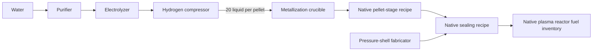

# Native hydrogen production recipe authority (1509)

All seven integrated machines now expose native assembler-style recipe
selection. Purifier, electrolyzer, compressor, crucible and pressure-shell
fabricator retain their original recipe IDs, amounts, power and artwork.
The pelletization forge offers one real recipe per raw decay stage (one
raw pellet to its matching forged stage, 24 seconds). The canister
assembler offers one recipe per forged stage (three matching pellets and
three pressure shells to three sealed fuel canisters, 16 seconds). The
native recipe quality selector governs ingredient quality.

Legacy hidden clock/intake/dispatch recipes remain defined for save
deserialization, hidden and disabled. Configuration migration returns
the original private and native inventory stacks at the machine, removes
clock items, clears old recipes and unlocks the normal selector. Existing
native recipes and reactor fuel are retained. No new private stock, recipe
switching, inserter scan, or custom GUI override is installed for the
integrated chain. Legacy standalone add-ons retain their separate runtime
ownership until uninstalled/migrated.

Native crafting does not pass arbitrary ingredient tags or individual
damage into a new product. Stage and recipe quality are retained; Space
Age's engine owns spoilage inheritance for forging, and its produced
deadline is not rerolled. Base-only script spoilage still initializes
new uncontained products; within-stage age transfer and exact reversible
containment metadata for newly native-crafted fuel are not established.
Existing tagged sealed fuel and its remote unseal operation are retained.
The standard native-crafting path intentionally does not invent missing
ingredient metadata. Verify these tradeoffs in engine before release.
