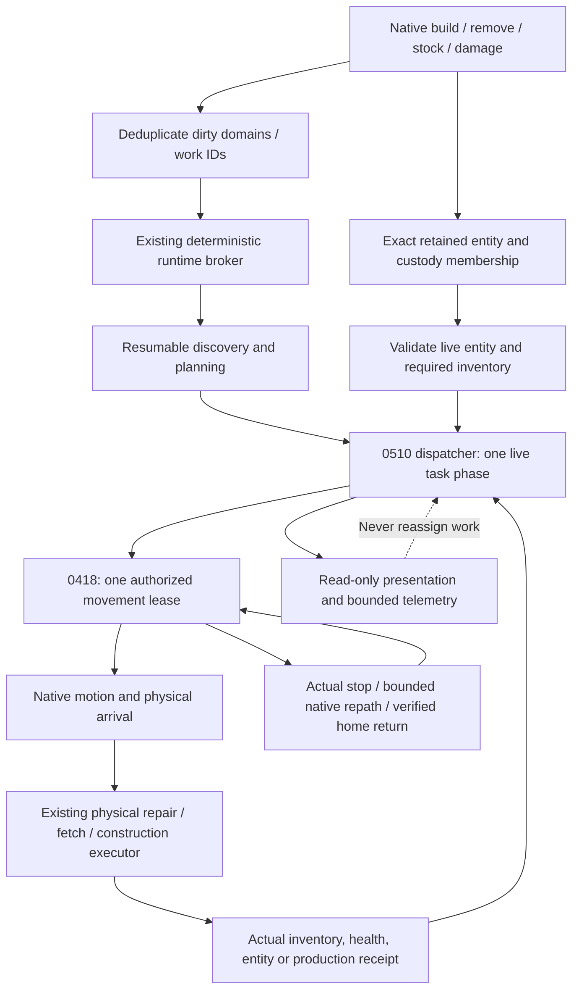

# Owner sandbox behavioral integrity and performance refinement — 1511

Status: diagnostic development contract, not a performance acceptance receipt.
Released reference: Tech Priests 1.0.4 at `fa235434452c70c3ce18bcd7d041327cac7e7700`.
Reviewed development reference: `fa2a6f65b375b978e6236bb37dd1c57c0ad1d70f` (1510 movement correction and reviewed maps).
This extends [UPS validation 0742](UPS_VALIDATION_RUNBOOK_0742.md) and [owner movement findings 1510](OWNER_SANDBOX_MOVEMENT_1510.md). Do not supersede the owner's release policy or publish a new build without authorization.

## Evidence and limits

The owner reports good overall frame rate, intermittent chugging with roughly a dozen priests, abnormal motion/wilderness excursions, and lag when placing structures. The supplied current log covers Factorio 2.1.25, Tech Priests 1.0.4, Space Age and additional mods. Initial test used all unlocked technology; later station creation includes non-immune forms, so the entire trace is not one controlled fully researched workload.

Aggregate counts from the complete 36,092-line current log (9,353,388 bytes); these are message counts, not independent jobs or timings:

| Signal | Count |
|---|---:|
| Ground speed governor | 14,736 (10 distinct priest IDs) |
| Five-tick governor samples | 13,823 |
| Direct acquisition movement-failed messages (all matching modes/reasons) | 2,575 |
| Valid-priest recall blocks | 2,388 |
| Orphan-purge blocks | 289 |
| Station cache invalidations | 83 |
| Order refresh messages | 227 |
| Infrastructure gate pending messages | 678 |
| Infrastructure gate assigned messages | 254 |
| Direct gather target messages | 848 |
| Unsatisfied emergency requests | 361 |
| Station supply satisfaction owner messages during active session | 2,035 |
| Fast-debug target-distance readings over 100 tiles | 3,114 |

Largest 5-tick displacement 133.6989 tiles; largest observed displacement 950.9510 tiles over 45 ticks. Target-distance readings are not necessarily station distances; do not relabel them as home distances. Final examples 968.53 and 951.14 tiles. Movement reasons when violations were observed: 0702 item-family source 3,179; 0527 known-source fetch 2,679; 0513 travel 2,285; 0513 return 1,864; 0478 remote work 1,556; materials-ready 1,514; 0566 overleash return 751; other 908. These are correlation labels, not proof that each owner caused the displacement.

1,776 consecutive 60-tick fast-debug intervals: median wall duration 1.123 s, p95 (inclusive/exclusive estimate immaterial at this precision) 1.359 s, maximum 3.847 s. This is an irregular, workload-dependent wall-time sample, not per-tick profiling or measured FPS. Six blocking saves and possible pauses are separate confounders. The log contains one GUI-open error reading unit_number from LuaItemStack. The current log ends with user quit; the previous dump is not proof of a crash in this session. The emergency diagnostic file is historical startup material, not a live profiler trace. Do not commit raw owner logs, binary cache or crash dump.

Native fully researched 10-worker, 30,000-tick diagnostic comparison [run 46128574503](https://github.com/mrcalzon02/Dens-Mortis/actions/runs/46128574503):
- Released: 17,821 steps >1 tile/tick; max step 7.403; max distance home 429.476; 61,531 overleash worker-ticks.
- 1510: 10,408 steps >1 tile/tick; max step 7.084; max distance home 406.151; 62,978 overleash worker-ticks.
- Both runs failed to establish sustained repair or machine production; movement of all ten originals is not equivalent to productive throughput. Separate controlled-displacement recovery failed to return home. 1510 is partial hardening only, not the solution.
- 100/100 source suite and 16 maps passed [run 46128502550](https://github.com/mrcalzon02/Tech-Priests/actions/runs/46128502550). Historical 1401 railway aggregate assertion failed in both release and candidate; keep it visible as a diagnostic.

## Repair order and admission criteria

| ID | Evidence and testable question | Preferred intervention | Feasibility / dependency |
|---|---|---|---|
| P0-A native movement | Same original unit samples >1 tile/tick at prototype speed 0.18; run isolated native worker, then dense terrain, then full task ownership. Does abnormal displacement occur with only native commands? | Compare ordinary/belt-immune forms, no research/all research, isolated unit vs packed factory, idle/walking/arrival/turn/attack/return, belts, collision, tile effects and supported runtime movement state. Trace actual native command/group state and every reachable physical position writer. Keep rendering and physical movement distinct. Fix the first demonstrated cause; only adjust speed/profile once cause is known. | Immediate experiments; engine behavior or mod interaction may require deeper work. No guessed speed clamp, per-tick teleport, entity replacement or visual masking. |
| P0-B custody & leash | 0513 and 0566 separately assess overleash and submit return; 0527/0702/0478 labels dominate displacement samples; 1510 still fails physical return. | One authoritative movement lease under 0418, one task phase under 0510. Canonical radius and actual destination checks; ordinary homeward return remains eligible until actual arrival; no stale acquisition/visual owner replaces it. Explicit documented native rail/physical courier exemptions only. Diagnose return blocker, not another timer. | High-value, moderate risk: preserve actual custody and special missions. Requires P0-A evidence and native return test. |
| P1-A build/remove invalidation | 0634.invalidate_near scans pair_map and limits changed matches, not visited pairs. Clears many shortage fields and invalidates corridor cache, including inventory-only events. 0247 create_pair wrapper does broad before/after neighborhood scans. | Event callback records exact entity/footprint/force/surface and dirty domain/version; synchronously maintain only necessary membership and custody correctness. Use existing spatial owner index; coalesce repeated dirty cells and work IDs. Resume matching/refresh on existing broker with counted rejected candidates. Gate 0247 full survey to explicit diagnostics; keep constant-cost registration proof. | High; isolate single structure, station and blueprint bursts independently. No delayed stale writes or lost removals. |
| P1-B callback fanout | Existing registry routes and broker services overlap. Runtime source inventory names lexical edges but does not prove which wrappers execute. | Profile entire event dispatch plus exclusive/inclusive callback durations and child query counts. Record active event-owner census and wake dedup. Retire verified duplicate/dead routes or turn legacy callers into single-owner forwarding shims; filter irrelevant event types. | High for identified duplicates; profile first. Avoid another wrapper service. |
| P1-C repeated valid-priest/lifecycle work | 0499 repair_reverse_maps and records called by ensure/purge wrappers even for valid priests. 2,388 blocked recalls and 289 purge blocks. | Make valid unchanged mapping an O(1) no-op, resolve identity only after actual mismatch/event. Trace callers and remove repeated recall submissions; compact counters/ring and rate-limit repeated log details. Keep death, mining, native recovery and exact identity protection. | High for observability/no-op path; medium for caller retirement. Logging-only A/B must not alter behavior. |
| P1-D supply & acquisition churn | 0639.service_pair checks available ammo before confirming ammo demand; available_count rebuilds station_owned_sources for each item and alternative. Unrelated GUI interaction falls back to service_all; fixed-prefix traversal. 0513/0527/0702 and legacy request paths can repeat same request. | One retained source identity view per scope/epoch; read live counts only for demanded item/quality. Coalesce one shortage per station/item/custody task; wake on relevant stock/route change; stable negative cache with bounded retry. Replace GUI all-pair fallback with actual station interaction. Fair continuation across source candidates and requests; verify physical transfer and demand completion. | High for source reuse; moderate for merging producers. Do not cache mutable quantities as truth, disable real resupply or consume items from prohibited slots. |
| P2 planning/cadence | Existing 1507 continuation and catalog budgets reduce broad scans, but registry/broker aggregate peak is not guaranteed; 0640 service_all now counts pair slots with saved cursor, while inner assessment can still be broad. 678 pending infra reports do not prove CPU cost or progress. | Trace job queue ages, native query/result sizes, rejected candidates, invalidation/restart and final validation. Share cached metadata and accepted plan across neighboring stations where domain is valid. Charge actual inner work; coalesce duplicate plan requests. Stagger existing services; allocate deterministic global planning work cap with movement/repair/active construction protected. | High for explicit bounded continuations; lower for oversized atomic engine queries, which require narrower domains or retained indexes. Never slow physical simulation. |
| P3 presentation & external load | Chugging can also be rendering, sound, diagnostic logging, autosave or other mods. Startup estimated textures ~4.8 GB, not evidence of runtime GPU bottleneck. | Compare same workload, GUI closed/open, camera near/far, ALT and radar visualization, standard/HD; profiler off for timing; separate instrumented captures. Only reduce decorative update work, reuse render objects and mipmaps; never suppress worker motion. Cross-check full mod stack after clean baseline. | High once actual CPU/render bottleneck measured; do not treat headless UPS as FPS. |

## Required behavior authority boundaries

Source review anchors: `prototypes/entity.lua:409–500` (native cloned unit/profile), `movement_controller.lua` (0418/0566/0611, 1510), `direct_acquisition_executor_0513.lua:169–182` (overleash), `station_area_change_invalidator_0634.lua:44–141` (event invalidation), `scripts/generated/control_legacy_part_013.lua:239–300` (0247 registration scan), `priest_lifecycle_authority_0499.lua:472–522` (recall/purge wrappers), `station_supply_satisfaction_0639.lua:126–162,337–394` (inventory/satisfaction), `infrastructure_first_governor_0640.lua:2060–2107` (resumable outer roster). Consult current behavior maps when changing any edge.

## Native investigation matrix

Every comparison pins exact source/zip digest, engine, map/fixture, seed, mod-list including versions, startup/runtime settings, research and quality, game speed=1, station/worker IDs, task mixture, warmup and measurement windows. No fake entities or bypassing original executors to create work-completion claims.

1. Movement isolation: one original standard/immune worker with a single real command; open ground; no other scripts replacing intent; no travel manipulation. Compare one native command with normal dispatcher-driven acquisition/return on same geometry. Inspect velocity/position deltas, actual command and ownership changes, collision/damage and native grouping. Then 4 and 12 original workers on belt/obstacle-heavy factory. Reproduce the uncontrolled fault before declaring fixed.
2. Placement isolation: repeat a single ordinary machine, chest, belt, wall and station placement; then removal and 10/50/200-entity blueprint or scripted native construction bursts. Record tick/event timestamps and actual whole-update time, per-route CPU, queries, inspected candidates, dirty keys and wake counts; measure input-to-render latency on Core30. Compare no workers, 12 and 100 workers in matched dense worlds. No synchronous full-surrounding scan to handle each placed ordinary entity.
3. Integrated 0/1/4/12/25/50/100 original workers, ordinary research and fully researched variants. Include supplied/unsupplied/blocked tasks, distributed and overlapping stations, repair, consecration, real stock transfers, real placement, resource acquisition, powered native production; independent defensive construction; frustration-triggered self-construction only at its authorized threshold. Verify each active worker's actual task progress and count honest waiting separately. Include save/reload during planning and in-flight cargo, depletion, death, player inventory change, and simultaneous placement.
4. Base + Space Age + required pinned dependencies first. Then repeat key failing cases with the owner's exact mod list and actual sandbox save if supplied. Include other-mod recipe/prototype compatibility; do not assume additional mods cause the defect.
5. Headless native benchmark: at least 600 ticks warmup and 18,000 measured ticks (30,000 for runaway movement) with three matched repeats for acceptance. Report whole-update and script mean/p50/p95/p99/max, spike counts per 1,000 ticks, actual achieved UPS/wall time, per-service and registry-route durations, native query calls/rows, real physical progress and backlog. Include autosave timing separately. Diagnostic profiler run is distinct from normal timing run. Headed Core30: actual rendered video/FPS/UPS and interactive placement measurement at fixed display settings; repeat 12/100 populations; never claim FPS from dedicated server.
6. Runners: hosted jobs and available Core20/Linux for native server and source comparisons; reserve exact Core30 headed/Steam session for graphical and input latency proof. Validate runner availability, engine and session before launch. Run independent cases in parallel; one integrator reconciles evidence and updates maps.

## Proposed numerical development gates

These are initial engineering targets for evaluation, not measured achievements or a replacement of the owner's release policy. Agree on movement balance only after physical fault is eliminated.

| Dimension | Gate |
|---|---|
| Movement integrity | 0 unauthorized coordinate relocations, 0 lost/replaced original worker identities, 0 unverified departures from hard leash (allow only explicitly witnessed native special mission and safe collision detour). Compare every tick to matched isolated native movement envelope, including turn and collision allowance; report all >1 tile/tick observations separately. No continual stop/repath loops. |
| Home recovery | Controlled real displacement and expired/stale command produce an actual stop; same body returns inside authorized envelope via native traversal. Measure time vs distance, real native reference and reachable geometry; no fabricated arrival or discarded cargo. |
| Useful work | All assigned original workers demonstrate physical task progression in each eligible 600-tick window; complete actual repair, inventory transfer, construction/production or justified waiting with explicit blocker and retry. Record work completions per simulated minute and CPU-ms/completion by class; no throughput regression beyond a proposed 5% repeated-run tolerance for matched solvable work. No benchmark passes by idling. |
| Frame/update | Owner's minimum stable 30 actual FPS with at least 100 active priests on headed runner. Target stable 60 UPS at speed 1; proposed p95 whole update <=16.67 ms and p99 <=25 ms, with separately counted >33.33 ms and >100 ms spikes. Report actual hardware/settings and worst windows. At 12 active priests require no recurring noticeable chugging and lower tail cost than matched released baseline. |
| Placement | Proposed single ordinary placement mod callback total p95 <=1 ms, p99 <=2 ms at 12/100, actual whole-update spikes and next-frame latency separately. No one-event broad rescan or duplicate job per affected station. Bursts can take many ticks/minutes for complex plan completion, but actual construction/maintenance remains responsive. |
| Budget/fairness | Every offered unit includes inspected/rejected/invalid candidate and final validation; bounded native queries/results and resumable inner loops. Every eligible owner receives a turn within declared cadence/budget-derived maximum wait; finite backlog drains, repeated invalidations do not restart whole job, no unbounded diagnostic ring or saved queue. |
| Regression/safety | Existing native launch/save/multiplayer tests remain valid. Preserve all owner-approved physical custody, mining, recipe, visual and construction behavior; no new release authorization inferred. Refresh 16 reviewed maps and generated inventory for every actual runtime edit. |

## Evidence receipt for each repair

Record change ID, current main and exact candidate commit, source/fixture/package hashes, native version, settings, runner, before/after results, profile scope, baseline equivalence, original worker identity/phase receipts, placement response, completed tasks and waiting causes, queue latency, observed anomalies, remaining blockers. Include links to runs and headed proof when available. A source test is not native evidence. Reject "improved" if useful progress falls, workers escape, or matching workload is absent.

Begin with P0-A/B and P1-A/B in parallel. P1-C/D are targeted simplifications once the live call/ownership census is captured. P2 follows measured residual hotspots; presentation only where render evidence supports it. Do not add compensating watchdogs, generic rescans or artificial idle delays in place of a demonstrated causal repair.

No production code changes in this diagnostic pass. No publication.
