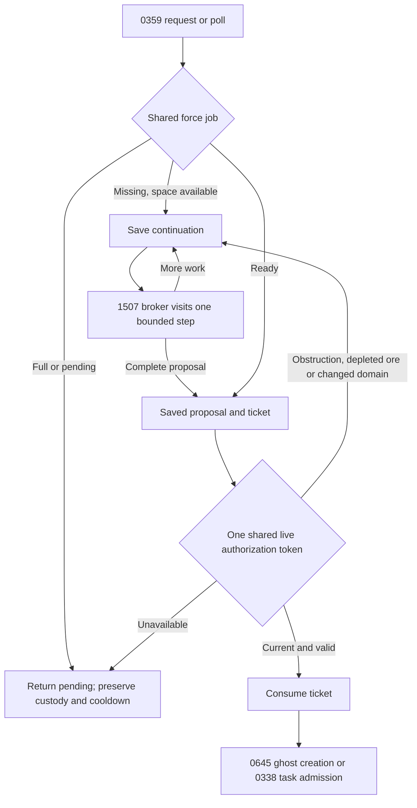

# Placement continuation 1507

## Authority and scheduling

`construction_site_planner.lua` (0359) remains the coordinate authority.
`construction_bootstrap_ghost_planner_0645.lua` creates planning ghosts;
`construction_planner.lua` (0338) remains the physical builder and inventory
custody owner. All searches now use `force_planning_queue.lua` (1507). Neither
placement caller advances a search when it submits or polls a request.

A force can take minutes to finish a large plan. No planner job changes the
movement tick rate, creates a fake work receipt, debits inventory, or installs a
new physical task while waiting. Existing physical construction keeps running
under the original dispatcher. The queue's global broker allowance, rather
than the number of priests or stations, bounds planning work each pulse.

## Charged work

The shared saved tick counters permit at most **15 placement search steps and
one final live authorization per game tick**, across callers and forces.
Rejected work consumes the same allowance as successful work. The central
broker also charges each visit, including waiting and rejected jobs; it
supplies a one-operation allowance to each handler.

| Work | Saved continuation and charge |
| --- | --- |
| Ordinary spiral | Ring and index; one candidate position per search step. The former top, left, bottom, right order is preserved without rebuilding a ring array. |
| Eligibility | Immutable metadata is requested separately. Each enabled-recipe candidate is checked in its own step. Final admission re-reads the selected recipe witness. |
| Resource discovery | One native cell query or one returned entity per step. Cells are at most 8 by 8 tiles and subdivide if the result page fills. |
| Mining placement | Separate resource, grid-anchor, nearby-drill, engine, clearance-query and clearance-entity steps. Resource priority and even/odd machine alignment remain enforced. |
| Defense territory | One neighboring station per step. A saved force/surface station epoch invalidates a proposal when station ownership changes. |
| Defense scoring | Threat discovery, candidates, clearances, service sides, support and spacing resume independently. Each returned entity is charged. |
| Fixed drill output | Uses the shared queue and final token, retaining the original engine/interior checks. An intentional output receiver is not rejected by an unrelated ordinary machine buffer. |
| Fixed positions and owned ghosts | `fixed-admission-placement-0359` returns an advisory ticket without moving the requested site. Physical admission spends the shared live token, validates current terrain and collisions, and exempts only the exact station-owned ghost. |
| Science advice | 0645's optional next-science hint uses a separate per-force queue job: one technology, prerequisite, ingredient or sort operation per step. Ghost creation does not wait for that hint. |

A narrow clearance query is bounded to the machine footprint and a maximum
128 returned entries. A full page fails closed. Mining/defense world discovery
uses capped cell pages instead of a single station-radius query. Dense pages
charge every returned row before subdivision; an unresolved minimum-size
overflow produces no placement.

## Pending, completion, and current-world validation

`placement-pending`, queue backpressure, missing metadata and exhausted live
authorization tokens all mean **unfinished work**. 0645 does not create a
`blocked-no-site` record for them. 0338 does not create a site refusal, new
failure cooldown, physical reservation or material custody for them. A true
completed search with no site remains a normal no-site outcome.

A proposal is identified by a serializable queue ticket. Before a new ghost or
physical task is admitted, its caller consumes the shared live token and
checks the actual world again. A newly blocked footprint is rejected before
inventory custody. Mining also verifies that its selected ore witness still
exists and has remaining resources. The station's position, surface, force,
and effective radius must still match the saved domain.

A 0645 ghost's identity, direction, position, force and owning station record
are checked before 0338 takes materials. The native `ghost_revive` placement
check validates current terrain and physical collisions; a bounded ghost query
rejects another ghost at the footprint. Fixed requests do not silently choose
a different coordinate. Ticketless, unstarted candidates from older saves
enter this admission path before becoming tasks. Already admitted tasks and
material custody continue under their existing execution authority.

Defense ownership is invalidated by constant-cost cogitator station events.
Station build/remove/clone events update only the relevant force/surface;
force/research/configuration changes invalidate the affected ownership proof.
Ordinary machine changes do not force a complete perimeter ranking restart.
Actual collision and service-side clearance are nevertheless checked live.

Already-admitted defense construction does not repeat an entire perimeter
ranking while carrying a machine. It retains its original admission and
checks current local collision and the recorded station domain. Existing
saved tasks from before this schema retain their established custody and are
still subject to the live engine/clearance checks.

## Save and reload

Search state is stored in the force queue, including ring/cell cursors,
selected recipe names, scoring phases, current bounded pages, and completed
proposal tickets. No coroutine, function, elapsed-time cutoff or profiler is
saved in a job. Native entity/force handles inside bounded pages use Factorio's
normal serializable object references and are checked for validity when read.
Module loading registers handlers again without replacing the saved jobs.

Elapsed time is not used to decide how much synchronized gameplay work runs.

## Source-level verification

The focused caller tests execute the production 0359, 0645 and 0338 modules,
with mocked Factorio objects:

- `ordinary_placement_continuation_1507.lua`: shared request deduplication,
  unchanged search order, 15 plus 1 hard caps, serialized continuation reload,
  full/stalled queues, no-action fairness, new obstruction before custody,
  changed stock and subsequent counted physical pickup.
- `placement_specialized_continuation_1507.lua`: fixed-defense and mining
  callers, per-station work, bounded native query geometry, changed territory,
  depleted/restored ore, no premature custody, and active construction.
- `placement_metadata_witness_1507.lua`: production metadata/constraints,
  cold lookup deferral, long disabled-recipe membership, and a revoked live
  recipe witness before ghost creation.
- `owned_ghost_admission_1507.lua`: actual 0645-to-0338 handoff, fixed position
  and direction, saved-state reload, full/stalled queues, shared final token,
  physical/terrain/foreign-ghost obstruction, changed stock and real pickup,
  including ticketless unstarted candidates restored from older versions.
- Existing mining alignment and live-clearance fixtures now drive the broker
  to completion instead of requiring the formerly synchronous API.
- Existing ghost-budget, master-plan reuse, physical source-footprint and
  distinct inventory-custody fixtures remain applicable.

These tests establish source behavior and accounting. They do not establish
native save compatibility, displayed FPS, native UPS, or the 100-active-priest
performance target. The headed smoke and matched baseline/candidate runs
remain separate acceptance evidence.
