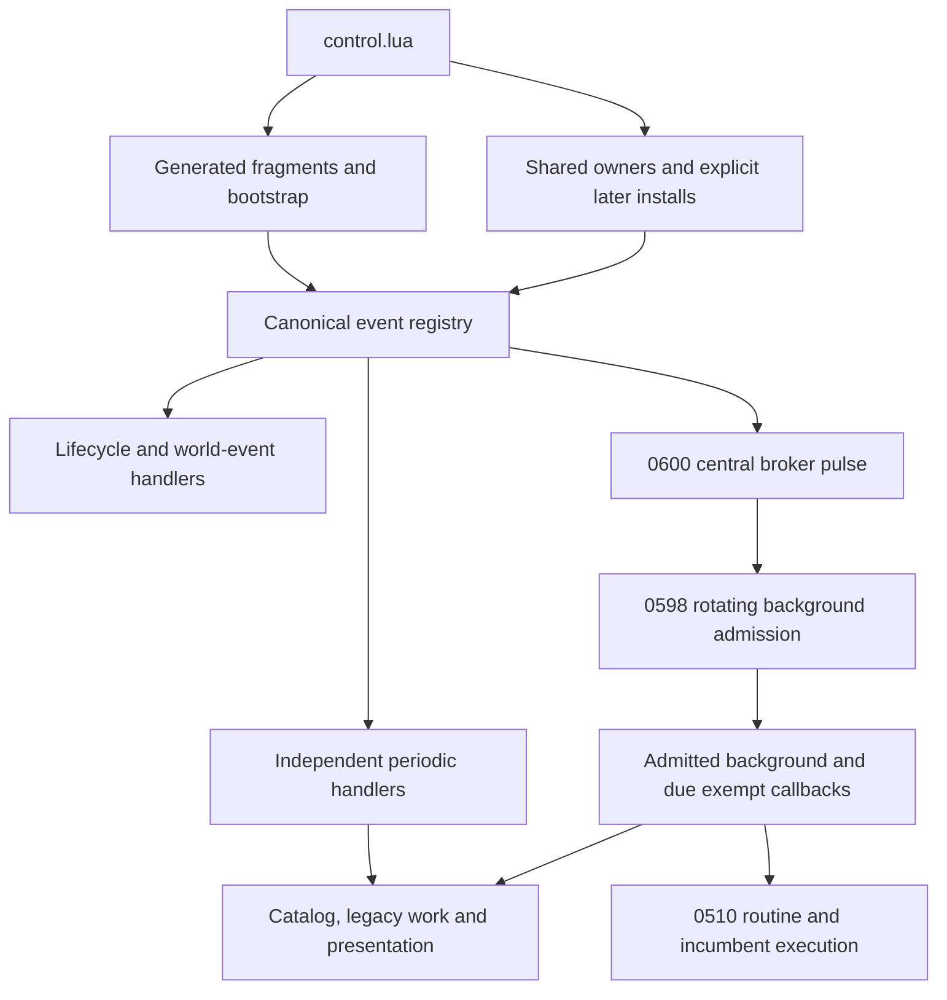
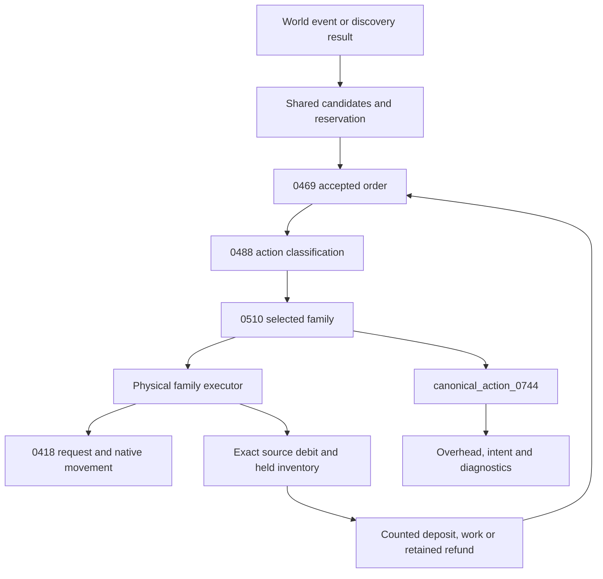
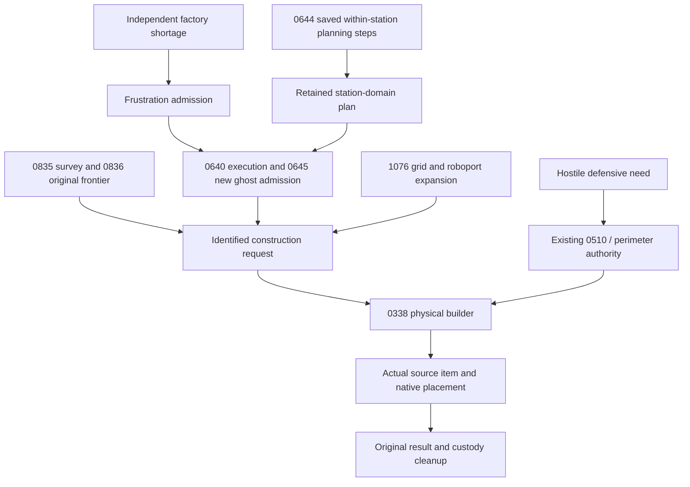
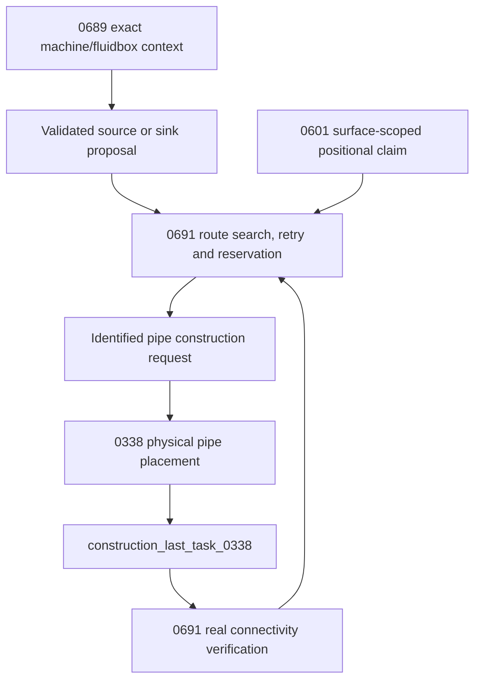
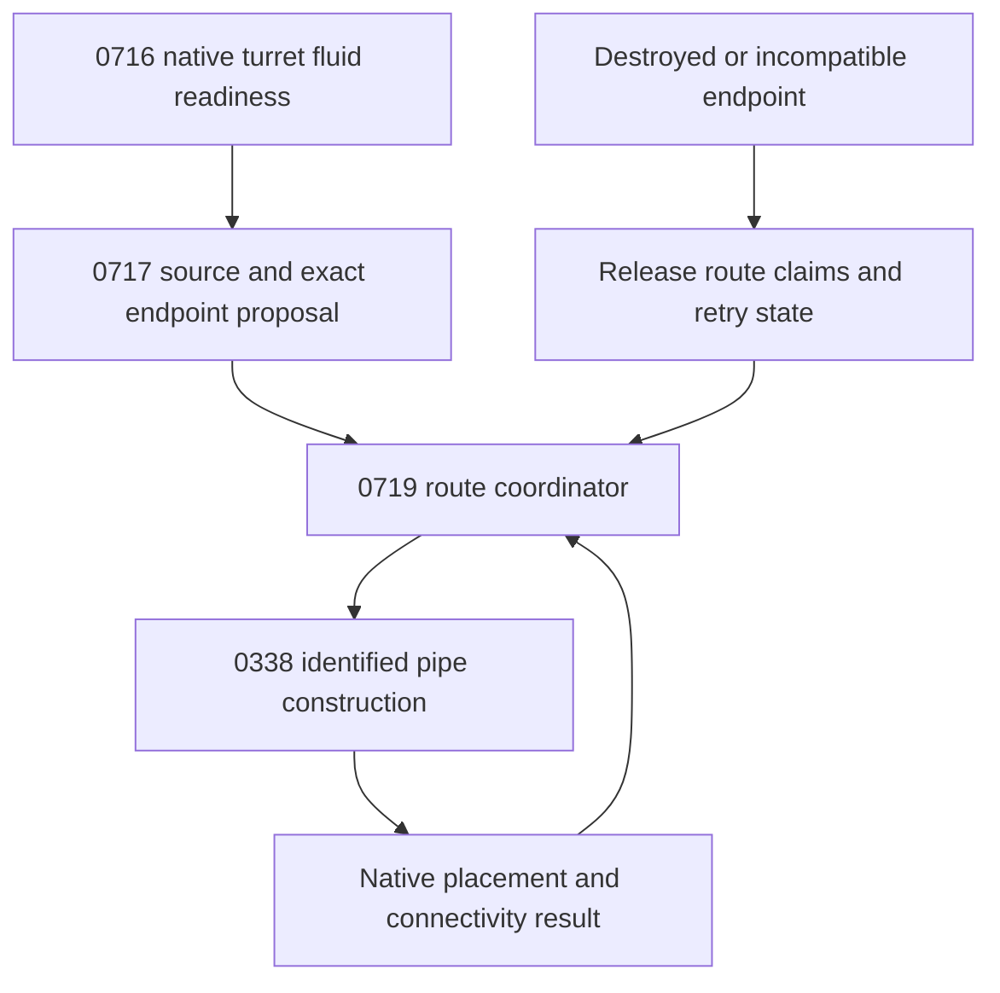

# Current Recovery and Runtime Authority Map

**Reviewed:** 2026-11-25. This is a source map, not native behavior or performance acceptance.
The number in this filename is retained for existing links; it is not a claim that the old implementation is still active.

Use the [complete source inventory](BEHAVIOR_SOURCE_INVENTORY.md) and its
[content hashes and source sites](BEHAVIOR_SOURCE_INVENTORY.json) for the full module/function/registration index.
Potential reachability, conditional wrappers, and retired source are distinguished there.
Source presence does not prove that a callback installed or ran in Factorio.

## Source scope and evidence status

The current declarative planning graph has **26 declarative active hardeners** and 48 explicitly retired authorities. That count covers `planning_constraints_0646`, not the entire loader or every live behavior. The generated source inventory supplies current file hashes, function/registration sites and potential dependency edges.

This map replaces stale claims that source version 0.1.674-dev, old rc.3 artifacts and an old workflow result constitute current acceptance. `info.json`, actual Git commits, native logs and publication records carry those facts independently. No current runtime/performance/release success is inferred from this document.

## Loader and timing ownership

The registry composes owner-keyed routes. It is not evidence that all callers use a common work budget. Its periodic routes and the broker's internal callbacks are separate admission boundaries. The current broker invokes 0598 for saved deadlines, deterministic initial phasing and rotating admission of at most four eligible background callbacks per pulse. Movement/dispatcher/combat categories and named queue, original-priest and custody services remain outside that background cap. Source-preserved direct/fallback calls and conditional installations remain explicitly inventoried.

## Order, selector, executor and observation

0527 fetch wraps the dispatcher before the original `service_pair`; incumbent cargo, defense, rail and expansion paths also precede ordinary classification. These are mapped in the [dispatcher drilldown](BEHAVIOR_MERMAID_FUNCTION_DRILLDOWN_0667_SINGLE_DISPATCHER.md). The broad behavior monitor is observational and incomplete; it is not the exhaustive executor graph.

## Canonical movement and lifecycle

| Responsibility | Current owner | Preserved boundary |
| --- | --- | --- |
| Ground request, priority, TTL, leases, native commands | `movement_controller` | One movement request; active custody and original owner checks. |
| Corridor proposal | `authority_corridor_pathing_0574` | Read-only route proposal, no independent command owner. |
| Void/platform backend | `void_movement_authority_0630`, explicit platform owners | Backend-specific surface/stepped movement; not an offscreen ground teleport substitute. |
| Pair ledger/reverse maps and disappearance | `station_pair_state`, `priest_lifecycle_authority_0499` | Observe original identities, conservative rebind and controlled recovery. |
| Controlled missing-priest recovery | 0503 under 0499 authorization | Existing exact recovery policy; not a free respawn loop. |
| Physical station relocation | `station_relocation_0823`, `station_cargo_0824` | Original station/worker, engine inventory custody, exact staged rebuild. |
| Station starvation reversal | 0850 family, 0921 continuations and protected depots | Reserve future work without abandoning physical incumbent work. |
| Station resupply | `station_surplus_resupply_1208` | Original counted courier; movement recovery exclusions. |

## Construction and resource strategy

Defensive construction stays separate from the frustration timer. The timer admits independent emergency factory expansion; it does not suspend urgent repair or defense. The periodic 0644 survey may still run before frustration; 0640 gates autonomous prerequisite execution, while 0645 gates new ghosts after reconciling existing owned sites. Plans and ghosts are not completion. Native robot jobs require actual material/network prerequisites and a real build receipt.

0645 consumes `pair.master_infrastructure_plan_0644` while station identity, surface, force, position, canonical clamped radius, metadata epoch and world witness match. Elapsed time does not initiate another master survey. Cold stations, old snapshot schemas and changed domains initialize through 0644; observing physical completion of its current target permits one immediate owner refresh so the same call cannot recreate that completed ghost. Live stock and construction custody still govern active-ghost replacement, and explicit requested-entity reservations bypass the autonomous proposal. Failed domain/completion refreshes cannot authorize an obsolete proposal.

Remote-resource strategies remain source-distinct: 0820 station chain; 0835 railway observation; 0836 next surveyed rail/build request; 0837 counted ore courier; existing native train, builder and worker execution. The source map does not establish sustained production or a successful rail save/reload.

## Consolidated specialized logistics

| Family | Readiness / discovery | Dispatcher physical owner | Persistent custody |
| --- | --- | --- | --- |
| Machines | 0528 discovery | 0528 | `machine_logistics_custody_0528` |
| Item inventories | 0702 | 0702 | `item_family_custody_0702` |
| Energy and fuel | 0705 / 0707 | 0707 | `energy_family_custody_0707` |
| Rocket silos | 0709 / 0710 | 0710 | `rocket_silo_custody_0710` |
| Artillery | 0712 / 0713 | 0713 | `artillery_custody_0713` |
| Existing roboports | 0714 / 0715 | 0715 | `roboport_repair_custody_0715` |

Readiness is not physical transfer. Discovery-only services publish candidates; the corresponding executor revalidates source, target, external ownership and actual inventory before acting. Roboport placement remains construction, while 0715 services repair packs in existing ports.

## Standard-fluid authority

The installed services are `fluid_network_doctrine_0689` and `standard_fluid_route_discovery_0691`. 0689 inspects and proposes; 0691 coordinates route/reservations/requests; 0338 alone moves the priest and consumes/places pipe items. Their explicit 1259 control installation is material: requiring a file in a unit test does not install its services in Factorio.

## Fluid-turret authority

`fluid_turret_route_discovery_0719` owns route discovery, not direct inventory or entity mutation. 0716/0717 interpret internal fluid/ammunition state and exact endpoints.

## Physical accounting and terminal cleanup

| Physical work | Accounting owner | Failure handling |
| --- | --- | --- |
| Direct acquisition | 0513 | Preserve extracted cargo until actual station deposit. |
| Recipe production | 0514 | Ingredient rollback or recipe-backed output custody. |
| Repair | 0516 | Held pack, verified health write, exact refund. |
| Consecration | 0515 | Shared sanctify claim, real rite item, retained refund and matching-order terminal acknowledgement. |
| Construction | 0338 | Real carried item, exact site revalidation, return remainder. |
| Generic storage / transfer | 0686 and `inventory_steward` | Shared 0327 retained four-type view with live generic-store checks. Chest/car-trunk/spider-trunk selection excludes vehicle fuel; machine work slots remain with their family executors. |
| Legacy known-source fetch | 0527 | Immediate transfer compatibility route; inspect its actual partial-deposit/refund contract separately. |

Consecration membership stays in `storage.tech_priests.consecration.machines`. The existing runtime bridge's 89-tick route performs an initial registration seed only when missing, or retries an incomplete seed; elapsed time no longer starts a full-surface rescan. Configuration changes request one fresh seed and explicit diagnostic scans remain available. Build, clone, removal, platform and generated-chunk routes maintain records through the existing registration authority. Record identity, wear, quality and operation history are retained. The existing 149-tick visibility watchdog refreshes selected-machine presentation without starting another global registration scan; decay, research and modules retain their current owners.

## Native combat and additional runtime families

The [full source inventory](BEHAVIOR_SOURCE_INVENTORY.md) also includes enemy colony seeding/research announcements, combat roster/muster/native AAI integration, bunker weapons, hydrogen runtime, orbital-trader visuals, Martian infrastructure and conditional Voidship armory. These explicit `control.lua` installs cannot be omitted merely because they were added after the older behavior-map series.

Combat roster preparation uses original 0338/0702 material owners. Native combat movement/targeting belongs to the native bridge/controller. Combat actors, including AAI forms implemented as cars, are excluded by consecration eligibility. Physical pickup and old-save cleanup are lifecycle/registry concerns, not a new sanctity behavior.

`control.lua` installs `bunker_cannon_integration.install_main` through the canonical event registry. Its init/configuration routes call `bunker_family_visuals.init`, which both seeds existing weapon visuals and restores enabled recipes for already researched bunker technologies. The unlock recovery reads `technology.prototype.effects` and writes the corresponding force recipe's `enabled` state. The module therefore has this lifecycle mutation alongside its visual role; native weapon targeting, projectiles, damage and ammunition remain separate combat owners. The source-preserved raw `install()` route is not the canonical main installation path.

The existing proxy ammunition owner 0649 keeps live inventory accounting and retained refund custody. Its current source collects station sources once per ammo query, reuses a derived immutable-prototype ammo list and returns early for a valid empty proxy inventory. Those read reductions do not change its 41-tick combat service into a deferred background route.

Generated 0302 remains the fixed-rank priest armor and damage authority. The obsolete 0297 force-wide 811-tick best-armor refresh is retired, and the preserved 0297 build entry delegates to 0302. Creation/recovery, research/reset, damage response and the existing 887-tick all-pair refresh remain. Armor alias lookups use the existing 0646 product-to-recipe membership and check enabled state live; direct recipe and missing-mech compatibility behavior are preserved. Explicit legacy 0297 force-profile helpers retain immutable armor metadata and share 0646 membership while reading enablement live and returning independent profile/resistance tables. They do not reinstate the retired poll. The 887 route still traverses the pair roster and is not an internally bounded continuation. The [combat/armor map](BEHAVIOR_MERMAID_FUNCTION_DRILLDOWN_0675_COMBAT_REPAIR.md#fixed-rank-priest-armor-0302) records these separate routes.

## Retired authority boundary

Player appearance has no physical recovery transaction. The picker uses the
original character and updates attached drawings for every selection, including
Engineer; `character_skin_transfer` is no longer reachable from the picker.
Existing custom-host saves keep that same body with corrected native animation
timing and gameplay properties. A configuration restore reattaches the chosen
drawing, and future deaths retain the standard native inventory corpse. No
crafting, combat, vehicle or robot state is moved to another body. The
[appearance route](BEHAVIOR_MERMAID_MAP_0660.md#character-appearance-and-native-player-ownership)
records rendering and lifecycle ownership separately from native simulation.

Forty-eight files remain explicitly retired in the planning declaration. They include the old mutable movement/leaf chain, construction preemption, remote salvage, duplicate repair/machine wrappers, 0505 behavior executor, death/recovery duplicates and specialized fluid/item/energy/silo/artillery wrappers. The [function index](BEHAVIOR_FUNCTION_MAP_0659.md#retired-source-must-not-be-drawn-as-live-behavior) gives their replacements; the inventory records every declared entry.

Retired source may be inspected as history. Re-enabling an installer, timer, state writer or wrapper is a runtime design change and must not happen incidentally while fixing a canonical owner.

## Performance protocol boundaries

- The broker's per-callback work budget and its four eligible-background-callback admission cap are different limits. Every callback must honor its offered work count; the cap does not limit total callbacks or elapsed milliseconds.
- Registry siblings, raw fallbacks and synchronous caller chains require separate accounting.
- A native-query result cap, a Lua candidate-loop cap, a pair budget and a time measurement are different facts.
- Per-pair fairness needs a retained cursor. Prefix loops in 0689 and 0716 remain open source findings; restart-from-first scanning can starve larger populations.
- `station_catalog` keeps 60-tick admission of two due stations and resumes saved work through the same registry owner every four ticks. Pending jobs share one native query and 256 counted work units per pulse; published snapshots remain available. Admission/pending-roster collection and sorting, cold ownership-index rebuilding and explicit synchronous scans remain separate costs. Ordinary cold readers enqueue an incomplete pending snapshot. Cursors preserve progress within a survey; its 13-query / 3,072-unique-result total bounds still cannot guarantee coverage of an incomplete tail across surveys.
- Movement, incumbent inventory return, defense and queue continuation must keep their existing required response while expensive discovery is deferred.

The 0640 discarded-budget/acted-only loop is repaired in its existing owner: the broker passes its budget; traversal counts every inspected slot and resumes saved `service_cursor`, preserving the acted-count compatibility result. Source tests can prove visit counts and rotation; only native evidence can establish its cost in the owner's save.

0733 now reports retired planner audit 0730 explicitly from `0646.RETIRED`, with `passed=false`, while checking live 0719 capabilities without running the planner. Existing 0725 requires the actual `fluid_turret_route_discovery_0719` service and existing 0717, and 0721 requires the current replacement globals, including `TechPriestsWorkReservations0601`. Their retirement metadata comes from the same canonical declaration. This corrects obsolete requirements that kept checkpoints incomplete. Init/configuration/source-revision checks, incomplete-state retries and 0735 migration assertions remain; only a completed state takes the cheap 601-tick broker branch. 0725 also requires the actual energy, rocket-silo, artillery and roboport discovery-service registrations. 0721 uses 0720's managed diagnostic-command predicate: the real High Fabricator designation command remains functional, while owned diagnostic commands still fail and are cleaned. The existing 0721 service retains its 307-tick task/custody/request/module/command audits and advances a persisted storage traversal every five ticks while pending, under a shared 256-work budget per game tick. Ordinary and serialization deadlines are saved through existing 0598; idle callbacks sleep. There is no overlapping walk or restart at a periodic deadline. Completion retains a scalar last-completed summary and makes the next walk due no sooner than 3,600 ticks later. Pending, unsupported, depth-limited or aborted traversal cannot produce a successful checkpoint. This is a rolling observation of mutable storage, not an atomic snapshot; the other independent audit services remain active.

The shared discovery changes are mapped in [0661](BEHAVIOR_MERMAID_FUNCTION_DRILLDOWN_0661.md). The 0327 inventory API, 0527, 0686, doctrine and 0643 use item-independent typed membership in the existing 0587 owner. Events cover construction/removal, movement, corpses, cargo, rocket launch and overlapping newly generated chunks. The shared API also reads engine-maintained vehicle/network-robot lists and retained-silo pods; observed identities enter the same cache. Last-cell removal preserves known deployed robots in batches. No timed expiry is applied, including to empty areas, and wider coverage serves narrower live views without alternating-radius reseeds. Initial population, changed station domain/type policy, coverage expansion or explicit cache clearing can rebuild membership. Current force, range, slot, wire and quantity policy remains with each consumer. The 256-entry generic-storage view retains its complete overflow; it is not a native query cap. Unraised scripts, never-observed outside-area orphans and some equipment-removal timing can still require explicit refresh. Missing metadata/event ownership or disabled caching retains compatibility discovery.

0634 retains dirty resource snapshots rather than synchronously rescanning per entity event; player stock/cursor events clear shortage answers without dirtying physical discovery or replacing its dirty token. Its finite-resource-depletion route releases exact/legacy ownership through 0327 and requests a nearby follow-up without scanning; infinite minimum-yield events preserve their usable claims. Scheduled 0327 native surveys exclude inventory-bearing types and merge borrowed 0587 identities without `get_contents`, full-list copies per slice or false complete-cell certification in 0579. Source-record/list revisions detect event updates and compaction during a survey. Item lookup reads live counts; explicit Work State/catalog UI rendering calls `snapshot_inventory` for live contents while retaining membership. Cold or obsolete-domain `get_for_pair` returns an incomplete current-domain pending snapshot without scanning; an already matching replacement job retains its deadline. Resource lookup validates current surface, native area overlap and canonical ownership, tries retained alternate instances and returns live distance. Publication keeps the latest explicit UI inventory table/timestamp. Explicit manual scans, unsupported-engine compatibility paths and other physical infrastructure/resource surveys remain separate spatial work. 0527 uses a six-type shared view with its existing same-or-neutral/circular/slot policy; a covered miss does not trigger a second nearby inventory search. Its loose-ground-item path and inactive 0526 source remain distinct.

0643 now admits a saved roster and one continuation per force/surface group
through `force_planning_queue_1507`. Each station, entity, provider slot,
recipe/material candidate and final request consumes work. A single large
factory group is split internally. Typed native inventory policy, force,
surface, 36-tile reach and logistic-network checks remain live. A final per-need
stock pass and current local witnesses precede 0645; partial group reports never
publish reservations. Relevant world edits cancel obsolete decisions. See the
[shortage continuation map](SHORTAGE_PLANNING_CONTINUATION_1507.md).

The catalog's existing scan reuses claim identity keys and read-only prototype-product arrays, and uses authoritative connector counts instead of materializing known-empty connections. Fully successful modern connector checks avoid obsolete property probes; uncertain checks retain compatibility fallbacks. Its scheduled continuation saves quadrant/result, deduplication, classification, subordinate-sort and ownership-retirement cursors. It publishes only after all phases finish; later changes request a follow-up without restarting current work. Domain cancellation rolls back staged-only claims while preserving external radar/build claims and current ownership, including a replaced pair record. Explicit synchronous refresh supersedes pending publication. Admission time remains the catalog age and original due-time basis; completion time is recorded separately. The native four-station fixture resumed a saved partial result and matched all 2,401 claims per station in 492–504 ticks at the one-query / 256-work maxima. This isolated result is not the matched owner-save timing acceptance.

0644's public callers now only submit/read shared jobs. Saved roster, area,
entity, inventory, recipe, receiver and science cursors replace whole-station
execution. A final bounded stock recount and cell validation precede advisory
publication. Domain, metadata epoch and at most four region counters invalidate
late world edits, including finished but unconsumed results. Science selection
retains current prerequisite, lab and material checks. No observation grants
custody or an atomic factory-wide stock reservation.

The one force-planning broker service shares at most 16 charged handler visits
per admitted pulse across all forces and jobs. No-action work rotates normally;
64 ordinary jobs per force and 256 globally impose backpressure. Shared item
and recipe indices have bounded reserved dependency capacity with the same
work budget, avoiding reset deadlocks when ordinary queues are full. Its
saved state uses scalar cursors/tables and native object identities. Native
movement, repair and active construction continue through their existing
owners. The [infrastructure drilldown](BEHAVIOR_MERMAID_FUNCTION_DRILLDOWN_0666_INFRASTRUCTURE_PLANNING.md#0644-cycle-continuation)
records the current routes; the former eight-whole-station cycle and synchronous
public/registry paths no longer describe 0644.

0359's ordinary, mining, defense, fixed-output and fixed/owned-ghost proposals share queue-backed
search and one live admission token. Pending/full is not no-site and cannot
claim stock or start a failure cooldown. The [construction map](BEHAVIOR_MERMAID_FUNCTION_DRILLDOWN_0665_CONSTRUCTION.md)
retains physical executor ownership. Ticketless unstarted candidates restored
from older saves acquire current admission; already admitted custody continues.
0259's separate perimeter planner also uses saved inner catalogue, point,
neighboring-station, support and fluidbox steps. Its physical defense executor
remains the owner, and pending work permits other dispatch. The [defense map](BEHAVIOR_MERMAID_DEFENSE_PLANNING_1507.md)
records its live authority and shared check allowance.
Learned path crossings remain subordinate
to native movement and edited-chunk invalidation, as shown in [0664](BEHAVIOR_MERMAID_FUNCTION_DRILLDOWN_0664_MOVEMENT_CONTROLLER.md).

## Stage 5 — Evidence and Release Boundary

Source mapping, freshness checking, installation, native execution, save/reload, timing, packaging and publication are different evidence states. Record the exact source commit/digest and artifact for each. A generated map or a green static count check cannot close a performance complaint.

Historical validation of `511254d59e76980706921c0a518c7b7f9440d214` in run `29875375384` applies only to that historical source. It is not current performance evidence. Historical 0.1.672/0.1.674-dev/rc.3 milestone statements are likewise not current release authorization or current `info.json` values. Current work and results belong in canonical development history and the current testing goals.

To accept a performance repair, retain matched source/save/settings, engine version, population, warmup/sample windows, profile scope, before/after timings and workload progress. If the comparison cannot be run, leave performance acceptance open and name the missing evidence.

## Update and evidence rule

Change the relevant diagram and ownership/exit description with the source change. Regenerate the source inventory with `python tools/audit_ups_hotspots_0743.py --write-behavior-maps`, explicitly acknowledge the reviewed curated maps with `--acknowledge-behavior-map-review`, then run `--check-behavior-maps` through the same tool. Generation alone does not bless a changed manual diagram. Follow the [performance validation protocol](UPS_VALIDATION_RUNBOOK_0742.md) for exact source, save, engine version, population, profiling settings, sample window and artifacts. A clean map check proves freshness only.
