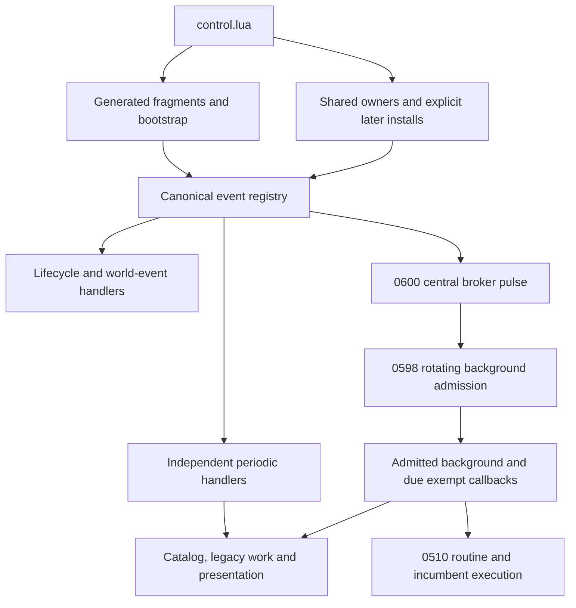
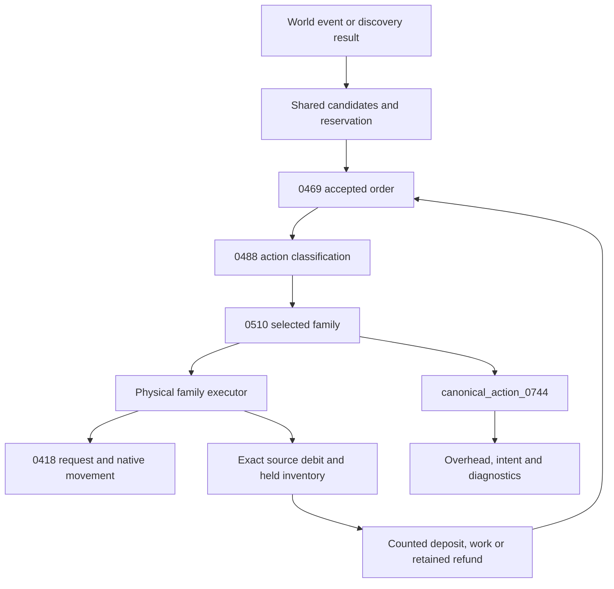
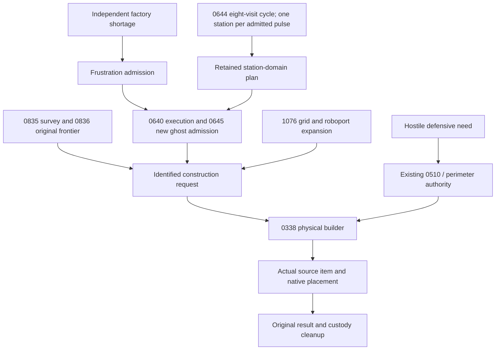
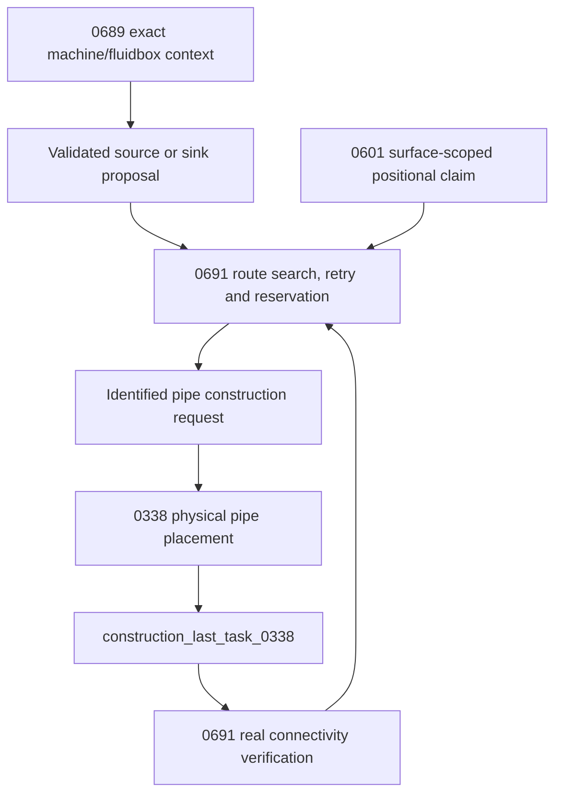
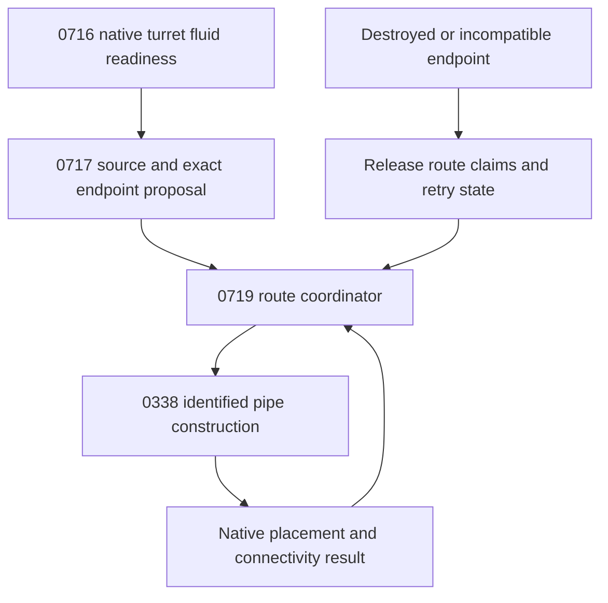

# Current Recovery and Runtime Authority Map

**Reviewed:** 2026-11-25. This is a source map, not native behavior or performance acceptance.
The number in this filename is retained for existing links; it is not a claim that the old implementation is still active.

Use the [complete source inventory](BEHAVIOR_SOURCE_INVENTORY.md) and its
[content hashes and source sites](BEHAVIOR_SOURCE_INVENTORY.json) for the full module/function/registration index.
Potential reachability, conditional wrappers, and retired source are distinguished there.
Source presence does not prove that a callback installed or ran in Factorio.

## Source scope and evidence status

The current declarative planning graph has **26 declarative active hardeners** and 48 explicitly retired authorities. That count covers `planning_constraints_0646`, not the entire loader or every live behavior. The generated source inventory supplies current file hashes, function/registration sites and potential dependency edges.

This map replaces stale claims that source version 0.1.674-dev, old rc.3 artifacts and an old workflow result constitute current acceptance. `info.json`, actual Git commits, native logs and publication records carry those facts independently. No current runtime/performance/release success is inferred from this document.

## Loader and timing ownership

The registry composes owner-keyed routes. It is not evidence that all callers use a common work budget. Its periodic routes and the broker's internal callbacks are separate admission boundaries. The current broker invokes 0598 for saved deadlines, deterministic initial phasing and rotating admission of at most four eligible background callbacks per pulse. Movement/dispatcher/combat categories and named queue, original-priest and custody services remain outside that background cap. Source-preserved direct/fallback calls and conditional installations remain explicitly inventoried.

## Order, selector, executor and observation

0527 fetch wraps the dispatcher before the original `service_pair`; incumbent cargo, defense, rail and expansion paths also precede ordinary classification. These are mapped in the [dispatcher drilldown](BEHAVIOR_MERMAID_FUNCTION_DRILLDOWN_0667_SINGLE_DISPATCHER.md). The broad behavior monitor is observational and incomplete; it is not the exhaustive executor graph.

## Canonical movement and lifecycle

| Responsibility | Current owner | Preserved boundary |
| --- | --- | --- |
| Ground request, priority, TTL, leases, native commands | `movement_controller` | One movement request; active custody and original owner checks. |
| Corridor proposal | `authority_corridor_pathing_0574` | Read-only route proposal, no independent command owner. |
| Void/platform backend | `void_movement_authority_0630`, explicit platform owners | Backend-specific surface/stepped movement; not an offscreen ground teleport substitute. |
| Pair ledger/reverse maps and disappearance | `station_pair_state`, `priest_lifecycle_authority_0499` | Observe original identities, conservative rebind and controlled recovery. |
| Controlled missing-priest recovery | 0503 under 0499 authorization | Existing exact recovery policy; not a free respawn loop. |
| Physical station relocation | `station_relocation_0823`, `station_cargo_0824` | Original station/worker, engine inventory custody, exact staged rebuild. |
| Station starvation reversal | 0850 family, 0921 continuations and protected depots | Reserve future work without abandoning physical incumbent work. |
| Station resupply | `station_surplus_resupply_1208` | Original counted courier; movement recovery exclusions. |

## Construction and resource strategy

Defensive construction stays separate from the frustration timer. The timer admits independent emergency factory expansion; it does not suspend urgent repair or defense. The periodic 0644 survey may still run before frustration; 0640 gates autonomous prerequisite execution, while 0645 gates new ghosts after reconciling existing owned sites. Plans and ghosts are not completion. Native robot jobs require actual material/network prerequisites and a real build receipt.

0645 consumes `pair.master_infrastructure_plan_0644` while station identity, surface, force, position and canonical clamped radius match. Elapsed time does not initiate another master survey. Cold stations, old snapshot schemas and changed domains initialize through 0644; observing physical completion of its current target permits one immediate owner refresh so the same call cannot recreate that completed ghost. Live stock and construction custody still govern active-ghost replacement, and explicit requested-entity reservations bypass the autonomous proposal. Failed domain/completion refreshes cannot authorize an obsolete proposal.

Remote-resource strategies remain source-distinct: 0820 station chain; 0835 railway observation; 0836 next surveyed rail/build request; 0837 counted ore courier; existing native train, builder and worker execution. The source map does not establish sustained production or a successful rail save/reload.

## Consolidated specialized logistics

| Family | Readiness / discovery | Dispatcher physical owner | Persistent custody |
| --- | --- | --- | --- |
| Machines | 0528 discovery | 0528 | `machine_logistics_custody_0528` |
| Item inventories | 0702 | 0702 | `item_family_custody_0702` |
| Energy and fuel | 0705 / 0707 | 0707 | `energy_family_custody_0707` |
| Rocket silos | 0709 / 0710 | 0710 | `rocket_silo_custody_0710` |
| Artillery | 0712 / 0713 | 0713 | `artillery_custody_0713` |
| Existing roboports | 0714 / 0715 | 0715 | `roboport_repair_custody_0715` |

Readiness is not physical transfer. Discovery-only services publish candidates; the corresponding executor revalidates source, target, external ownership and actual inventory before acting. Roboport placement remains construction, while 0715 services repair packs in existing ports.

## Standard-fluid authority

The installed services are `fluid_network_doctrine_0689` and `standard_fluid_route_discovery_0691`. 0689 inspects and proposes; 0691 coordinates route/reservations/requests; 0338 alone moves the priest and consumes/places pipe items. Their explicit 1259 control installation is material: requiring a file in a unit test does not install its services in Factorio.

## Fluid-turret authority

`fluid_turret_route_discovery_0719` owns route discovery, not direct inventory or entity mutation. 0716/0717 interpret internal fluid/ammunition state and exact endpoints.

## Physical accounting and terminal cleanup

| Physical work | Accounting owner | Failure handling |
| --- | --- | --- |
| Direct acquisition | 0513 | Preserve extracted cargo until actual station deposit. |
| Recipe production | 0514 | Ingredient rollback or recipe-backed output custody. |
| Repair | 0516 | Held pack, verified health write, exact refund. |
| Consecration | 0515 | Shared sanctify claim, real rite item, retained refund and matching-order terminal acknowledgement. |
| Construction | 0338 | Real carried item, exact site revalidation, return remainder. |
| Generic storage / transfer | 0686 and `inventory_steward` | Generic stores only; no treating machine work slots as generic depots. |
| Legacy known-source fetch | 0527 | Immediate transfer compatibility route; inspect its actual partial-deposit/refund contract separately. |

Consecration membership stays in `storage.tech_priests.consecration.machines`. The existing runtime bridge's 89-tick route performs an initial registration seed only when missing, or retries an incomplete seed; elapsed time no longer starts a full-surface rescan. Configuration changes request one fresh seed and explicit diagnostic scans remain available. Build, clone, removal, platform and generated-chunk routes maintain records through the existing registration authority. Record identity, wear, quality and operation history are retained. The existing 149-tick visibility watchdog refreshes selected-machine presentation without starting another global registration scan; decay, research and modules retain their current owners.

## Native combat and additional runtime families

The [full source inventory](BEHAVIOR_SOURCE_INVENTORY.md) also includes enemy colony seeding/research announcements, combat roster/muster/native AAI integration, bunker weapons, hydrogen runtime, orbital-trader visuals, Martian infrastructure and conditional Voidship armory. These explicit `control.lua` installs cannot be omitted merely because they were added after the older behavior-map series.

Combat roster preparation uses original 0338/0702 material owners. Native combat movement/targeting belongs to the native bridge/controller. Combat actors, including AAI forms implemented as cars, are excluded by consecration eligibility. Physical pickup and old-save cleanup are lifecycle/registry concerns, not a new sanctity behavior.

`control.lua` installs `bunker_cannon_integration.install_main` through the canonical event registry. Its init/configuration routes call `bunker_family_visuals.init`, which both seeds existing weapon visuals and restores enabled recipes for already researched bunker technologies. The unlock recovery reads `technology.prototype.effects` and writes the corresponding force recipe's `enabled` state. The module therefore has this lifecycle mutation alongside its visual role; native weapon targeting, projectiles, damage and ammunition remain separate combat owners. The source-preserved raw `install()` route is not the canonical main installation path.

The existing proxy ammunition owner 0649 keeps live inventory accounting and retained refund custody. Its current source collects station sources once per ammo query, reuses a derived immutable-prototype ammo list and returns early for a valid empty proxy inventory. Those read reductions do not change its 41-tick combat service into a deferred background route.

## Retired authority boundary

Forty-eight files remain explicitly retired in the planning declaration. They include the old mutable movement/leaf chain, construction preemption, remote salvage, duplicate repair/machine wrappers, 0505 behavior executor, death/recovery duplicates and specialized fluid/item/energy/silo/artillery wrappers. The [function index](BEHAVIOR_FUNCTION_MAP_0659.md#retired-source-must-not-be-drawn-as-live-behavior) gives their replacements; the inventory records every declared entry.

Retired source may be inspected as history. Re-enabling an installer, timer, state writer or wrapper is a runtime design change and must not happen incidentally while fixing a canonical owner.

## Performance protocol boundaries

- The broker's per-callback work budget and its four eligible-background-callback admission cap are different limits. Every callback must honor its offered work count; the cap does not limit total callbacks or elapsed milliseconds.
- Registry siblings, raw fallbacks and synchronous caller chains require separate accounting.
- A native-query result cap, a Lua candidate-loop cap, a pair budget and a time measurement are different facts.
- Per-pair fairness needs a retained cursor. Prefix loops in 0689 and 0716 remain open source findings; restart-from-first scanning can starve larger populations.
- `station_catalog` has a separate 60-tick registry cadence and synchronous cold/explicit access; broker deferral does not cover it automatically. The route rotates two due stations, while due-roster collection and sorting still visit the roster. Dense subdivision restarts in each station area without a retained entity/subtree cursor; preserving ownership on an incomplete scan does not prove complete or eventual candidate coverage.
- Movement, incumbent inventory return, defense and queue continuation must keep their existing required response while expensive discovery is deferred.

The 0640 discarded-budget/acted-only loop is repaired in its existing owner: the broker passes its budget; traversal counts every inspected slot and resumes saved `service_cursor`, preserving the acted-count compatibility result. Source tests can prove visit counts and rotation; only native evidence can establish its cost in the owner's save.

The shared discovery changes are mapped in [0661](BEHAVIOR_MERMAID_FUNCTION_DRILLDOWN_0661.md). 0527 and 0686 reuse item-independent typed source membership in the existing 0587 cache owner. Physical identities are retained independently of live force eligibility; topology, player/vehicle/train/spider movement and corpse events update membership. A 1,800-tick demand expiry also bounds reuse of initially empty results and discovers previously unseen silent arrivals on the next request. Expiry alone does not run a scan. Initial population, changed station domain/type policy or an explicit clear can rebuild sooner; a missing event owner falls back to fresh discovery. Consumers read current quantities/eligibility, and 0527's catalog path checks live radius and distance before choosing a retained source. Initial and expired discovery use complete native queries; a 256-entry generic-storage view is not an engine query cap. 0527 and the source-preserved 0526 helper read existing catalog state without forcing a scan on item misses.

0634 retains dirty catalog snapshots rather than synchronously rescanning per world event; ordinary known-resource rendering reuses an existing snapshot but cold `get_for_pair` can still scan. The separate periodic 0327 broad world survey still includes inventory-bearing entities and reads their contents for its catalog; this is not a claim that every surrounding-world query is event-only. 0527's loose-ground-item scan is also a separate path from retained inventory membership.

The catalog's existing scan now reuses claim identity keys and read-only prototype-product arrays, and uses authoritative connector counts instead of materializing known-empty connections. Fully successful modern connector checks avoid obsolete property probes; uncertain checks retain compatibility fallbacks. Those changes do not reduce entity/query limits or change the scan cadence. The 13-query / 3,072-unique-result bound and incomplete dense coverage remain separate limitations.

0644 shares item counts only inside one synchronous `build_plan` call and reuses laboratories from its role survey. 0646 retains immutable product-to-recipe-name membership in original force recipe order, including disabled recipes; enabled flags and ingredients are read live. Its optional third unlock result is the currently selected live recipe, not a cached availability answer. 0644 requests products-only candidates and preserves the first matching enabled recipe's feasibility result.

The 0644 broker route retains up to eight station IDs per 97-tick cycle, attempts one current pair per admitted five-tick pulse, and saves both its cursor and the cycle's original deadline. Failed or removed IDs consume an attempt so they cannot hold the batch in place. The existing 0598 owner persists revised continuation deadlines through reload. This preserves up to eight visits per roughly 100 ticks when admission is available; it does not reduce the survey allowance to one visit per 97 ticks. Public `service_all` remains synchronous, and its conditional registry fallback retains the default cap of 24 per 97 ticks. The [infrastructure drilldown](BEHAVIOR_MERMAID_FUNCTION_DRILLDOWN_0666_INFRASTRUCTURE_PLANNING.md#0644-cycle-continuation) maps those separate routes. These source boundaries do not claim a measured native improvement.

## Stage 5 — Evidence and Release Boundary

Source mapping, freshness checking, installation, native execution, save/reload, timing, packaging and publication are different evidence states. Record the exact source commit/digest and artifact for each. A generated map or a green static count check cannot close a performance complaint.

Historical validation of `511254d59e76980706921c0a518c7b7f9440d214` in run `29875375384` applies only to that historical source. It is not current performance evidence. Historical 0.1.672/0.1.674-dev/rc.3 milestone statements are likewise not current release authorization or current `info.json` values. Current work and results belong in canonical development history and the current testing goals.

To accept a performance repair, retain matched source/save/settings, engine version, population, warmup/sample windows, profile scope, before/after timings and workload progress. If the comparison cannot be run, leave performance acceptance open and name the missing evidence.

## Update and evidence rule

Change the relevant diagram and ownership/exit description with the source change. Regenerate the source inventory with `python tools/audit_ups_hotspots_0743.py --write-behavior-maps`, explicitly acknowledge the reviewed curated maps with `--acknowledge-behavior-map-review`, then run `--check-behavior-maps` through the same tool. Generation alone does not bless a changed manual diagram. Follow the [performance validation protocol](UPS_VALIDATION_RUNBOOK_0742.md) for exact source, save, engine version, population, profiling settings, sample window and artifacts. A clean map check proves freshness only.
