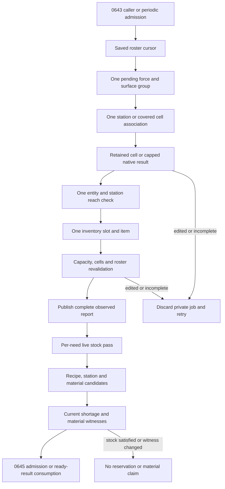

# 0643 shortage assessment continuation

Source baseline: `025a7a5d613f1df6e3b131aad0b1cc5006760160`.
This document describes the implementation under integration, not a completed
Factorio frame-rate result. The integrator records the final commit and headed
run evidence separately.

## Authority and scheduling

`emergency_facility_placement_bridge_0643.assess()` admits a roster request and
returns the last complete reports. It never advances a survey. The existing
113-tick broker callback also only admits work. `force_planning_queue` is the
sole executor: its saved per-force queues share a deterministic global budget,
and each visit advances one bounded operation. The neutral bookkeeping queue
contains roster traversal; force queues contain their surface-group jobs and
shared immutable metadata preparation.

A force/surface group owns one shortage job. Even a single factory with hundreds
of stations is subdivided inside that job. Pending admission, a full queue and a
zero-action visit do not impose failure cooldowns, take materials or suspend the
priest's active executor. Roster admission rotates among groups, including when
one force queue is full. Completed healthy groups wait 1,800 ticks before another
deep stock reconsideration; relevant entity changes can wake them earlier.
Movement, repair and active construction do not use that reconsideration timer.

## What a work unit measures

Variable collections have saved cursors. The worker separately charges roster
entries, station/cell associations, raw retained entities, rejected query rows,
entity-to-station reach candidates, inventory IDs and item reads, current
capacity entries, final cell checks, current roster checks, research pack rows,
recipe candidates, shortage-stock source slots, station candidates, material
candidates and final request checks. A no-match or invalid object still costs a
visit. Metadata uses `planning_metadata_1507`, whose prototype, recipe and
product membership seeds also resume through the shared executor.

World membership comes directly from certified raw cells in the existing
`efficiency_economy_0579` owner. No complete filtered catalog view is copied for
each pulse. An unknown cell uses a native query limited to 16 results. Every
returned row is visited separately, including duplicates and rejected entities.
A saturated result is charged before deterministic subdivision. A still
saturated minimum cell is incomplete and cannot support an absence claim.
Nearby cells shared by several stations are queried once per group.

No elapsed timer controls gameplay. Profiling can observe these slices, but
only deterministic budgets and saved state decide progress.

## Current-world checks and reservation semantics

Every station, provider and machine remains subject to live validity, force,
surface and reach checks. Providers additionally require an actual shared
logistic-network identity. Chest-family entities use the supported chest slot;
compatibility inventory-ID discovery and each resulting slot read are sliced.

The published report contains `observed_since`, `observed_until`, `complete`
and an explicit rolling-observation authority label. It does **not** claim that
hundreds of inventories were sampled simultaneously. Factorio exposes no
complete event stream for native inventory changes, so such a claim would be
false for a multi-tick scan.

The worker completes the entire group before considering a reservation. It
recounts live stock for each proposed need, then checks the selected station's
current shortage, the real material witness and the recipe's live enablement
before calling 0645. The final request does not claim custody. 0645 and the
physical construction owner retain their own live placement, authority and
material checks. A stock quantity in a report cannot authorize their execution.
A pending 0645 result remains `awaiting-planner`; it is never translated into
"no site" or a failure cooldown.

Reservations are complete objects published only after those checks. Private
intermediate reports and candidates are never exposed as reservations. A
constant-work entity-event hook can invalidate the one pending force/surface
group through its chunk membership map, including an edit after the final cell
pass but before dispatch. Current group membership is also revalidated, and
retired groups' reports and reservations are removed incrementally.

There remains a fundamental observation limit: an unrelated inventory can
change after its last slot read without emitting an event. Group totals remain
observations, and final local witnesses plus canonical live consumption are the
action authority. They must not be described as an atomic force-wide inventory
snapshot or as a native performance proof.

## Shared bounded area helper

`bounded_planning_area_1507.begin(pair, radius, types, options)` creates a saved
area cursor. `step(state)` performs one setup, capped query, returned/retained
row or final cell check. It returns at most one eligible entity. The optional
`force_policy` is `same` by default; `any` supports neutral native resources and
`same-or-neutral` supports a mixed survey with caller-side role policy.

`validate(state)` repeats the final cell walk one cell per visit. `current(state)`
checks station geometry and at most four hierarchical region-epoch counters.
Entity changes update a fixed 21 ancestor counters, independent of the number
of jobs or stations. Thus a local edit is visible even after the last cell pass,
while unrelated regions remain reusable. Large tile events use one conservative
planning epoch for their surface rather than traversing every changed tile in
an event callback. Pathfinding keeps its separate chunk-local invalidation;
this helper does not clear routes or learned crossings.

## Verification performed

The following standalone Lua tests exercise production modules through the
actual caller/broker interface, using native-shaped object fixtures:

| Test | Evidence |
| --- | --- |
| `shortage_continuation_1507.lua` | Repeated caller admission without scanning; a 100-station single group; saved-table restoration and module reload; full/stalled queues; no-action fairness between forces; local stock and a different provider's stock changing while pending; new capacity before dispatch; deletion of a roster cursor; bounded cold discovery. |
| `emergency_facility_provider_snapshot_1072.lua` | Broker-owned recount, unique physical providers, correct chest slots, compatibility inventory IDs, force/range/network filtering and disconnection. The fixture now waits for the asynchronous caller contract. |
| `bounded_planning_area_1507.lua` | Saturated cold-query subdivision, candidate charging, reload during a result, retained raw-cell reuse, neutral resources, late local edits, unrelated-region reuse and bounded revalidation. |

All three passed with `texlua` during integration. They do not substitute for
an actual Factorio save/reload, four-priest headed smoke test or a matched
100-active-priest FPS/UPS timing window. Those native checks remain with the
integrator.
