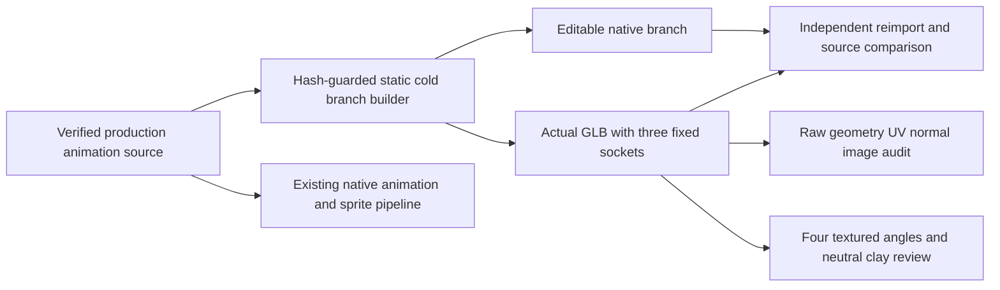

# Boiler V08 — independently inspected static interchange

This closes the **G5 static cold-pose interchange** slice against the current reconstructed production source. The animation source, installed sprites and four-direction drawing registrations remain unchanged. This GLB contains no animation; use `production-source.blend` for the existing working animation. It does not replace the source or prove an animated GLB.

## Artifacts and repairs

The editable [cold-pose branch](../../../art/source-to-3d/boiler-v08/interchange/boiler-v08-cold-interchange.blend) and actual [GLB](../../../art/source-to-3d/boiler-v08/interchange/boiler-v08-cold.glb) contain all **264 visible machine meshes / 224,311 triangles**. Six hidden reference-pipe parts and 16 hidden steam puffs are excluded deliberately. Fixed water, steam and cage-top circuit attachment empties accompany the model; model units are not equated with Factorio fluidbox tiles.

The source inspection found 205 collapsed geometric triangles and ten fittings without UV layers. Raw GLB inspection then found collapsed existing UV faces on the manifolds, chassis, visor and screw bevels. The accepted branch removes 1,009 collapsed/numerical-sliver triangles (area below 1e-10 or minimum edge below 1e-6 model units), totaling only 2.1689093e-7 square model units. Every surviving indexed triangle/material assignment and all indexed world vertices are independently checked against the source; the largest vertex difference is 1.1921e-7 model units.

Ten new fitting maps use an X-axis cylindrical/planar end-face unwrap. A further 49,780 collapsed or numerically unstable UV triangles receive a dominant-plane projection with a fixed 0.5-model-unit texture repeat, preserving continuity across coplanar faces. Existing valid UVs and materials remain. This is a reuse of the source's actual PBR maps, not a replacement texture scheme. The raw GLB passes geometry, finite/unit-normal and noncollapsed-UV checks, and all **13 embedded images / 29 materials** load. Earlier rejected audits are retained under `rejected-export-audits/`; their failures are not counted as passes.

## Independent artifact and visual evidence

Blender 5.0.1 independently reopens the saved native branch and reimports the actual GLB. All 264 parts match unique position/UV/material coverage, triangle counts and surface areas. Maximum GLB reimport position delta is 2.0862e-7 model units and UV delta is 4.7684e-7. Ground is Z=0; bounds are `[-1,-0.956671715,0]` to `[1,0.957518995,1.221761346]`.

Water `(-1,0.5,0.36)` / outward `(-1,0,0)` and steam `(1,0.5,0.36)` / outward `(1,0,0)` coincide with the actual outer flange planes and centers. The fixed circuit mount `(0.667127073,0.921660960,0.843182802)` remains inside its cage upright's bounds. Imported sockets project through all four **existing** sprite scale/shift registrations with maximum mouth residual **0.00000452 native pixels**. Physical prototype pipe fields are untouched. See `socket-bounds-validation.json` for full rotated positions and outward normals.

Eight actual local CPU Cycles renders were viewed: source/GLB front and rear pairs, two further textured GLB angles, and front/rear neutral clay. Every PNG fully decodes and has clear alpha margins. The [review board](boiler-glb-reimport-review.png) labels these actual images. Front/rear differences average 0.0913/0.1312 code values out of 255 over visible pixels; maxima are 23/22. No pixel-identity claim. The source's construction and finish are preserved; no reference redesign or new owner approval is claimed. `visual-review.json` records reasoned scores bound to the exact native, GLB and render hashes.



## Reproduce locally

From the repository root, use Blender 5.0.1 with `--factory-startup --background --threads 2 --python-exit-code 12 --python <script> -- <arguments>`. No Actions or behavior/regression tests are used. Use a **fresh output directory**; the builder refuses an existing one before mutation. The source hash guard binds the exact current production model.

```text
tools/art/boiler_interchange/build.py <out> --source art/source-to-3d/boiler-v08/production-source.blend
tools/art/boiler_interchange/verify_roundtrip.py <out>
tools/art/boiler_interchange/compare_source_geometry.py <out> --source art/source-to-3d/boiler-v08/production-source.blend
tools/art/boiler_interchange/verify_sockets.py <out> --job tools/art/jobs/boiler-v08.json
tools/art/boiler_interchange/render_review.py <out> --source art/source-to-3d/boiler-v08/production-source.blend
```

Run the raw audit with a local Python environment containing NumPy and Pillow: `python tools/art/boiler_interchange/audit_glb.py <out>`. The six published tools were exercised using their portable arguments, not merely syntax-checked. Render review uses 12 samples, two CPU threads and 640px RGBA images, leaving the existing A02 GPU render workers running.
