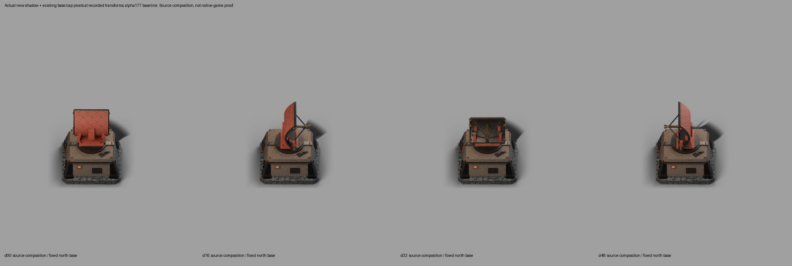
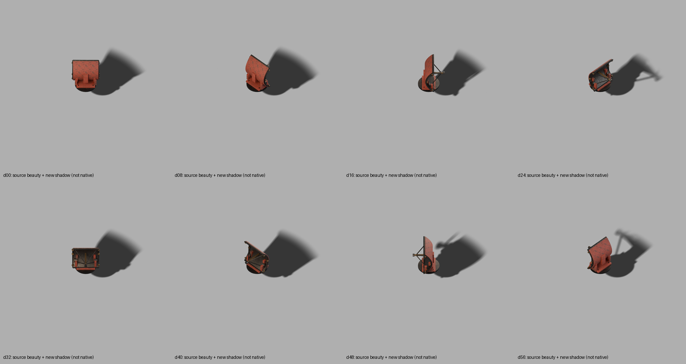

# Energy-dish V03: missing idle shadow export

**Completed slice:** 64 new idle shadow renders, full PNG decoding, 64 authored-opacity frames and **128 exact authored/downsample RGBA atlas cells** across eight bounded sheets. Raw and authored frame bytes are delivered in a CRC/SHA-verified source archive. This is a source-art/export checkpoint; no native prototype installation or final owner approval is claimed.

The existing 33-mesh V03 native source and GLB remain unchanged. All 64 earlier beauty-frame SHA-256 values still match their receipt. No A02 capture, dish beauty capture, atlas assembly or failed GLTF study was repeated.

## Geometry, light and placement contract

- Source: `art/source-to-3d/martian-bunker/alternatives/energy-dish-v03/energy_dish_v03.blend`, SHA-256 `b4851a3cfca888e51eff8f77ba12e0adc8d216b65304448aaefc40bb1cdc5c71`.
- Original bunker/A02 camera source SHA-256 `0c9ebf42b16ddd53a8162d836bb88a052c77f16c28f4e7265172300797e372ed`. Camera matrix, original receiver and soft receiving footprint retained. No camera or model was resaved.
- Bearing `(0,0,1.70)`, elevation pivot `(0,0,2.34)` remain fixed. Headings are clockwise: N0/E16/S32/W48, yaw `180-direction*5.625` degrees. No new sockets, ammo or weapon interfaces were assigned.
- Source beauty uses 640 pixels over 6.20 model units. Shadow uses 1280 pixels over 12.40 units, preserving pixels per world unit. Camera-derived sprite shift equals the existing beauty shift within 0.00001; scales are approximately 0.31 at 1280 and 0.775 at 512. Exact values and projected origin are in the validation receipt.
- The inherited three-light studio pilot was actually reviewed and retained as rejected: its multiple broad, faint projections read poorly. The shadow-only derivative retains the original NW key position/direction/energy, narrows its area size to 0.25 and disables fill/rim/world illumination. Beauty lighting and pixels remain unchanged. This is an explicit art-pass lighting change, not pixel parity with the old studio render.
- Raw renders remain untouched. Authored alpha is `round(raw_alpha*177/255)`, matching the measured peak alpha of the existing `base-north-shadow.png`; its reference hash is recorded. Raw display RGB contains a one-level residual; authored RGB is explicitly set to neutral black. Raw pixels are retained unchanged. This deterministic style adjustment is explicitly included in archive-to-atlas verification.

The image above is actual new shadow plus existing base/cap pixels at recorded transforms. **It is a source composition, not a native-game screenshot or proof of 3D mounting clearance.** Shadow intensity/layering still needs native review.

## Export delivery

Assets: `art/source-to-3d/martian-bunker/alternatives/energy-dish-v03-shadow64/`.

| Artifact | Layout | Meaning |
|---|---|---|
| `idle-shadow-1280-1..4.png` | Four 5120×5120 sheets, 4×4 cells each | Authored 1280-pixel shadows; page 1 directions0–15, page2 16–31, page3 32–47, page4 48–63 |
| `idle-shadow-512-1..4.png` | Four 2048×2048 sheets, 4×4 cells each | Deterministic Lanczos downsample, same page/direction map |
| `source-shadow64.zip` | `raw/`, `authored/`, identity | Original 64 renders plus 64 opacity-authored PNGs; all members hash-verified |

Within each sheet, headings run left to right, then top to bottom. The largest sheet is below 8192 pixels. `shadow64-validation.json` binds every raw/authored frame, alpha bounds, sheet, camera and reference. `independent-delivery-proof.json` independently reads only the delivery archive/sheets and proves raw-to-authored alpha plus all 128 atlas cells. Atlas equality is with the documented authored frames/downsample, not with unmodified raw render alpha.

Planned runtime sprite path remains `tech-priests_src/graphics/entity/bunker-energy-dish/`; planned module remains `tech-priests_src/prototypes/generated_graphics/bunker-energy-dish-v03.lua`. Neither is installed here. Exact rotated-sprite/animation registration, layering and the actual target prototype must be grounded before runtime promotion. Do not replace `bunker_autocannon` or invent combat statistics.

## Review and continuation

The cardinal pilots, mounted composition and eight-heading board were actually inspected. The agent's hash-bound scores in `visual-review.json` assess only this shadow slice. Existing coarse surfaces and inferred hidden construction are not upgraded to final acceptance by adding shadows.

Still open: source-faithful surface refinement, intended emitter/working-state design, emission/working shadow states if required, all-direction native layering/placement, owner final fidelity approval and full-model delivery gates. Workbench is excluded; another chat owns the emergency steam engine.

Do not repeat either 64-heading idle pass. Resume from `CHECKPOINT.json` and existing raw/authored frames. Blender 5.0.1, the original restored `work/lobber-a02` pipeline and Pillow/NumPy were used locally. Executed scripts are delivered beside the sheets. Copy them to the existing `work` directory before inspection/execution; they resolve that workspace and use the saved `energy-dish-v03-shadow64-sharp/loader-metadata` checkpoint. Capture identities fail on mismatched scripts/config/source; existing valid outputs are reused. No Actions/workflow edits, gameplay changes, behavior/regression tests or releases were performed.
