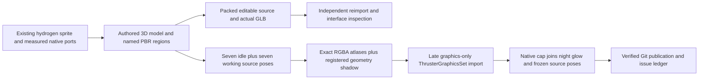

# Hydrogen thruster V01 — authored model and native graphics integration

The old sprite now has an editable, fully textured 3D source and a reviewed graphics-only integration on the exact `hydrogen-thruster` target. This completes this asset's initial model/render/import lane, not the other thruster bodies, a packaged release or the wider goal. No fuel, thrust or behavior/regression tests were run.

## Source and construction

The authority is the existing repository hydrogen idle/run sprite, hashes in `visual-review.json`. The later HB-TTRPG-tools R128 vanilla benchmark is a different candidate and was not substituted. The model retains the broad beam and saddles, two canisters, diagonal load links, six feeds, side actuators/coils, stepped pressure chamber, winged cast emblem and single hollow flared bell. Explicit socket necks and platform support feet fit the required integration. Fine legacy engraving is simplified for modeled readability; no pixel-replica or new owner-approval claim.

Editable [native model](../../../art/source-to-3d/space-platform-engines/hydrogen-thruster/v01/hydrogen-thruster-v01.blend) and actual [GLB](../../../art/source-to-3d/space-platform-engines/hydrogen-thruster/v01/hydrogen-thruster-v01.glb): **291 meshes / 92,996 triangles / 18 embedded images / seven materials**. Eighteen authored base-color/metal-rough/normal maps distinguish cast structure, tanks, brass, steel, bell and dark regions. The bell's circumferential seams and axial lip treatment follow its actual UVs. Source meshes are evaluated and triangulated; numerical faces and collapsed UVs are guarded before export.

The actual GLB independently reimports with finite geometry, unit normals, noncollapsed UVs and loaded images. Native/export part triangle counts, unique world-position/UV/material coverage and surface areas agree: position delta at most 2.3842e-7 model units, UV delta 1.1921e-7. Actual reimported GLB oblique/rear/clay renders were viewed. A separate reopen checks flange mating planes, outward normals, two feet at the platform plane and contact for **82 named mounting heads**; maximum checked head-to-support distance is 1.0203e-6 model units. This is not an exhaustive all-intersection claim.

## Interface, direction and state contract

Only the native fixed **north** direction is supported, matching the existing not-rotatable prototype. Do not manufacture four-way thruster states. Blender +Y is toward the platform, -Y aft, +Z up. The modeled engine axis tilts aft/down 25 degrees; source coordinates are not automatically native grid-cell coordinates.

| Interface | Model mating center / outward | Preserved native cell / mating XY / adjacent pipe |
|---|---|---|
| Hydrogen west | `(-2,0.5,0.36)` / `(-1,0,0)` | `(-1.5,-0.5)` / `(-2,-0.5)` / `(-2.5,-0.5)` |
| Oxygen east | `(2,0.5,0.36)` / `(1,0,0)` | `(1.5,-0.5)` / `(2,-0.5)` / `(2.5,-0.5)` |

The fixed 45-degree, 512x768 camera gives scale **0.375**, shift approximately **(0,1.318405509)**. Imported sockets project to the measured native pipe interfaces within 0.00000477 pixels. The 4x4 footprint, 3.7x3.7 collision, selection, platform masks, filters and all nonvisual prototype fields remain unchanged. Existing `pipe-4`/`pipe-1` overlays and their per-connection gates are preserved. No circuit/wire connector is declared by this native hydrogen prototype; none is invented in the model.

The new bell reaches native draw Y=4.916061759, so only the **visual culling box** grows to bottom Y=5.25 with a measured quarter-tile margin. Collision, selection and placement are independent. This change prevents viewport-edge culling of the authored bell.

The native source stores seven idle poses (frames 0–6) and seven working poses (16–22); only source-supported light changes are animated. Source run indices 0 and 6 intentionally match. All 28 beauty/emission PNGs are fully decoded and every atlas cell matches its exact RGBA source. Body/run sheets are 3584x768. The 768x1024 static shadow has the identical optical axis and pixels/model unit; actual source triangles above the platform plane are projected along a parallel light and rendered as a matte. Its image borders are clear. Earlier noisy/clipped Cycles catcher studies are rejected, not installed.

Four PNGs are used in runtime: idle, run, run emission and shadow. The exported idle-emission sheet stays with the **model source**, not as an unused runtime sprite. The generated `ThrusterGraphicsSet` module loads at the end of `data-final-fixes.lua`, preserves the native cap visuals and adds only the working thermal glow. Old sprites remain untouched for rollback. The existing 64px icon depicts the same primary silhouette and is retained under its existing icon path; it was viewed and hash-checked.

## Native proof and precise limits

The isolated Factorio **2.1.24** profile copied all **1,432 tracked mod-source files**, including the real late require and staged art. Every copied input was hash-checked against the checkout. The snapshot records Windows working-copy bytes before later documentation checkpoints; canonical Git text uses LF, as recorded separately in the final validation. It loaded with Mechanicus absent. Data-stage comparisons preserve all nonvisual prototype fields and cap definitions; runtime readbacks preserve exact ordinary pipe joins in connected/disconnected views.

`native/` contains 21 unretouched native PNGs: the legacy/actual-idle/forced-working displays connected and disconnected, night glow, seven sequential cold-clock observations, and seven **frozen source-frame variants**. The sequential screenshots are **not accepted as proof of working-clock progression**. Instead each frozen variant explicitly selects one source rectangle for both beauty and glow; all seven were viewed. This validates native source-frame rendering without propulsion testing. The GIF is seven actual **Blender source renders**, not a claim that an unfuelled thruster completed a powered native cycle.

The [native comparison](native-review-board.png), [frozen-pose board](native-frozen-poses.png), [source clip](working-source-loop.gif), raw GLB audit, input receipts and reasoned scored review bind acceptance to exact source/export/capture/runtime hashes. All **207 entity PNGs** verify/decode after integration. The user's normal save/mod list and all other asset graphics are untouched.

## Repeat locally

Use Blender 5.0.1 and a local Python environment with NumPy/Pillow. Keep outputs outside the delivery tree, e.g. `build/model-completion/hydrogen-v01/`. **Never dispatch Actions.** The builder refuses an existing output directory and hash-checks the two original sprite references. Capture resumption verifies the native source and every completed PNG hash; use a fresh capture after changing scripts or render configuration.

1. Run `python art/source-to-3d/space-platform-engines/hydrogen-thruster/v01/make_textures.py --out <fresh-textures>`.
2. Run Blender with `--factory-startup --background --threads 2 --python-exit-code 12 --python art/source-to-3d/space-platform-engines/hydrogen-thruster/v01/build_model.py -- --out <fresh-model-dir> --textures <textures> --reference-idle tech-priests_src/graphics/entity/hydrogen-thruster/hydrogen-thruster-idle.png --reference-run tech-priests_src/graphics/entity/hydrogen-thruster/hydrogen-thruster-run.png`.
3. With the same Blender flags, invoke `tools/art/hydrogen_thruster_v01/{verify_roundtrip,verify_interfaces,capture,render_directional_shadow,render_review}.py -- <model-dir>` individually. Inspect each real result; do not infer success from exit code alone.
4. Run local Python `tools/art/hydrogen_thruster_v01/audit_glb.py <model-dir>` and `package_candidate.py <model-dir>`. Inspect the actual rendered output and exact-cell receipt before source promotion.
5. Prepare a fresh native profile with `tools/art/native_visual_review/prepare.py`. Then run `tools/art/hydrogen_thruster_v01/native_review/prepare.py --review-root <profile> --package <model-dir>/package --source-model <model-dir>/hydrogen-thruster-v01.blend --legacy-json docs/art/hydrogen-thruster-v01/native-graphics-baseline.json --control tools/art/hydrogen_thruster_v01/native_review/control.lua --json-helper tools/art/hydrogen_thruster_v01/native_review/json.lua`. Launch via the existing `launch.ps1 -ReviewRoot <profile>` and inspect `review.py <profile> <model-dir>` using the local Python environment. No fuel or actor orders are needed.

The next authored body is **Thetazine**, with its own 5x5 frame and source silhouette. Do not scale this model into either fusion variant or treat this lane as their completion.
