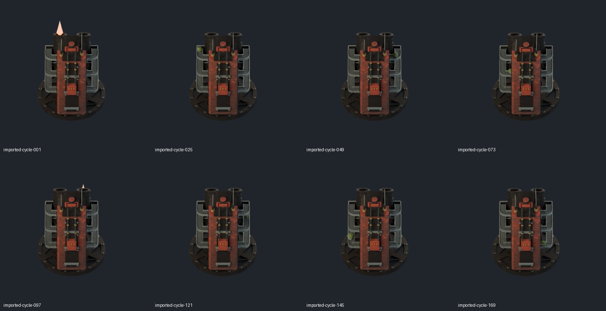
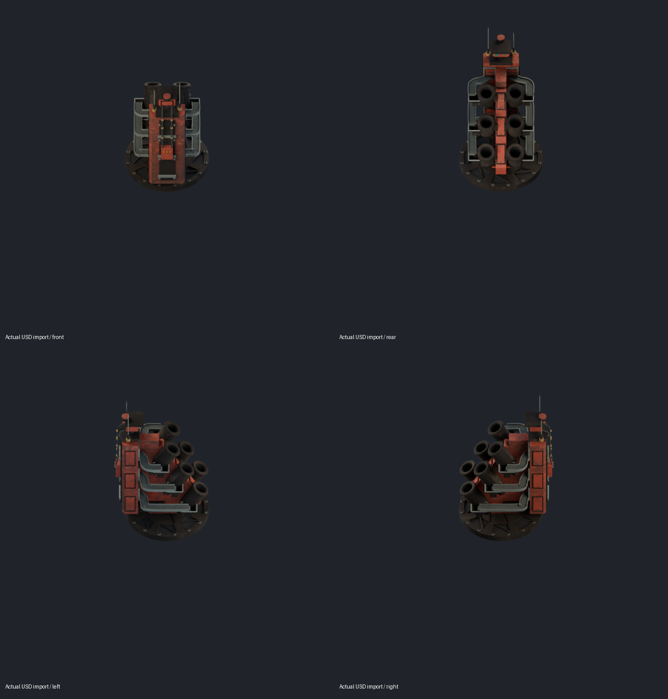

# A02 evaluated-geometry USD checkpoint

**Technical geometry-cache subset passes; full G5, native integration and final appearance acceptance remain open.** This is the original six-station A02 cap, not V15/V16. No prototype, weapon, ammo or gameplay interface was changed.

The existing local source SHA-256 remains `0c9ebf42b16ddd53a8162d836bb88a052c77f16c28f4e7265172300797e372ed`. No source sprite captures or atlas assembly were repeated. Blender 5.0.1 exported four evaluated USD states preserving the real bevel geometry, including topology-changing loader belts. Exported PBR uses the two actual UV image maps, constant metal/paint materials and relative texture paths; no newly authored surface finish is claimed.

| State | Export keys at 24 fps | Source raster frames | Span |
|---|---:|---:|---:|
| Idle | 1 | 1 | Static |
| Cycle | 193 | 192 | 8 s, duplicate boundary key |
| Entry | 16 | 15 | 0.625 s, endpoint key |
| Settle | 16 | 15 | 0.625 s, endpoint key |

Independent OpenUSD reads compared **68,252 mesh samples** (302 meshes across all 226 keys) against the evaluated native derivatives: points, topology, corner normals, material-used UVs and world transforms. All four states pass with no missing nodes or topology failures. Maximum position error is below 0.000001 source units. This checks geometry at the sampled times, not arbitrary subframe dynamics or complete FX equivalence. See `independent-data-summary.json` and per-state receipts.

The actual exported idle USD was imported into a separate Blender scene after removing original model geometry. Four directional views retain the source capture camera/world/area lights. The actual cycle USD was separately imported and rendered at eight bounded review poses; evaluated vertex counts change as expected. The source idle raster, four views, eight poses and clay view were actually inspected. `visual-review.json` binds the scored agent review to source/export/render hashes. Owner approval is not asserted.

## Deliberately open gates

- **GLTF remains failed.** The first GLB study omitted bevel evaluation on 238 meshes. Signed antenna weights also clamp on Blender GLTF import. Baking ordinary morph targets failed because the evaluated belts change vertex topology. Failed GLBs stay local and are not promoted; the failed-study receipt is preserved. USD geometry-cache support does not close the ledger's GLB requirement.
- The original native source retains inherited degenerate triangles (2,131–2,140 in inspected poses). They were not silently removed or waived. Final clean-geometry acceptance remains open.
- Eighteen volume-smoke meshes, the capture receiver and flash point lights remain in editable native source and existing sprite passes. Core geometry USD includes the emissive flash meshes, not full volumetric/lighting parity. Separate beauty/emission/shadow raster exports remain authoritative for the game art.
- No native alternate-cap target has been grounded. `bunker_autocannon` is the autocannon and must not be replaced or given invented ammo/weapon interfaces. Native mounted firing/reload/entry/settle, all 64 directions, effect/shadow parity and final owner appearance review remain open.
- Four complete ZIPs are **local only**, under the path in `CHECKPOINT.json`. Every ZIP passes CRC plus SHA-256 equality of all decompressed USD/texture members. The cycle ZIP is 129,539,984 bytes, above GitHub's single-file limit. This commit publishes scripts/evidence/previews, not those binary archives. No release or Actions job was created.

## Resume without duplication

The evaluated USD files and archives already exist; inspect their checkpoint and hashes before invoking any exporter or packager. No active render job remains at checkpoint. Do not repeat the completed 42,816 source captures, atlas assembly, USD export or archive creation.

Executed production scripts are retained in `tools/art/a02_interchange/`. They use their containing directory as the local workspace: copy them into the existing `work` directory to run, not into the frozen source pipeline. Their dependencies are Blender 5.0.1 with bundled OpenUSD/NumPy, Pillow for review boards, and the existing `lobber-a02`, `a02-gltf-20261114`, and `a02-evaluated-usd-20261114` directories. Original capture helpers/config/source manifest are tracked under `art/source-to-3d/martian-bunker/captures/lobber-64/`. `export_a02_interchange.py` creates the sampled editable derivatives and retains the failed GLTF study; `export_a02_evaluated_usd.py` consumes those derivatives; `verify_a02_evaluated_usd.py` reads actual exported data; the render scripts import actual USD files; `package_a02_usd.py` verifies local ZIPs. Existing-output guards intentionally prevent blind duplicate production.

Continue by grounding an actual native alternate-cap import contract or planning a source-faithful GLTF adapter, preserving the approved source and failed studies. Workbench belongs to Tanks for Bob and is excluded. Emergency steam-engine work belongs to the other chat. The full Tech-Priests goal remains open.
