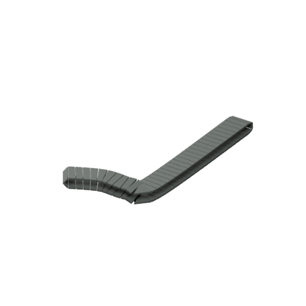
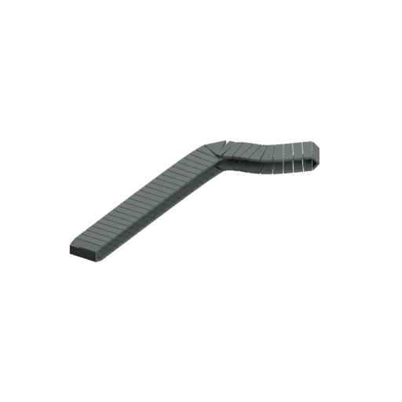

# Rejected A02 one-belt GLTF mesh-sequence study

**Not a production export. Do not repeat or expand this pilot.** The existing verified USD and all original sprite/native source files remain unchanged.

The earlier ordinary GLTF export lost evaluated bevel geometry; ordinary morph baking cannot encode changing topology. This bounded alternative sampled only `CONTINUOUS_SEGMENTED_RUBBER_TRACK_LEFT_3_ANIM_L` from the existing cycle derivative at all 193 keys (24 fps, including endpoint). It exported evaluated meshes with their world transforms baked, then used a single standard GLTF STEP scale animation to select exactly one pose mesh per discrete sample. It does not preserve arbitrary smooth subframe geometry and does not export the complete cap.

Actual independent Blender import checked all **193 sample selections and geometry positions/triangle counts**, plus **192 half-frame STEP selections**. Positions compare exactly in this pilot. Normal correspondence fails the existing 0.00002 component tolerance: direct raw-buffer maximum difference is approximately 0.0000674; the Blender-import diagnostic reaches approximately 0.00950. Those are correspondence measurements, not proof of a visible defect of that magnitude. No tolerance was relaxed and no pass is claimed.

The isolated GLB is **162,908,036 bytes for one belt**. That storage cost, together with the unresolved normal fidelity, makes blind propagation across the whole cap inappropriate. The file and all 193 hash-bound NPZ source references remain local in the checkpoint directory. Compact scripts, receipts and actual-import diagnostic renders are published; no large binary or release was uploaded.

The closeups were actually viewed. Segmented links and the bent routing are legible; isolated appearance does not establish full-cap acceptance or waive the measured normal discrepancy. `visual-review.json` separates scored agent observations from final/owner approval. Original native source SHA-256 remains `0c9ebf42b16ddd53a8162d836bb88a052c77f16c28f4e7265172300797e372ed`.

Executed scripts are under `tools/art/a02_interchange/failed_studies/`. Copy into the existing local `work` directory if inspecting them; they resolve their adjacent workspace there. Blender 5.0.1 with NumPy is required for sampling/import/render; the raw-buffer reader uses Python/NumPy. The producer refuses existing output; check saved files and processes rather than starting duplicate exports. Verification failure exits nonzero intentionally.

Next: retain this failed study, preserve verified USD, and ground the native alternate-cap target or select another source-grounded asset. A redesigned GLTF adapter requires a bounded plan for topology, signed antenna weights and normals before another export. Full G5, complete smoke/light parity, clean source geometry, native mounted animation and final owner approval remain open. Do not invent weapon/ammo interfaces. Workbench and other-chat emergency steam-engine work remain excluded.
