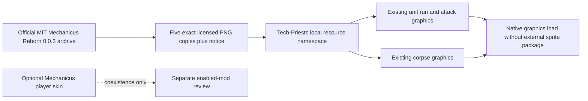

# Priest sprite namespace — native load gate

The owner's startup error named `__mechanicus-reborn__/images/level1_running.png`. `prototypes/entity.lua` used that namespace unconditionally although `info.json` makes the package optional. The fix bundles only the five existing sprite sheets in `graphics/entity/tech-priest/` and changes the local resource prefix. Animation layouts, speeds, shifts, scale, tint, stats and behavior code are unchanged; this equivalence is checked against the baseline source. The optional player-skin mod remains optional.

## Source and license

The [original Mechanicus](https://mods.factorio.com/mod/Mechanicus) by markmen494 and [Mechanicus Reborn](https://mods.factorio.com/mod/mechanicus-reborn) by Mad Engineer / mad_engineer both identify MIT licensing in their official Mod Portal records. The installed 0.0.3 ZIP matches the official release SHA-1. Five PNGs were copied byte-for-byte; no sprites were regenerated, replaced with generic art or resized. Saved portal metadata, archive hashes and each PNG's SHA-256 bind this provenance. Full attribution and the MIT permission notice ship in `tech-priests_src/THIRD-PARTY-NOTICES-MECHANICUS.txt`. The normal package selector includes the notice and all five PNGs.

## Native evidence and limits

Two separate exact-source graphical profiles loaded Factorio 2.1.24 with the same base/Space Age configuration. In `without/`, the Mechanicus ZIP is physically absent and the active-mod receipt omits it. In `with/`, version 0.0.3 is enabled. Both reached the fixture's tick 10 capture, displaying 80 frozen units (five ranks, normal/belt-immune variants, eight requested orientations), five directly created corpses and the boiler's four directions. No AI order, attack, work, fuel or other behavior result is tested. Unit suppression uses the installed 2.1 `disabled_by_script` API; the initial fixture's read-only `active` setter error was repaired before these accepted captures.

All 10 unit and 5 corpse graphic definitions are identical between configurations and resolve only to the five local sprite names. The two profiles copied the same 1,427 mod-source files. Native screenshots differ in some frames and these differences are retained; source-pixel equivalence is established by exact PNG hashes, not a false claim that every native snapshot is identical. The fixture removes its temporary player avatar before capture. Both source and rendered previews were viewed.

The copied sheets contain 706 existing animation cells, with unchanged 150x160 cells, 22 frames x eight directions for each animated sheet, and two corpse frames. All 203 current entity PNGs decode and verify. `native-dependency-comparison.png` and `native-tier-gallery.png` crop/resize and label real screenshots. Full snapshots, actual graphic definitions, fixtures and load receipts are retained.

`tools/art/native_visual_review/prepare.py` now defaults to a no-Mechanicus profile; passing its existing `--sprite-dependency` option enables the coexistence case. No user mod list, save, packaged version or release status was changed. This closes the missing sprite-namespace load gate, not the overall modeling goal or final priest model/animation fidelity. The current boiler G5 independent GLB inspection and other model families remain open.
