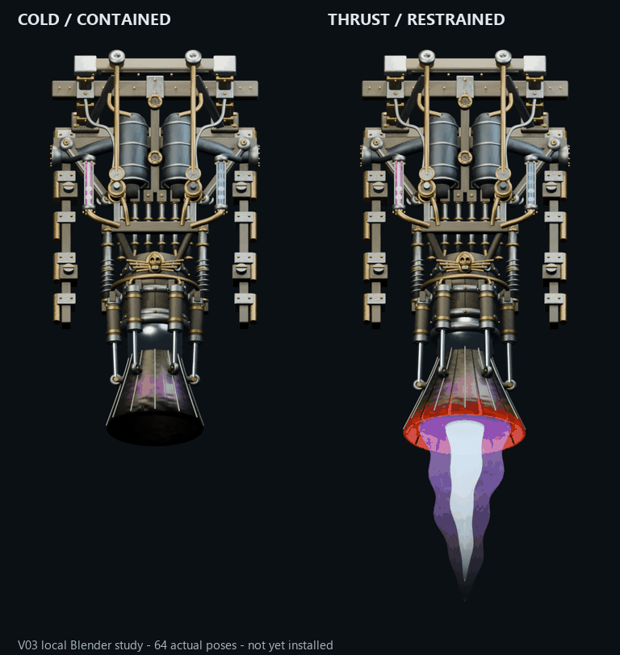
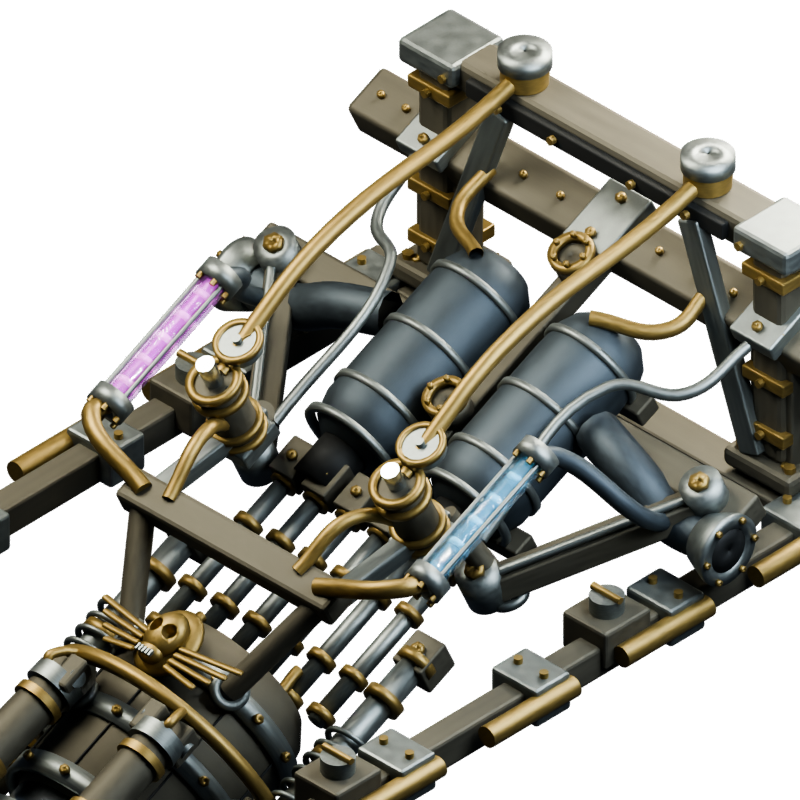

# Thetazine V03: pressure machinery and restrained bell

**Local refinement candidate, not final art or game import.** Implements the owner's requested vertical platform gantry, raised machinery, transparent fuel section, visible tinted cone, heat/char and substantial pistons resisting a moving bell.

The model has **671 meshes / 126,548 triangles**, 26 embedded GLB images and 18 materials. All exported geometric and textured-UV triangles are noncollapsed, normals are finite/unit, and images decode. Native/GLB one-to-one oriented triangle, material and UV matching passes: maximum position error 1.43051147e-06; all671 meshes sampled across64working poses+wrap agree within 3.33786011e-06. Both sockets remain fixed. Each of six actual shaft endpoints is checked against its moving pin with .22 gland overlap and .08 pin-center inset in both artifacts. All24 primary/sealing leaves are individually closed shells; front/rear/clay inspection separately checks assembly readability.

The cold pose is tighter and dark/charred; running extends the carrier, opens/interleaves the leaves, heats the lip and oscillates the cone. The liquid windows contain moving density fronts inside real hollow glass. These are visual mechanisms, not a pressure/thrust simulation. Source motion wraps exactly. The rendered wrap differs by at most 1 byte level (mean 3.81469727e-07); do not claim byte-identical rendered frames.

All **66 actual source PNGs** (cold0, working1..64, wrap65) decode, remain inside the512x1280 canvas, and preserve64distinct working RGBA images. Source archive and every frame hash are checked. The GIF uses every working pose at approximately30fps (GIF10ms timing resolution), with a static cold reference. Full source captures use Eevee blended-alpha rendering; independent imported geometry views use CPU Cycles. Transparent exhaust was judged after compositing over dark space; the earlier too-faint density study remains local and rejected.

See [rear](export-rear.png), [neutral clay](export-rear-clay.png), [full front](export-front.png), [key poses](thetazine-v03-keyposes.png), [scored review](visual-review.json), [raw artifact audit](raw-glb-audit.json), [triangle/material roundtrip](roundtrip-validation.json), [all-pose shaft/socket check](animation-validation.json), [capture receipt](full-preview-capture.json), [preview/archive validation](preview-validation.json), and [checkpoint](CHECKPOINT.json).

Editable/import paths and exact fixed-source projection are in [the source plan](../../../art/source-to-3d/space-platform-engines/thetazine-thruster/v03-pressure-study/source-export-plan.json). This fixed thruster has one supported orientation; cap states remain independent. Current .46875 scale and measured shift preserve actual west/east pipe planes despite the taller1280px canvas. The ordinary mod remains on its previous body; **no V03 runtime module, gameplay, collision, recipe, platform tile, release or workflow edits** are included.

Next: actual-scale V03 local native placement pilot, then separate body/emission/shadow/idle/FX source captures and exact atlases, native phase/occlusion/cap/underlay proof, finish refinement and conditional normal-mod import. Final appearance threshold remains4/5; surface/exhaust is currently3/5, runtime1/5. No owner approval inferred. Other goal families remain open. Tests are limited to model/render/export/integration.
