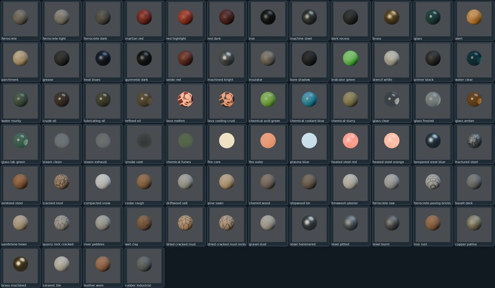
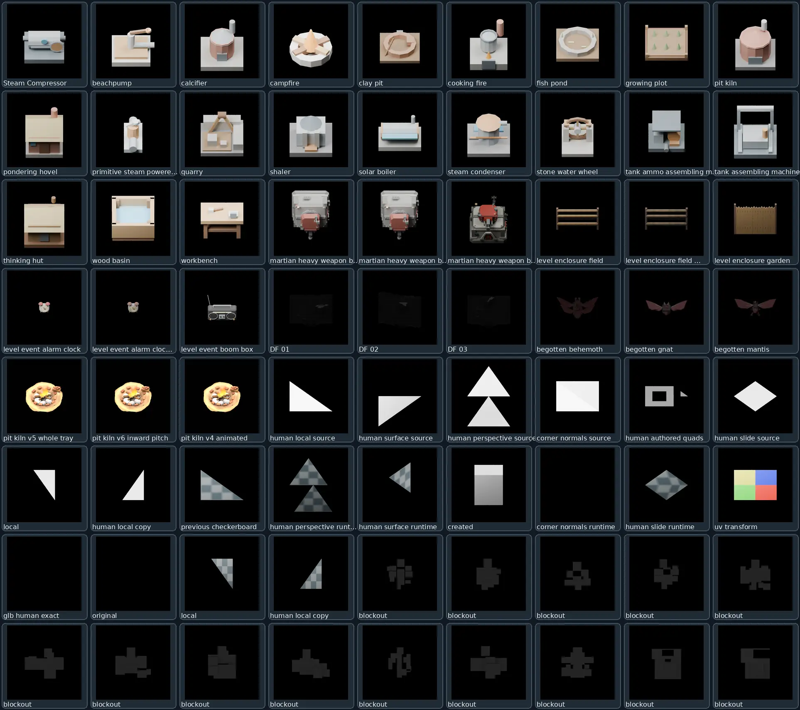
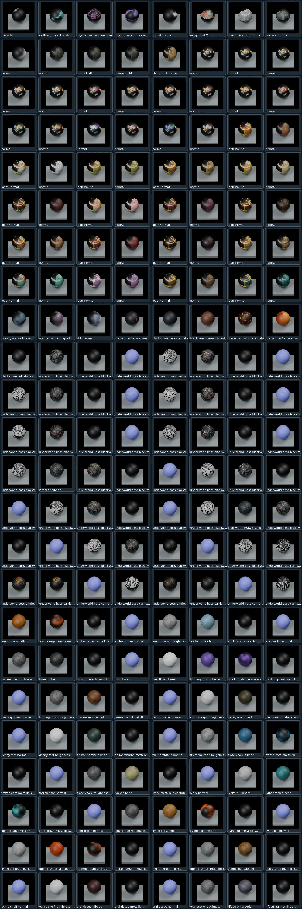

# FMPL — Verified Blender render gallery

Browse previews **directly on GitHub** below, or open the searchable [GitHub Pages gallery](https://mrcalzon02.github.io/Tech-Priests/fmpl-gallery/) once Pages has been enabled on the `main` branch `/docs` folder.

The images are genuine render previews verified against source receipts; **not** proof of modeling approval, finalized PBR status, or game integration.

| Family | Verified previews |
|---|---:|
| Canonical FMPL materials | 76 |
| 3D source model renders | 180 |
| Raw texture-map sphere previews | 192 |

## Canonical FMPL materials

Find exact names, pinned commits, material classes and original source links in [the manifest](manifest.json).

## 3D source model renders

Find exact names, pinned commits, material classes and original source links in [the manifest](manifest.json).

## Raw texture-map sphere previews

Find exact names, pinned commits, material classes and original source links in [the manifest](manifest.json).

## Source & provenance

Proofs originate from verified FMPL renderer artifacts, never generated placeholders. Full-resolution `.blend` source and PNG render packages remain separate from the lightweight inline review gallery. No new GitHub Actions workflow is required.
