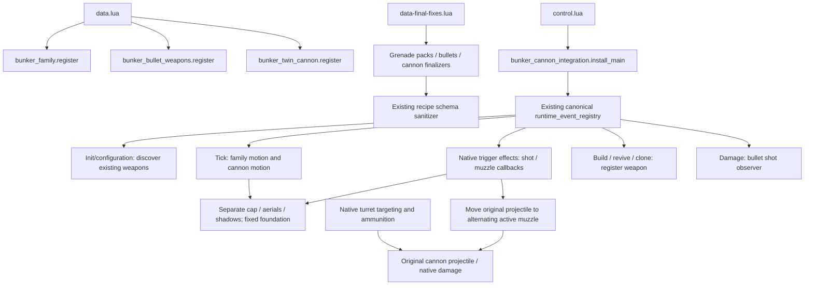

# Main-mod bunker runtime ownership

The weapon owner adds named routes; it does not install raw script handlers
over priest services. An installation assertion verifies every previous route
still exists. Full-mod fixtures observed 180 preserved routes. Rendering is
shot-driven; ammunition and damage remain owned by the native engine.
