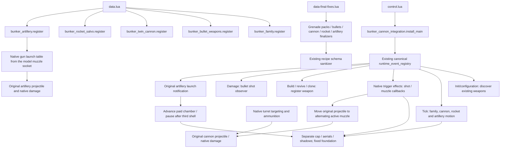

# Main-mod bunker runtime ownership

The weapon owner adds named routes; it does not install raw script handlers
over priest services. An installation assertion verifies every previous route
still exists. Full-mod fixtures observed 180 preserved routes. Rendering is
shot-driven; ammunition and damage remain owned by the native engine.

Artillery observes `on_trigger_fired_artillery`. It does not create replacement
shells or apply scripted damage. Its native gun fires at the model-derived
socket, and the observer selects recoil, breech indexing, lowering, gate motion,
shell insertion and re-elevation. The fixed foundation retains the shared
force-coloured corner masks.

The artillery window uses a live camera and actual inventory widgets. A static
cap must not be layered over the moving body: an earlier alpha-intersection
fallback hid the lower reload cage. The native cap sublayers now remain empty;
the complete source body, shell overlays and moving shadow are rendered by the
weapon owner.
