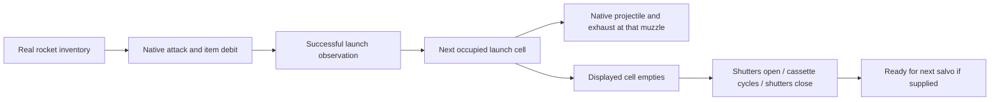

# Fortified rocket salvo turret — candidate design

Owner-selected behaviour: staggered rocket salvo followed by visible reload.
The current candidate has two independently supported triangular three-cell
pods on one traversing assembly. The fixed bunker is separate; it retains the
existing force-coloured corner stanchions. This is an original model candidate,
not a registered native turret or a finished weapon.

## Proposed rhythm and purpose

Six real rockets depart one at a time, alternating left/right and advancing
through the three cells. The source study uses ticks 0, 10, 20, 30, 40 and 50,
then a reload that finishes before the next proposed salvo at tick 240. These
numbers are provisional. The intended distinction is a short concentration of
rocket damage followed by a visible vulnerability while the magazines recycle.
It complements the steady anti-armour twin cannon. Actual range, target rules,
damage and research response need native gameplay measurement.

Plan to use existing rocket ammunition and native projectiles. Prototype work
must prove one item consumed per launched rocket, interrupted salvos, exhaustion,
target loss, correct muzzle origin and direction, save/reload and shooting-speed
research. Do not implement the salvo as one paid rocket creating six projectiles.
Do not copy the vanilla turret's effects on top of custom launch sockets.

## Construction and surfaces

Each pod has three real bored launch canisters, individual collars and retaining
bands, connected cross braces, a lower saddle and trunnion. Loading cassettes run
on exposed guide rails behind hinged breech shutters. A shared tapered keel
carries optics, radio, elevation mechanisms and the common traverse bearing.
Selected red curved shields, dark tube/casting surfaces, machined steel guide
rails, brass retainers and recessed optical glass preserve the bunker family.
The surface plan and physical UV scale are stored in the editable source.

The source study removes each displayed loaded rocket at its departure and
cycles both rear shutters/cassettes. It demonstrates the mechanism only. Runtime
animation must be driven by real successful launches and real available ammo.
Full moving-part collision inspection and owner visual review are still open.

This is the intended runtime ownership map, not implemented runtime code.
Use the existing bunker owner and canonical event registry when integrating.
Keep the six previously completed weapons unchanged while reviewing the model.

## Shutter correction

Candidate-v01 is superseded after the owner identified structural penetration.
The original source timing/height tests did not prove clearance. Evaluated mesh
sweeps confirm the original problem, including closed-panel interference with
guide rails and the loading drive.

Candidate-v02 uses narrower panels, outboard loading drives and extended linear
guides. The cassette withdraws before the flap opens; it feeds under the fully
raised flap, withdraws again before closure, and returns behind the closed flap.
The new evaluated shutter sweep reports zero intersections at 481 half-frame
samples against all other launcher meshes, exempting only intended hinge pins.
This closes that sampled shutter-intersection check, not continuous collision
proof, acceptance of all other moving interfaces, or native gameplay testing.
See candidate-v02/shutter-clearance.gif and shutter-sweep-check.json.
