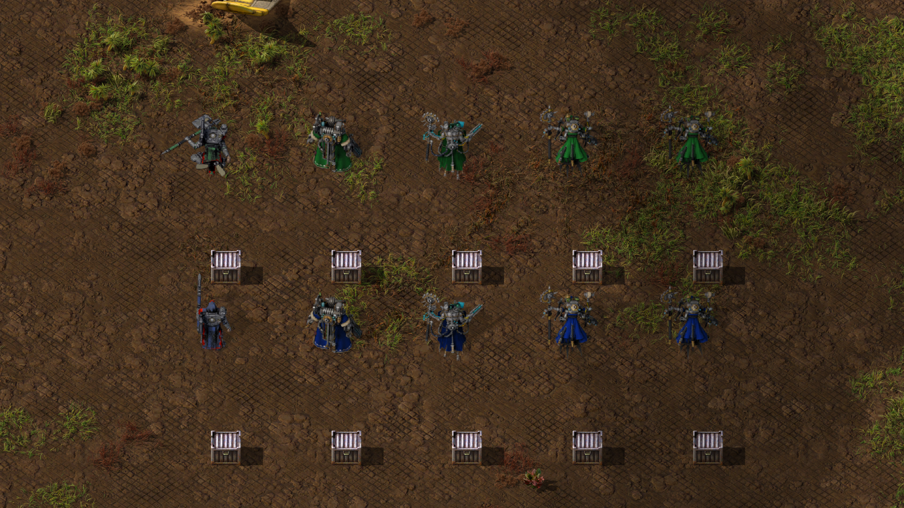
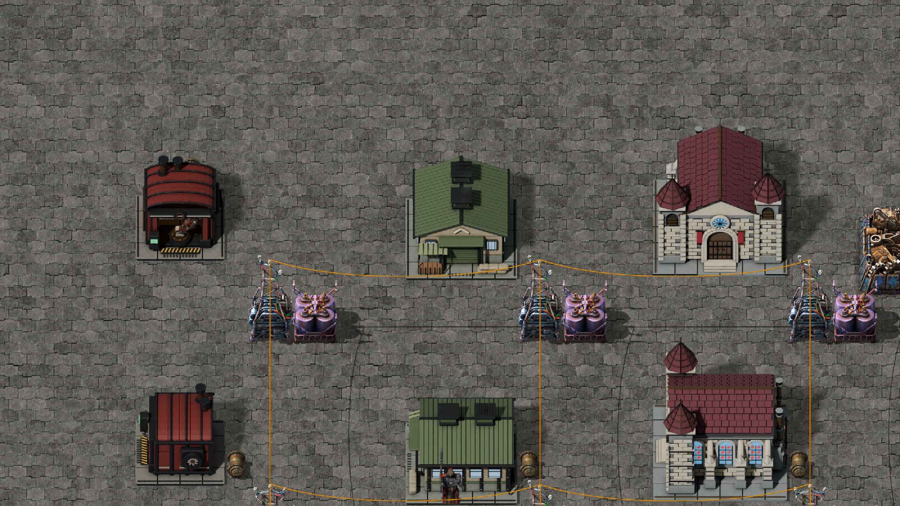
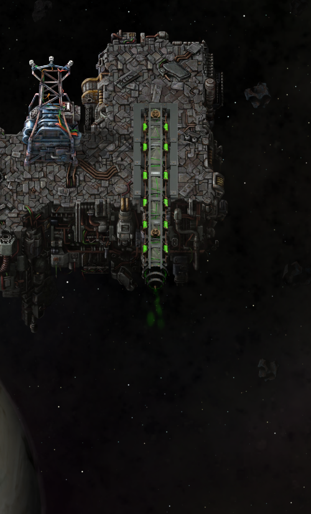

# Tech Priests — Factorio 2.1

> The factory is sacred. Its machines demand devotion.

Bring a machine-tending industrial order to Factorio. Build a hierarchy of Cogitator Stations, assign Tech-Priests to manage equipment and logistics, use ritual consecration and machine-sanctity systems, and reinforce your factories with heavy defenses, specialized industry, and combat forces.

## In-game demonstrations

### Tech-Priests and Cogitator Stations

The Junior, Intermediate, Senior, Planetary Magos, and Space Age Void roles form the command hierarchy. This native screenshot demonstrates rank-linked character appearances; it is not evidence that every AI behavior has passed end-to-end acceptance.

### Factories in action

The Martian Manufactorum, Guard Muster Hall, and Sororitas Convent have actual Factorio testing evidence for placed machinery, crafting, resource consumption and working effects. Additional production families include emergency industry, metallicized hydrogen processing, and three plasma-reactor classes.

### Space-platform technology

[Native narrow thruster animation](https://github.com/mrcalzon02/Tech-Priests/blob/e694f0d97b174f66e49fc2b4c4d1eb8b914a5b13/docs/art/thruster-resumption-20261117/animation-capture/native-narrow-v11e/void-fusion-thruster-native-power-working.gif) | [Native large thruster animation](https://github.com/mrcalzon02/Tech-Priests/blob/e694f0d97b174f66e49fc2b4c4d1eb8b914a5b13/docs/art/thruster-resumption-20261117/animation-capture/native-wide-v18g/large-void-fusion-thruster-native-power-working.gif)

These are real engine graphics and power-state captures from isolated tests. They do not by themselves demonstrate a complete mission or platform combat scenario.

## Features

- **Cogitator hierarchy:** Five station/Tech-Priest ranks with quality-linked behavior and wider service range at higher tiers.
- **Machine Spirit:** Condition, consecration, servicing, inspection, machine modules, and two research directions with differing efficiency and survival priorities.
- **Factory construction and logistics:** Resource acquisition, station inventories, manufacturing, pipe and fluid support, emergency equipment, and industrial expansion behavior.
- **Advanced power:** Seven-machine metallic-hydrogen chain and Minoris, Majoris, Maximus plasma reactors.
- **Combat and defense:** Bunker and artillery families, faction recruitment structures, AAI-controlled combat units, and defensive support.
- **Space Age systems:** Void Priest, void fusion thrusters, shield equipment, heavy shipboard weaponry, and propulsion components.

## Requirements

- Factorio 2.1, `base >= 2.1.18`
- **Required:** `aai-programmable-vehicles >= 0.9.2`
- **Optional integrations:** Space Age, Quality, Mechanicist, Tanks for Bob Fork, several additional 40K-themed vehicle mods, Informatron, Factory Planner and others. Consult the exact release `info.json`.

## Status and credits

Tech Priests includes experimental and still-developing systems. Real screenshot evidence does not imply that all automation, consecration and quality interactions have been verified in the current release. See the changelog and repository for current acceptance status.

Created by Christopher Vardeman. Third-party art and asset attribution is documented in the source. Fan-made project, not affiliated with Wube Software or Games Workshop.

Source: https://github.com/mrcalzon02/Tech-Priests
